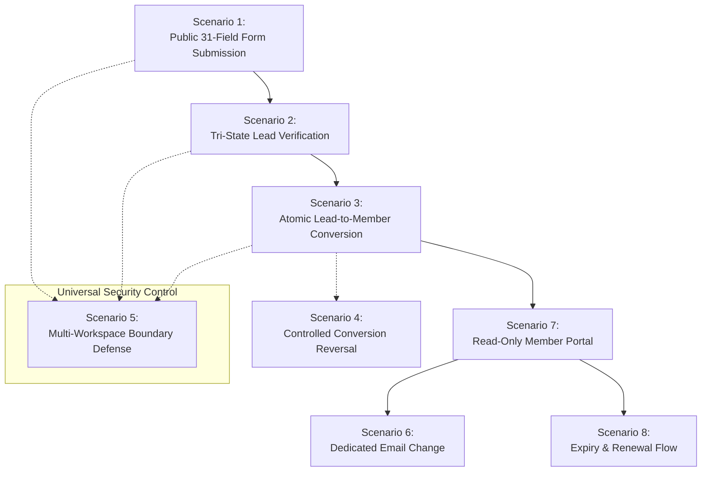

# Scenario-Based Acceptance Criteria and E2E Test Matrix

**Phase:** 01-discovery-decisions-and-acceptance-criteria  
**Plan:** 01-03  
**Status:** Approved Acceptance Contract  
**Governing Documents:** [Docs/emk-membership-crm-plan-revision-10.md](file:///d:/EMK_Protal/Docs/emk-membership-crm-plan-revision-10.md) (Sections 2, 4, 6, 7 & 9), [MVP-BOUNDARIES.md](file:///d:/EMK_Protal/.planning/phases/01-discovery-decisions-and-acceptance-criteria/MVP-BOUNDARIES.md), [FIELD-DICTIONARY.md](file:///d:/EMK_Protal/.planning/phases/01-discovery-decisions-and-acceptance-criteria/FIELD-DICTIONARY.md), [VERIFICATION-DICTIONARY.md](file:///d:/EMK_Protal/.planning/phases/01-discovery-decisions-and-acceptance-criteria/VERIFICATION-DICTIONARY.md), [STATUS-DICTIONARY.md](file:///d:/EMK_Protal/.planning/phases/01-discovery-decisions-and-acceptance-criteria/STATUS-DICTIONARY.md), [DELEGATION-MATRIX.md](file:///d:/EMK_Protal/.planning/phases/01-discovery-decisions-and-acceptance-criteria/DELEGATION-MATRIX.md)  
**Requirements Reference:** DISC-05, DEC-01 through DEC-11 (D-01 through D-11)

---

## 1. Acceptance Testing Framework & Protocol

This document codifies the formal, scenario-based acceptance criteria for the EMK Membership CRM and Member Portal in accordance with **DISC-05** and the Phase 1 Exit Gate (Section 9).

All scenarios are structured in standard Gherkin (`Given` - `When` - `Then`) specification format to serve as the definitive contract for:
1. **Behavior-Driven Development (BDD)** test suites during implementation phases (Pest PHP / PHPUnit feature tests).
2. **End-to-End (E2E) Browser Verification** during release certification in Phase 12 (Playwright / Laravel Dusk).
3. **Manual User Acceptance Testing (UAT)** sign-off by EMK Center management.

### Architectural Decision Traceability Reference
- **DEC-01 (D-01):** Multi-Workspace Isolation & Server-Side Tenancy Guard
- **DEC-02 (D-02):** Modular Central Registry & Static Action Declaration
- **DEC-03 (D-03):** Independent Tri-State Verification Gate prior to Conversion
- **DEC-04 (D-04):** 30-Day Auditable Conversion Reversal Protocol
- **DEC-05 (D-05):** Manual 10-Character Uppercase bKash TxID Verification
- **DEC-06 (D-06):** Read-Only Member Portal with Forced First-Login Password Reset
- **DEC-07 (D-07):** Dedicated Member Email Change Workflow with Manager Approval
- **DEC-08 (D-08):** Dynamic Database-Driven Membership Terms, Fees & Expiry Dates
- **DEC-09 (D-09):** Under-18 Youth Protection & Parental Consent Form Upload
- **DEC-10 (D-10):** Replaceable Payment Provider Boundary
- **DEC-11 (D-11):** Append-Only Immutable Audit Log Trail

---

## 2. Core Workflow Acceptance Scenarios



---

### Scenario 1: Public 31-Field Form Submission & Validation
**Traceability:** DISC-03, DISC-05, DEC-01 (D-01), DEC-05 (D-05), DEC-09 (D-09)  
**Target Component:** Public Form (`Livewire\Public\MembershipApplicationForm`)

#### Context & Test Fixtures
- Active workspace: `ws-emk-dhaka`
- Public form URL: `/spaces/emk-dhaka/apply`
- Configured membership terms: Student (1 Year - BDT 500), Regular (2 Years - BDT 1500)
- Existing registered member email: `existing.member@example.com`
- Existing verified bKash TxID: `BKASH99999`

#### Acceptance Criteria

```gherkin
Feature: Public Membership Application Submission

  Scenario: Applicant under 18 submits application requiring parental consent (DEC-09)
    Given an unauthenticated visitor navigates to the public registration form for "EMK Center Dhaka"
    When the applicant enters Date of Birth resulting in an age of 16 years (today minus 16 years)
    Then the client-side form immediately expands Field 7 ("Parent / Guardian Consent Form Upload")
    And Field 7 is marked with a mandatory asterisk (*) and validation constraint
    When the applicant attempts to submit without uploading a file in Field 7
    Then form submission is blocked with error "Parent / Guardian Consent Form is required for applicants under 18 years of age"
    When the applicant uploads a valid signed PDF "consent_signed.pdf" (1.2 MB)
    And completes all remaining 30 mandatory fields with valid data
    And enters a unique 10-character uppercase bKash Transaction ID "BLM8901234"
    And clicks "Submit Membership Application"
    Then the server stores uploaded documents onto the private encrypted disk
    And creates a Lead record in database table "leads" with "workspace_id = ws-emk-dhaka"
    And initializes verification states "payment_status = pending", "document_status = pending", "photo_status = pending"
    And dispatches a queued confirmation email "ApplicationReceivedNotification" to the applicant
    And redirects the applicant to the submission success confirmation view with Lead Reference Number

  Scenario: Applicant enters invalid or duplicate bKash Transaction ID (DEC-05)
    Given an unauthenticated visitor on the public registration form
    When the applicant enters bKash Transaction ID "bkash123" (lowercase / 8 characters)
    Then client-side and server-side validation reject with "bKash Transaction ID must be exactly 10 uppercase alphanumeric characters"
    When the applicant enters "BKASH99999" (an existing verified Transaction ID)
    Then submission is rejected with "This bKash Transaction ID has already been submitted or verified"

  Scenario: Applicant attempts duplicate registration with existing email
    Given an unauthenticated visitor on the public registration form
    When the applicant enters email "existing.member@example.com"
    And completes the form
    Then submission is blocked with error "An active member account or pending application already exists for this email address"
    And no duplicate Lead record is created in the database
```

---

### Scenario 2: Independent Tri-State Lead Verification
**Traceability:** DISC-03, DISC-05, DEC-03 (D-03), DEC-05 (D-05), DEC-09 (D-09)  
**Target Component:** Staff Lead Workspace (`Livewire\Staff\Leads\LeadDetailView`)

#### Context & Test Fixtures
- Active Lead in `submitted` status for applicant "Rahim Ahmed" (`ws-emk-dhaka`)
- Uploaded identity document: Blurry, unreadable national ID photograph
- Uploaded photo: Compliant white-background passport photo
- Submitted bKash TxID: `BLM8901234`
- Authenticated users: `staff_user` (`delegated_staff`) and `manager_user` (`workspace_manager`)

#### Acceptance Criteria

```gherkin
Feature: Independent Tri-State Verification Workflow

  Scenario: Payment verification by Workspace Manager (DEC-05)
    Given a Lead in "submitted" status in workspace "ws-emk-dhaka"
    And an authenticated user with role "workspace_manager"
    When the Manager cross-references bKash TxID "BLM8901234" against the official merchant statement
    And records payment verification with verified amount 500 BDT
    Then the Payment verification stream updates to "payment_status = verified"
    And a log entry is appended to "payment_verification_log" with actor ID and timestamp
    And the overall Lead status updates to "under_review"

  Scenario: Document defect flagged as Missing Items by Delegated Staff
    Given a Lead in "under_review" status with "payment_status = verified"
    And an authenticated user with role "delegated_staff"
    When staff reviews the uploaded National ID document and identifies it as unreadable
    And selects rejection reason code "DOC_UNREADABLE" with note "Text blurred, please re-upload high resolution copy"
    And clicks "Flag Missing Items & Notify Applicant"
    Then the Document verification stream updates to "document_status = missing_items"
    And the overall Lead status updates to "missing_items"
    And an official template email is automatically dispatched to the applicant with a secure one-time re-upload URL
    And staff notes remain stored internally and are NOT exposed in the applicant email

  Scenario: Applicant resolves missing items and Photo checklist passes
    Given a Lead in "missing_items" status
    When the applicant visits the secure re-upload link and submits "nid_clean_scan.pdf"
    Then the Lead status automatically resets to "under_review"
    And staff receives a dashboard notification of re-uploaded items
    When delegated staff inspects the re-uploaded document and clicks "Verify Document"
    Then "document_status" transitions to "verified"
    When delegated staff evaluates the uploaded studio photo against the 5-point checklist:
      | Checklist Item | Status |
      | White plain background | Checked |
      | Face and both ears clearly visible | Checked |
      | No eyeglasses or tinted lenses | Checked |
      | Neutral expression / studio lighting | Checked |
      | Proper aspect ratio / resolution | Checked |
    And clicks "Verify Studio Photo"
    Then "photo_status" transitions to "verified"
    And all three verification streams are now "verified"
```

---

### Scenario 3: Atomic Lead-to-Member Conversion
**Traceability:** DISC-03, DISC-05, DEC-03 (D-03), DEC-08 (D-08), DEC-11 (D-11)  
**Target Component:** Lead Conversion Service (`App\Domain\Leads\Services\LeadConversionService`)

#### Context & Test Fixtures
- Lead A: `payment_status = verified`, `document_status = verified`, `photo_status = verified` (All Complete)
- Lead B: `payment_status = verified`, `document_status = verified`, `photo_status = pending` (Incomplete)
- Space Code: `EMK`, Year: `2026`, Last sequence: `00142`
- Selected term: Student 1 Year (Approval Date: 2026-11-03)

#### Acceptance Criteria

```gherkin
Feature: Atomic Lead-to-Member Conversion Transaction

  Scenario: Conversion successfully executed when all verification streams are verified (DEC-03)
    Given Lead A has "payment_status = verified", "document_status = verified", "photo_status = verified"
    And the user is authenticated as "workspace_manager" in "ws-emk-dhaka"
    When the Manager clicks "Approve & Convert to Member"
    Then the system executes an atomic database transaction with pessimistic locking:
      1. Generates sequential Member ID "EMK-2026-00143" using the atomic workspace sequence counter
      2. Creates a record in "members" table copying verified personal, demographic, and contact fields
      3. Sets "start_date = 2026-11-03" (Manager approval date per DEC-08)
      4. Sets "expiry_date = 2027-11-03" (Dynamic 1-year duration per DEC-08)
      5. Sets "member_status = active"
      6. Generates post-conversion Invoice with status "paid" matching verified bKash payment
      7. Re-associates private encrypted document and photo attachments to the Member record
      8. Transitions Lead record status to "converted" and links "converted_member_id"
      9. Initializes physical ID card record in "id_cards" with status "provided_for_printing"
      10. Emits an immutable audit log record with actor ID, timestamp, and entity references (DEC-11)
      11. Queues "MemberWelcomeNotification" email containing initial temporary login credentials
    And transaction commits successfully without error

  Scenario: Server-side conversion gating invariant blocks incomplete lead (DEC-03)
    Given Lead B has "photo_status = pending"
    When an actor attempts to invoke the conversion action via UI or direct API request
    Then the system halts execution immediately
    And throws a "LeadConversionInvariantException"
    And returns HTTP 422 Unprocessable Entity with message "Conversion blocked: All verification streams (Payment, Document, Photo) must be Verified"
    And no Member record, Invoice, or ID card record is created
```

---

### Scenario 4: Controlled Conversion Reversal
**Traceability:** DISC-03, DISC-05, DEC-04 (D-04), DEC-11 (D-11)  
**Target Component:** Reversal Service (`App\Domain\Leads\Services\ConversionReversalService`)

#### Context & Test Fixtures
- Erroneously converted Member: `EMK-2026-00143` (Converted 2 days ago)
- Stale converted Member: `EMK-2026-00050` (Converted 45 days ago)
- Authenticated user: `workspace_manager` in `ws-emk-dhaka`

#### Acceptance Criteria

```gherkin
Feature: Controlled Conversion Reversal Protocol

  Scenario: Workspace Manager reverses valid conversion within 30-day window (DEC-04)
    Given Member "EMK-2026-00143" was converted 2 days ago in workspace "ws-emk-dhaka"
    And an authenticated user with role "workspace_manager"
    When the Manager opens the Member profile and selects "Reverse Conversion"
    And enters mandatory justification "Accidental approval of unverified guardian consent signature - re-reviewing" (74 characters)
    And confirms 2FA password prompt
    Then the system executes the rollback transaction:
      1. Transitions Member record status to "archived_reversed"
      2. Immediately revokes Member portal authentication credentials and invalidates active sessions
      3. Voids associated post-conversion invoices and sets status to "voided"
      4. Cancels pending ID card print jobs and sets status to "cancelled"
      5. Reverts original Lead record status from "converted" back to "under_review"
      6. Resets Lead verification stream "document_status = pending"
      7. Records an immutable audit log entry in "audit_logs" capturing the 74-character reason, manager ID, and timestamp (DEC-11)
    And displays success notification "Conversion successfully reversed. Lead returned to Under Review."

  Scenario: Reversal blocked when reason text is insufficient (< 20 characters)
    Given Member "EMK-2026-00143" within 30 days of conversion
    When the Manager enters justification "wrong lead" (10 characters)
    And attempts confirmation
    Then the action is rejected with error "Justification reason must be at least 20 characters in length"
    And no database status changes occur

  Scenario: Reversal blocked when attempted beyond 30-day statutory window
    Given Member "EMK-2026-00050" converted 45 days ago
    When the Manager views the Member profile
    Then the "Reverse Conversion" button is disabled
    When a forced direct request is dispatched to the reversal endpoint
    Then the server throws "ConversionReversalWindowExpiredException"
    And returns HTTP 403 Forbidden with "Conversion reversals are strictly prohibited after 30 days"

  Scenario: Delegated Staff user prohibited from executing conversion reversal
    Given an authenticated user with role "delegated_staff"
    When they access any Member profile
    Then the "Reverse Conversion" UI action is not visible
    When staff dispatches a forged POST request to the reversal endpoint
    Then the system returns HTTP 403 Forbidden
    And logs an unauthorized privilege elevation attempt in security audit logs
```

---

### Scenario 5: Multi-Workspace Tenancy Boundary Defense
**Traceability:** DISC-02, DISC-04, DISC-05, DEC-01 (D-01), DEC-11 (D-11)  
**Target Component:** Tenancy Middleware & Scopes (`WorkspaceScope`, `VerifyWorkspaceAccess`)

#### Context & Test Fixtures
- Active workspaces: `ws-emk-dhaka` (EMK Center Dhaka) and `ws-amcenter-dhaka` (American Center Dhaka)
- Lead 101 belongs to `ws-emk-dhaka`
- Lead 202 belongs to `ws-amcenter-dhaka`
- Authenticated user: `dhaka_manager` assigned strictly to `ws-emk-dhaka`

#### Acceptance Criteria

```gherkin
Feature: Multi-Workspace Tenancy Boundary Defense

  Scenario: Workspace staff restricted to assigned workspace domain (DEC-01)
    Given user "dhaka_manager" is authenticated in "ws-emk-dhaka"
    When they view the Leads CRM list
    Then the query automatically applies Eloquent global scope "where workspace_id = 'ws-emk-dhaka'"
    And only leads belonging to "ws-emk-dhaka" are returned
    And Lead 202 is completely absent from the results

  Scenario: Cross-workspace URL tampering blocked with HTTP 403
    Given user "dhaka_manager" authenticated in "ws-emk-dhaka"
    When they directly navigate to "/workspaces/ws-amcenter-dhaka/leads/202"
    Then the tenancy route middleware intercepts the request
    And halts execution with HTTP 403 Forbidden
    And writes a security alert event to "security_audit_logs":
      | Field | Value |
      | actor_id | dhaka_manager |
      | attempted_workspace | ws-amcenter-dhaka |
      | authorized_workspace | ws-emk-dhaka |
      | action | cross_workspace_violation |

  Scenario: Livewire component parameter tampering blocked
    Given user "dhaka_manager" viewing a Lead in "ws-emk-dhaka"
    When they tamper with a Livewire payload modifying component property "$leadId" to "202"
    Then the Livewire hydration lifecycle re-verifies the tenant boundary
    And rejects the request with HTTP 403 Forbidden
    And terminates the malicious request prior to executing any component action

  Scenario: Global Admin and Superadmin retain cross-workspace access
    Given an authenticated user with role "superadmin"
    When they access "/workspaces/ws-amcenter-dhaka/leads/202"
    Then access is granted
    And cross-workspace reporting dashboards display aggregated metrics
```

---

### Scenario 6: Dedicated Member Email Change Workflow
**Traceability:** DISC-04, DISC-05, DEC-07 (D-07), DEC-11 (D-11)  
**Target Component:** Email Change Service (`App\Domain\Members\Services\EmailChangeService`)

#### Context & Test Fixtures
- Active Member: `EMK-2026-00143` with email `rahim.old@example.com`
- Requested new email: `rahim.new@example.com`
- Authenticated users: `rahim_member` (`member`), `dhaka_manager` (`workspace_manager`)

#### Acceptance Criteria

```gherkin
Feature: Dedicated Member Email Change Workflow

  Scenario: Member requests email change from Member Portal (DEC-07)
    Given member "rahim_member" is authenticated in the Member Portal
    When they navigate to Account Settings
    Then the email input field is disabled and marked "Read-Only (Requires Staff Approval)"
    When the member clicks "Request Email Address Change"
    And enters new email "rahim.new@example.com" and reason "Personal domain migrated"
    And submits the request
    Then a record is created in "member_change_requests" with "request_type = email_change", "status = pending"
    And the member's current login email remains "rahim.old@example.com"
    And an automated high-priority email notification is dispatched to "dhaka_manager" alert inbox

  Scenario: Workspace Manager reviews and approves email change request
    Given a pending email change request for Member "EMK-2026-00143" to "rahim.new@example.com"
    And user "dhaka_manager" is authenticated in "ws-emk-dhaka"
    When the Manager accesses the "Email Change Approvals" panel
    And reviews the submitted rationale and verifies member identity
    And clicks "Approve Email Change"
    Then within an atomic database transaction:
      1. Updates "members" table "email = rahim.new@example.com"
      2. Updates "users" portal authentication table "email = rahim.new@example.com"
      3. Archives the previous email into "member_email_history" with change timestamp
      4. Marks change request status as "approved"
      5. Dispatches confirmation emails to BOTH old and new email addresses
      6. Records an immutable audit log entry documenting manager approval (DEC-11)
    And member can subsequently authenticate using "rahim.new@example.com"

  Scenario: Email change rejected if new email already exists in system
    Given member requests change to "existing.other@example.com"
    When the Manager attempts approval
    Then the operation is rejected with "Email address is already registered to another user or applicant"
    And no changes are committed to the member profile
```

---

### Scenario 7: Read-Only Member Portal Access
**Traceability:** DISC-04, DISC-05, DEC-06 (D-06), DEC-11 (D-11)  
**Target Component:** Member Portal Shell (`Livewire\Portal\ProfileDashboard`)

#### Context & Test Fixtures
- Newly converted Member: `EMK-2026-00143`
- Initial status: `must_reset_password = true`
- Internal data on record: Staff note "Verified after phone interview with guardian", Document verification checklist, bKash raw transaction metadata

#### Acceptance Criteria

```gherkin
Feature: Read-Only Member Portal Access and Data Isolation

  Scenario: First-time login forces password reset (DEC-06)
    Given newly converted member receives welcome credentials with temporary password
    When they navigate to "/portal/login" and enter Member ID and temporary password
    Then the portal authentication middleware intercepts the session
    And redirects immediately to "/portal/reset-password-forced"
    When the member attempts to navigate to any other portal URL without resetting
    Then they are forced back to the password change screen
    When the member provides a strong new password meeting security complexity rules
    Then "must_reset_password" is set to "false"
    And the member is redirected to their Portal Dashboard

  Scenario: Profile data and documents presented in strictly read-only mode (DEC-06)
    Given an authenticated Member viewing their Portal Dashboard
    Then all personal details (Full Name, Date of Birth, Phone, Education, Address) are displayed as read-only text
    And no editable form inputs or profile save buttons exist
    When the member views "My Documents"
    Then they can view and download their verified National ID and Studio Photo
    And when inspecting HTML markup and component state, internal staff notes are completely omitted
    And verification checklists, reviewer comments, and internal audit logs are inaccessible (T-01-08)

  Scenario: Direct member cancellation and attendance logging prohibited
    Given an authenticated Member in the Portal
    When inspecting available portal actions
    Then no "Cancel Membership" or "Delete Account" button exists
    And no event attendance logging or physical access self-validation features exist
```

---

### Scenario 8: Membership Expiry and Renewal Flow
**Traceability:** DISC-04, DISC-05, DEC-05 (D-05), DEC-08 (D-08), DEC-11 (D-11)  
**Target Component:** Renewal Service (`App\Domain\Members\Services\MembershipRenewalService`)

#### Context & Test Fixtures
- Active Member: `EMK-2026-00088` whose membership expires on `2026-11-30`
- Current date: `2026-11-01` (Within 30-day renewal window)
- Non-eligible Member: `EMK-2026-00099` whose membership expires on `2027-06-30` (8 months away)

#### Acceptance Criteria

```gherkin
Feature: Membership Expiry and Streamlined Renewal Flow

  Scenario: Renewal banner displays when within 30-day expiry window (DEC-08)
    Given Member "EMK-2026-00088" expires on "2026-11-30" (in 29 days)
    When the member logs into the Member Portal on "2026-11-01"
    Then a prominent renewal banner is displayed: "Your membership expires in 29 days. Renew now to maintain privileges."
    And a "Renew Membership" action button is enabled

  Scenario: Renewal action disabled outside of the renewal window
    Given Member "EMK-2026-00099" expires on "2027-06-30"
    When they log into the Member Portal
    Then no renewal banner is displayed
    And the renewal submission endpoint rejects requests with "Renewal is only available within 30 days of membership expiration"

  Scenario: Member submits renewal bKash payment without re-filling 31-field form
    Given Member "EMK-2026-00088" in the renewal window
    When the member clicks "Renew Membership"
    Then they are presented with a streamlined renewal payment form
    And personal profile fields, documents, and address do NOT need to be re-entered
    When the member selects renewal term "Regular - 1 Year (BDT 800)"
    And enters bKash Transaction ID "REN1234567"
    And clicks "Submit Renewal Payment"
    Then a renewal request record is created in "membership_renewals" with "status = pending_verification"
    And a notification appears in the Workspace Manager renewal verification queue

  Scenario: Staff verifies renewal and extends expiry date dynamically (DEC-08)
    Given a pending renewal for Member "EMK-2026-00088" with bKash TxID "REN1234567"
    When Workspace Manager verifies payment against the merchant statement
    And clicks "Approve Renewal"
    Then the system executes the renewal extension:
      1. Extends Member "expiry_date" from "2026-11-30" to "2027-11-30" (1 full year appended)
      2. Generates a new paid Invoice for BDT 800
      3. Appends renewal event to member activity timeline
      4. Dispatches "MembershipRenewedNotification" email with updated expiry date
      5. Emits an immutable audit log entry (DEC-11)
    And member status remains "active" without service interruption
```

---

## 3. Summary E2E Test Execution Matrix

| Scenario # | Scenario Description | Primary Actor | Guard | Mandatory Prerequisites | Key Assertions / Invariants | Target Test Layer |
|---|---|---|---|---|---|---|
| **Scenario 1** | Public 31-Field Form Submission | Unauthenticated Public | None | Form published in `ws-emk-dhaka` | Minor consent required if < 18; valid 10-char bKash TxID; duplicate email rejected | BDD Feature & Dusk E2E |
| **Scenario 2** | Independent Tri-State Lead Verification | `delegated_staff`, `workspace_manager` | `web` | Lead in `submitted` status | Payment, Doc, Photo decoupled; missing items triggers email; 5-point photo checklist | Livewire Test & Feature Test |
| **Scenario 3** | Atomic Lead-to-Member Conversion | `workspace_manager` | `web` | All 3 streams `verified` | Pessimistic lock; Member ID assigned; invoice created; approval date = start date | Unit & Feature Test |
| **Scenario 4** | Controlled Conversion Reversal | `workspace_manager` | `web` | Member converted <= 30 days | Min 20-char reason; status `archived_reversed`; invoices voided; audit logged | Feature Test & Livewire |
| **Scenario 5** | Multi-Workspace Tenancy Defense | `workspace_manager`, `delegated_staff` | `web` | User in `ws-emk-dhaka` | Tampering URLs or Livewire properties terminates with HTTP 403; audit logged | Integration & Security Test |
| **Scenario 6** | Dedicated Email Change Workflow | `member`, `workspace_manager` | `member`, `web` | Active Member account | Portal input read-only; request alerts Manager; approval updates user & member | Feature Test & E2E |
| **Scenario 7** | Read-Only Member Portal Access | `member` | `member` | Newly converted Member | Forced first password reset; internal notes hidden; profile strictly read-only | Dusk E2E Browser Test |
| **Scenario 8** | Membership Expiry and Renewal Flow | `member`, `workspace_manager` | `member`, `web` | Member expires <= 30 days | Streamlined payment form; no 31-field re-entry; term appended dynamically | Feature Test & E2E |
