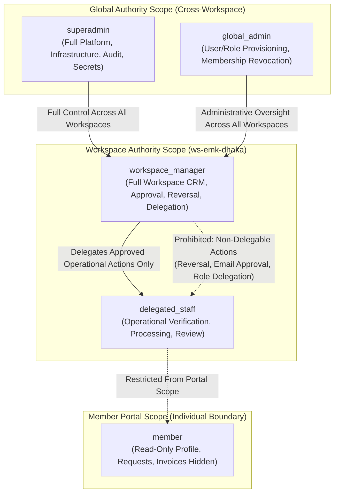

# Role, Module, Action, and Workspace Delegation Matrix

**Phase:** 01-discovery-decisions-and-acceptance-criteria  
**Plan:** 01-03  
**Status:** Approved Specification  
**Governing Documents:** [Docs/emk-membership-crm-plan-revision-10.md](file:///d:/EMK_Protal/Docs/emk-membership-crm-plan-revision-10.md) (Sections 2, 4, 7 & 9), [WORKSPACE-MAPPING.md](file:///d:/EMK_Protal/.planning/phases/01-discovery-decisions-and-acceptance-criteria/WORKSPACE-MAPPING.md), [DECISION-REGISTER.md](file:///d:/EMK_Protal/.planning/phases/01-discovery-decisions-and-acceptance-criteria/DECISION-REGISTER.md)  
**Requirements Reference:** DISC-04, DEC-01 (D-01), DEC-02 (D-02), DEC-04 (D-04), DEC-06 (D-06), DEC-07 (D-07), DEC-11 (D-11)

---

## 1. Overview & Security Foundation

In accordance with **DISC-04**, **DEC-01 (D-01)**, and **DEC-02 (D-02)**, the EMK Membership CRM enforces a robust, multi-tenant Role-Based Access Control (RBAC) architecture built upon Spatie Laravel-Permission.

The system rejects runtime dynamic code evaluation and ad-hoc permission overrides in favor of a **static modular action catalog** and **workspace-scoped delegation boundaries**. 

### Core Architectural Invariants
1. **Multi-Workspace Tenancy Boundary (DEC-01 / D-01):** Workspace Managers and Delegated Staff are strictly restricted to their designated physical workspace (`ws-emk-dhaka` for pilot launch). All Eloquent queries, route middlewares, Livewire property listeners, and background jobs enforce tenant boundary isolation. Cross-workspace visibility, aggregation, and provisioning authority are reserved exclusively to `superadmin` and `global_admin`.
2. **Static Module Action Declaration (DEC-02 / D-02):** All system functionality is organized across 8 core modules declaring explicit, immutable actions. No dynamic code execution, eval-based plugins, or uncompiled runtime extensions are permitted.
3. **Least Privilege & Delegation Safety (T-01-07):** Workspace Managers may only delegate an explicitly permitted subset of operational permissions to Workspace Staff. Sensitive operations—specifically conversion reversal (**DEC-04 / D-04**), lead final approval/conversion (**DEC-03 / D-03**), email change request approvals (**DEC-07 / D-07**), and user role assignment—are hardcoded as **non-delegable** at the service layer.
4. **Member Portal Read-Only Isolation (DEC-06 / D-06):** Member portal users authenticate on a separate authentication guard (`member`) and hold strictly read-only permissions over their profile, documents, and communications. Internal notes, verification checklists, and audit events are strictly excluded from portal access (mitigating **T-01-08**).

---

## 2. Role Archetypes & Scoping Boundaries

The platform standardizes on five discrete role archetypes operating across three explicit authorization scopes:



### Role Specification Table

| Role Identifier | Guard | Scope | Workspace Constraint | Description & Key Responsibilities | Prohibited Actions / Hard Boundaries |
|---|---|---|---|---|---|
| `superadmin` | `web` | Global | Unrestricted (All Workspaces + Staging Pool) | Root platform administrator. Full system configuration, environment secret management, physical database backup/restore operations, hard deletions, immutable audit log inspection, cross-workspace multi-tenant provisioning, and platform analytics rollup. | Cannot bypass append-only audit trail invariants (DEC-11). Cannot alter historical financial ledgers without generating offsetting audit records. |
| `global_admin` | `web` | Global | Unrestricted (All Workspaces + Staging Pool) | Executive operations administrator. Manages user provisioning across workspaces, sets organizational policies, authorizes member restriction or revocation upon formal EMK Center management instruction, and views aggregated mission reports. | Cannot modify platform environment secrets, database connection parameters, or system-level backup jobs. Cannot alter audit logs. |
| `workspace_manager` | `web` | Workspace | Strictly bound to assigned workspace (`ws-emk-dhaka`) | Chief operational authority for an American Space workspace. Administers leads, members, forms, invoices, and ID card logistics; performs bKash manual payment verification (DEC-05); executes atomic lead approval and conversion (DEC-03); executes 30-day conversion reversal (DEC-04); approves member email change requests (DEC-07); delegates authorized module actions to workspace staff. | **Strictly blocked from viewing, searching, or querying any other workspace (DEC-01).** Cannot perform hard deletions, modify platform configuration, or provision new workspaces. |
| `delegated_staff` | `web` | Workspace | Strictly bound to assigned workspace (`ws-emk-dhaka`) | Frontline operational staff (e.g. Information Desk). Processes incoming leads, reviews uploaded applicant documents and studio photos, logs missing items and communicates with applicants, views member master profiles, and marks physical ID cards ready/delivered. | **Strictly prohibited from lead conversion reversal (DEC-04), member email change approval (DEC-07), lead final approval/conversion, user role delegation, and cross-workspace access.** |
| `member` | `member` | Individual | Scoped strictly to authenticated member's own record | Validated active or inactive member. Accesses dedicated member portal in read-only mode (DEC-06); views own profile data, approved membership terms, and official communication threads; submits profile change requests, dedicated email change requests, and renewal payment submissions. | **Strictly read-only; cannot directly edit profile fields, cannot cancel membership, cannot log event attendance, cannot view internal staff notes, verification checklists, or audit logs.** |

---

## 3. Eight Core Modules and Declared Actions (DEC-02 / D-02)

To prevent runtime eval vulnerabilities and ensure deterministic permission resolution, the platform defines exactly 8 core modules and 38 declared actions:

```
[Module Key] . [Action Key]  ==>  Spatie Permission Name
Example: leads.reverse_conversion, members.export_csv, platform_services.view_audit_logs
```

### Module 1: `forms` (Form Builder & Public Form Management)
- `forms.view`: View workspace form definitions, fields, and configuration templates.
- `forms.create`: Design and construct new custom forms or embed codes.
- `forms.edit`: Modify existing form layouts, instructional copy, and display options.
- `forms.publish`: Deploy a form to the public endpoint or toggle live registration availability.
- `forms.archive`: Retire a form version and disable further public submissions.
- `forms.view_entries`: Inspect unmoderated raw form submissions prior to lead triage.

### Module 2: `leads` (Public Lead Lifecycle & Tri-State Verification)
- `leads.view`: Search, filter, and view lead profiles, submissions, and timeline history.
- `leads.create`: Manually input an offline or walk-in lead submission into the workspace.
- `leads.edit`: Update non-identity lead metadata, contact phone, or address details.
- `leads.delete_soft`: Soft-delete an abandoned or invalid lead entry (retaining audit trace).
- `leads.verify_payment`: Verify manual bKash 10-char Transaction ID and payment amount (DEC-05).
- `leads.verify_documents`: Review applicant national ID/passport/birth certificate and minor consent form (DEC-09).
- `leads.verify_photo`: Verify passport studio photo against 5-point compliance checklist.
- `leads.communicate`: Send official missing items notifications or direct email correspondence.
- `leads.approve`: Issue formal preliminary administrative approval for verified leads.
- `leads.reject`: Issue formal application rejection with standardized reason code.
- `leads.convert`: Execute 10-step atomic Lead-to-Member conversion transaction (DEC-03).
- `leads.reverse_conversion`: Execute controlled 30-day conversion rollback with required reason (DEC-04).

### Module 3: `members` (Member Master Profiles & Physical ID Cards)
- `members.view`: Search, filter, and inspect member master profiles, terms, and history.
- `members.edit`: Update member contact details, education/profession, or physical address.
- `members.restrict`: Temporarily suspend member borrowing privileges or building access.
- `members.revoke`: Permanently revoke membership upon formal management instruction.
- `members.export_csv`: Export workspace-filtered member records to CSV format (audited).
- `members.export_excel`: Export workspace-filtered member records to Microsoft Excel format (audited).
- `members.manage_cards`: Advance physical ID card issuance lifecycle (Printing $\rightarrow$ Ready $\rightarrow$ Delivered).

### Module 4: `member_portal` (Self-Service Read-Only Member Portal)
- `member_portal.view_profile`: View personal profile, term validity, and official communications (DEC-06).
- `member_portal.request_change`: Submit general profile data modification request for staff review.
- `member_portal.request_email_change`: Submit formal email change request triggering Manager alert (DEC-07).
- `member_portal.request_renewal`: Submit membership renewal application and bKash payment details.

### Module 5: `invoices` (Billing & Fee Records)
- `invoices.view`: Inspect system-generated post-conversion and renewal invoices.
- `invoices.generate`: Trigger manual ad-hoc invoice or replacement fee billing record.
- `invoices.verify_payment`: Validate payment reconciliation for membership renewal invoices.
- `invoices.export`: Export invoice lists and revenue receipts to CSV/PDF (audited).

### Module 6: `dashboard_reports` (Operational & Mission Analytics)
- `dashboard_reports.view_dashboard`: Access workspace-scoped operational metrics and KPIs.
- `dashboard_reports.generate_reports`: Generate lead pipeline, membership growth, and demographic reports.
- `dashboard_reports.export_metrics`: Export operational charts, summaries, and executive metrics.

### Module 7: `platform_services` (Security, Administration & Auditing)
- `platform_services.manage_settings`: Configure workspace operational parameters, terms, and email templates.
- `platform_services.manage_users`: Provision staff accounts, deactivate credentials, and manage passwords.
- `platform_services.delegate_roles`: Assign permitted operational permissions to workspace staff (DEC-01 / DISC-04).
- `platform_services.view_audit_logs`: Inspect append-only immutable security and operational audit logs (DEC-11).
- `platform_services.manage_backups`: Trigger on-demand backup snapshots or verify restore health.

### Module 8: `migration` (Legacy Zoho Ingestion & Data Reconciliation)
- `migration.import_zoho`: Execute automated import pipeline for legacy Zoho CRM and Zoho Forms records.
- `migration.export_zoho`: Export migrated records or rollback datasets in legacy Zoho-compliant format.
- `migration.reconcile_data`: Run automated data integrity and reconciliation matching scripts.

---

## 4. Comprehensive 2D Delegation & Permission Matrix

The following matrix maps every declared action across all 5 role archetypes.

### Legend
- **`GLOBAL`**: Action executable across all workspaces.
- **`WS`**: Action executable strictly within the actor's assigned workspace.
- **`OWN`**: Action executable strictly on the authenticated actor's own personal account.
- **`NO`**: Action explicitly denied by RBAC policy (server-side 403 Forbidden).
- **`DELEGABLE`**: A Workspace Manager may optionally grant this action to a `delegated_staff` user within their assigned workspace.
- **`NON-DELEGABLE`**: Action is strictly reserved for the Workspace Manager or Global Administrator; cannot be delegated to staff under any circumstances.

| Module | Action Identifier | `superadmin` | `global_admin` | `workspace_manager` | `delegated_staff` (Default) | Manager Delegable? | `member` |
|---|---|---|---|---|---|---|---|
| **forms** | `forms.view` | GLOBAL | GLOBAL | WS | WS | Granted | NO |
| | `forms.create` | GLOBAL | GLOBAL | WS | NO | **DELEGABLE** | NO |
| | `forms.edit` | GLOBAL | GLOBAL | WS | NO | **DELEGABLE** | NO |
| | `forms.publish` | GLOBAL | GLOBAL | WS | NO | **NON-DELEGABLE** | NO |
| | `forms.archive` | GLOBAL | GLOBAL | WS | NO | **NON-DELEGABLE** | NO |
| | `forms.view_entries` | GLOBAL | GLOBAL | WS | WS | Granted | NO |
| **leads** | `leads.view` | GLOBAL | GLOBAL | WS | WS | Granted | NO |
| | `leads.create` | GLOBAL | GLOBAL | WS | WS | Granted | NO |
| | `leads.edit` | GLOBAL | GLOBAL | WS | WS | Granted | NO |
| | `leads.delete_soft` | GLOBAL | GLOBAL | WS | NO | **NON-DELEGABLE** | NO |
| | `leads.verify_payment` | GLOBAL | GLOBAL | WS | NO | **NON-DELEGABLE** | NO |
| | `leads.verify_documents` | GLOBAL | GLOBAL | WS | WS | Granted | NO |
| | `leads.verify_photo` | GLOBAL | GLOBAL | WS | WS | Granted | NO |
| | `leads.communicate` | GLOBAL | GLOBAL | WS | WS | Granted | NO |
| | `leads.approve` | GLOBAL | GLOBAL | WS | NO | **NON-DELEGABLE** | NO |
| | `leads.reject` | GLOBAL | GLOBAL | WS | NO | **NON-DELEGABLE** | NO |
| | `leads.convert` | GLOBAL | GLOBAL | WS | NO | **NON-DELEGABLE** | NO |
| | `leads.reverse_conversion`| GLOBAL | NO | WS | NO | **NON-DELEGABLE** | NO |
| **members**| `members.view` | GLOBAL | GLOBAL | WS | WS | Granted | NO |
| | `members.edit` | GLOBAL | GLOBAL | WS | NO | **DELEGABLE** | NO |
| | `members.restrict` | GLOBAL | GLOBAL | NO | NO | **NON-DELEGABLE** | NO |
| | `members.revoke` | GLOBAL | GLOBAL | NO | NO | **NON-DELEGABLE** | NO |
| | `members.export_csv` | GLOBAL | GLOBAL | WS | NO | **DELEGABLE** | NO |
| | `members.export_excel` | GLOBAL | GLOBAL | WS | NO | **DELEGABLE** | NO |
| | `members.manage_cards` | GLOBAL | GLOBAL | WS | WS | Granted | NO |
| **portal** | `member_portal.view_profile` | NO | NO | NO | NO | N/A | OWN |
| | `member_portal.request_change` | NO | NO | NO | NO | N/A | OWN |
| | `member_portal.request_email_change`| NO | NO | NO | NO | N/A | OWN |
| | `member_portal.request_renewal` | NO | NO | NO | NO | N/A | OWN |
| **invoices**| `invoices.view` | GLOBAL | GLOBAL | WS | WS | Granted | NO |
| | `invoices.generate` | GLOBAL | GLOBAL | WS | NO | **NON-DELEGABLE** | NO |
| | `invoices.verify_payment`| GLOBAL | GLOBAL | WS | NO | **NON-DELEGABLE** | NO |
| | `invoices.export` | GLOBAL | GLOBAL | WS | NO | **DELEGABLE** | NO |
| **reports** | `dashboard_reports.view_dashboard` | GLOBAL | GLOBAL | WS | WS | Granted | NO |
| | `dashboard_reports.generate_reports` | GLOBAL | GLOBAL | WS | NO | **DELEGABLE** | NO |
| | `dashboard_reports.export_metrics` | GLOBAL | GLOBAL | WS | NO | **DELEGABLE** | NO |
| **platform**| `platform_services.manage_settings` | GLOBAL | GLOBAL | WS | NO | **NON-DELEGABLE** | NO |
| | `platform_services.manage_users` | GLOBAL | GLOBAL | NO | NO | **NON-DELEGABLE** | NO |
| | `platform_services.delegate_roles` | GLOBAL | GLOBAL | WS | NO | **NON-DELEGABLE** | NO |
| | `platform_services.view_audit_logs` | GLOBAL | GLOBAL | WS | NO | **NON-DELEGABLE** | NO |
| | `platform_services.manage_backups` | GLOBAL | NO | NO | NO | **NON-DELEGABLE** | NO |
| **migration**| `migration.import_zoho` | GLOBAL | GLOBAL | NO | NO | **NON-DELEGABLE** | NO |
| | `migration.export_zoho` | GLOBAL | GLOBAL | NO | NO | **NON-DELEGABLE** | NO |
| | `migration.reconcile_data`| GLOBAL | GLOBAL | NO | NO | **NON-DELEGABLE** | NO |

---

## 5. Non-Delegable Actions & Security Enforcement (T-01-07)

To prevent privilege escalation attacks where a Workspace Manager attempts to grant administrative or destructive capabilities to temporary or student staff, the platform enforces strict programmatic boundaries.

### Hardcoded Non-Delegable Actions Registry

The `DelegationPolicyService` maintains an immutable allowlist. Any request to assign a permission not present in the delegable allowlist throws a `PrivilegeDelegationException` and emits a high-severity security audit event:

```php
namespace App\Domain\AccessControl\Services;

class DelegationPolicyService
{
    /**
     * Strictly delegable actions that a Workspace Manager may grant to Staff.
     * All unlisted actions are non-delegable by default (Fail Closed).
     */
    public const DELEGABLE_ACTIONS = [
        'forms.create',
        'forms.edit',
        'members.edit',
        'members.export_csv',
        'members.export_excel',
        'invoices.export',
        'dashboard_reports.generate_reports',
        'dashboard_reports.export_metrics',
    ];

    /**
     * Actions explicitly reserved for Workspace Manager or above.
     * Hardcoded restriction preventing manager privilege elevation (T-01-07).
     */
    public const STRICTLY_NON_DELEGABLE = [
        'leads.approve',
        'leads.reject',
        'leads.convert',
        'leads.reverse_conversion',       // DEC-04: Reversal restricted strictly to Manager
        'leads.verify_payment',            // DEC-05: Payment verification restricted to Manager
        'leads.delete_soft',
        'forms.publish',
        'forms.archive',
        'invoices.generate',
        'invoices.verify_payment',
        'platform_services.manage_settings',
        'platform_services.manage_users',
        'platform_services.delegate_roles',
        'platform_services.view_audit_logs',
        'members.restrict',
        'members.revoke',
    ];

    public function assertCanDelegate(User $manager, string $permission, User $targetStaff): void
    {
        if ($manager->workspace_id !== $targetStaff->workspace_id) {
            throw new TenancyBoundaryException("Cannot delegate permissions across workspace boundaries.");
        }

        if (!in-array($permission, self::DELEGABLE_ACTIONS, true)) {
            Log::warning("Security Alert: Attempted unauthorized delegation of {$permission} by Manager {$manager->id}");
            throw new UnauthorizedDelegationException("Action {$permission} is non-delegable to staff.");
        }
    }
}
```

---

## 6. Spatie Permission Implementation & Identifier Syntax

### 1. Permission String Specification
- Format: `{module}.{action}` in snake_case.
- Strict consistency: No prefixes like `can_` or suffixes like `_perm`.
- Case sensitivity: Strictly lower-case alphanumeric with periods and underscores.
- Examples:
  - `leads.verify_payment`
  - `leads.reverse_conversion`
  - `members.export_csv`
  - `member_portal.view_profile`
  - `platform_services.view_audit_logs`

### 2. Multi-Guard Authentication Separation
Permissions are partitioned across two independent authentication guards in `config/auth.php`:
1. `guard_name = 'web'`: Staff, Workspace Managers, Global Admins, and Superadmins.
2. `guard_name = 'member'`: Public member portal users.

This structural separation ensures that an authenticated member can never be matched against staff permissions, even if an identifier name were erroneously duplicated.

### 3. Automatic Cache Invalidation Protocol
Spatie Laravel-Permission caches granted permissions in Redis/memory to prevent repeated database queries during request lifecycles.

To ensure immediate enforcement of role revocations or permission delegations:
1. Whenever a role is granted, synced, or revoked on a user model:
   ```php
   app(\Spatie\Permission\PermissionRegistrar::class)->forgetCachedPermissions();
   ```
2. When a staff user's workspace assignment changes or their account is deactivated, their active sessions are immediately terminated via cache token eviction (`session()->getHandler()->destroy($sessionId)`).
3. Livewire components check `$this->authorize('action_name')` during both mount and sub-component hydration, ensuring that revoked permissions reject mid-session actions without requiring a full page refresh.

---

## 7. Tenancy Defense & Authorization Scopes

In alignment with **DEC-01 (D-01)**, permissions are never evaluated in isolation from workspace tenancy. Having the permission `leads.view` does not confer global visibility; it confers visibility strictly within the actor's assigned `workspace_id`.

```php
// Tenancy authorization invariant in Eloquent Global Scope
static::addGlobalScope('workspace_tenancy', function (Builder $builder) {
    $user = auth()->user();
    if ($user && !$user->hasRole(['superadmin', 'global_admin'])) {
        $builder->where('workspace_id', $user->workspace_id);
    }
});
```

Any attempt by a `workspace_manager` or `delegated_staff` to query, manipulate, or dispatch requests referencing an unauthorized `workspace_id` terminates immediately with an HTTP 403 Forbidden response and logs an immutable security event per **DEC-11 (D-11)**.
