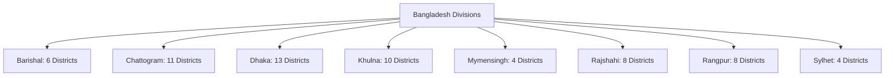

# Public Membership Application Form: 31-Field Dictionary and Validation Contract

**Phase:** 01-discovery-decisions-and-acceptance-criteria  
**Plan:** 01-02 (Task 1)  
**Status:** Approved Data Contract  
**Governing Documents:** [Docs/emk-membership-crm-plan-revision-10.md](file:///d:/EMK_Protal/Docs/emk-membership-crm-plan-revision-10.md) (Section 5, Section 9), [.planning/PROJECT.md](file:///d:/EMK_Protal/.planning/PROJECT.md)  
**Governing Decisions:** DEC-03 (D-03), DEC-05 (D-05), DEC-09 (D-09), DISC-03

---

## 1. Overview & Data Contract Purpose

This document establishes the exhaustive, unambiguous data specification and validation contract for the **31-Field Public Membership Application Form** at EMK Center and American Spaces across Bangladesh.

It satisfies requirement **DISC-03**, implements the 10-character bKash Transaction ID validation per **DEC-05 (D-05)**, enforces the conditional youth parental consent rule per **DEC-09 (D-09)**, and resolves field validation ambiguities (such as allowing hyphens and apostrophes for transliterated names) identified in the specification.

This dictionary serves as the binding specification for:
1. **Phase 2 (Architecture & Data Model):** Database schema, column definitions, table constraints, and file storage mappings.
2. **Phase 5 (Form Builder & Public Form):** Dynamic form builder field types, validation rules, Alpine.js client-side reactive dependencies, and error messages.
3. **Phase 6 (Leads CRM & Verification):** Field mapping from public submission payloads to Lead entity properties, file attachment handling, and audit timeline tracking.

---

## 2. General Data Handling & Security Principles

1. **Dual-Layer Validation:** Every field rule must be enforced **identically on both client and server**:
   - Client-side: Reactive Alpine.js validation providing instant visual feedback and disabling invalid submits.
   - Server-side: Laravel Form Request (`StoreMembershipApplicationRequest`) validation rules executing before model creation. Client validation is considered untrusted.
2. **Character Encoding & Sanitization:** All text inputs are UTF-8 encoded, trimmed of leading/trailing whitespace, and sanitized against XSS (HTML special characters escaped; no raw tags permitted).
3. **Name Casing & Transliteration:** Proper capitalization is preserved. Hyphens (`-`), apostrophes (`'`), and spaces are explicitly permitted to support standard Bangladeshi and ethnic transliterated names (resolving the strict "letters only" ambiguity from legacy PDF forms without violating data integrity).
4. **Private Storage & Safe Filenames:** Uploaded identity documents, parental consent forms, and studio photos are never stored in publicly accessible directories. Files are stored on a private, encrypted storage disk using cryptographically secure UUID filenames (`/storage/app/private/leads/{lead_uuid}/{document_type}_{hash}.{ext}`). Original client filenames are preserved only in database metadata for display to reviewing staff.
5. **No Duplicate bKash TxID:** The bKash Transaction ID must be unique across all existing Leads (pending, approved, or rejected) and Member Invoices to prevent fraudulent duplicate submissions.

---

## 3. The 31-Field Specification Table

| # | Field Name | Database Column | Form Input Type | Required? | Validation Rules & Regex | Allowed Values / Options | Error Message | Conditional / Reactive Trigger |
|---|---|---|---|---|---|---|---|---|
| **1** | First Name | `first_name` | Text Input | **Required** | `string, min:2, max:50`<br>Regex: `^[A-Za-z\s'\-]{2,50}$` | English letters, spaces, hyphens, apostrophes | *"Please enter a valid first name (2-50 letters)."* | None |
| **2** | Middle Name | `middle_name` | Text Input | Optional | `nullable, string, max:50`<br>Regex: `^[A-Za-z\s'\-]{1,50}$` | English letters, spaces, hyphens, apostrophes | *"Middle name cannot exceed 50 characters."* | None |
| **3** | Last Name | `last_name` | Text Input | **Required** | `string, min:2, max:50`<br>Regex: `^[A-Za-z\s'\-]{2,50}$` | English letters, spaces, hyphens, apostrophes | *"Please enter a valid last name (2-50 letters)."* | None |
| **4** | American Spaces | `american_space` | Dropdown Select | **Required** | `string, in:american_center,emk_center,barishal_corner,chattogram_corner,rajshahi_corner,sylhet_corner` | • American Center<br>• EMK Center<br>• Barishal Corner<br>• Chattogram Corner<br>• Rajshahi Corner<br>• Sylhet Corner | *"Please select a valid American Space."* | EMK Center routes to `ws-emk-dhaka`; others route to Superadmin staging pool |
| **5** | Sex | `sex` | Dropdown Select | **Required** | `string, in:male,female,na` | • Male<br>• Female<br>• N/A | *"Please select a valid option for sex."* | None |
| **6** | Date of Birth | `date_of_birth` | Date Picker | **Required** | `date, date_format:Y-m-d, before:today, after:1900-01-01` | Valid historical date (past, age 5 to 120) | *"Please enter a valid date of birth."* | Calculates `age_years` dynamically. If `age_years < 18`, activates Field 7 |
| **7** | Consent Form Upload | `parental_consent_path` | File Upload | **Conditional Required** | `required_if:age_years,<18, file, mimes:pdf,jpg,jpeg,png, max:4096` | PDF, JPG, JPEG, PNG (Max 4MB) | *"Parental/Guardian consent form is mandatory for applicants under 18 years of age."* | **DEC-09 (D-09):** Shown and required IF `age_years < 18`. Hidden and omitted IF `age_years >= 18`. Provides template download link |
| **8** | House No. | `address_house_no` | Text Input | **Required** | `string, min:1, max:100`<br>Regex: `^[A-Za-z0-9\s,\-\/\.#]{1,100}$` | Alphanumeric characters, spaces, punctuation (`- , / . #`) | *"Please enter your house/building number."* | None |
| **9** | Road No. | `address_road_no` | Text Input | Optional | `nullable, string, max:100`<br>Regex: `^[A-Za-z0-9\s,\-\/\.#]{1,100}$` | Alphanumeric characters, spaces, punctuation | *"Road number cannot exceed 100 characters."* | None |
| **10** | Area | `address_area` | Text Input | **Required** | `string, min:2, max:100`<br>Regex: `^[A-Za-z0-9\s,\-\.]{2,100}$` | Alphanumeric characters, spaces, punctuation | *"Please enter your neighborhood/area."* | None |
| **11** | ZIP / Postal Code | `address_zip_code` | Text Input | **Required** | `string, min:3, max:10`<br>Regex: `^[A-Za-z0-9\s\-]{3,10}$` | Alphanumeric (typically 4 digits for Bangladesh, e.g., `1209`) | *"Please enter a valid postal/ZIP code (3-10 characters)."* | None |
| **12** | Division | `address_division` | Dropdown Select | **Required** | `string, in:barishal,chattogram,dhaka,khulna,mymensingh,rajshahi,rangpur,sylhet` | 8 Official Divisions of Bangladesh (see Section 4) | *"Please select your administrative division."* | Cascading parent: Updates available options in Field 13 (District) |
| **13** | District | `address_district` | Cascading Dropdown | **Required** | `string, max:50, valid_district_for_division` | 64 Districts of Bangladesh, strictly mapped to selected Division | *"Please select a valid district for the chosen division."* | Filtered dynamically based on Field 12 |
| **14** | Contact Number | `contact_number` | Tel Input | **Required** | `string, regex:/^\+8801[3-9]\d{8}$/` | Exactly 14 characters, starting with `+8801` followed by valid operator code (3-9) and 8 digits | *"Please enter a valid Bangladeshi mobile number in format +8801XXXXXXXXX."* | None |
| **15** | Email | `email` | Email Input | **Required** | `email:rfc,dns, max:150, unique_across_leads_and_members` | Valid RFC 5322 format, lowercase normalized, globally unique | *"Please enter a valid email address that has not already been registered."* | Core identity key. Used for login account creation and duplicate detection |
| **16** | Website | `website` | URL Input | Optional | `nullable, url, max:200` | Valid HTTP/HTTPS URL | *"Please enter a valid website URL (including https://)."* | None |
| **17** | Occupation | `occupation` | Dropdown Select | **Required** | `string, in:artist,community_worker,educator,entrepreneur,media_professional,performer,student,other` | • Artist<br>• Community Worker<br>• Educator<br>• Entrepreneur<br>• Media Professional<br>• Performer<br>• Student<br>• Other | *"Please select your primary occupation."* | If `other`, reveals conditional child text input `occupation_other` |
| **18** | Last / Current Place of Study | `institution_study` | Text Input | **Required** | `string, min:2, max:150`<br>Regex: `^[A-Za-z0-9\s,\-\.'&]{2,150}$` | Alphanumeric school/university names, standard punctuation | *"Please enter your last or current place of study (2-150 characters)."* | None |
| **19** | Highest Certification | `highest_certification` | Dropdown Select | **Required** | `string, in:ssc,o_level,hsc,a_level,undergraduate_degree,undergraduate_honors,graduate,postgraduate,other` | • SSC<br>• O-level<br>• HSC<br>• A-level<br>• Undergraduate Degree<br>• Undergraduate Honors<br>• Graduate<br>• Postgraduate<br>• Other | *"Please select your highest academic certification."* | If `other`, reveals conditional child text input `highest_certification_other` |
| **20** | Area of Subject | `area_of_subject` | Text Input | **Required** | `string, min:2, max:150`<br>Regex: `^[A-Za-z0-9\s,\-\.'&]{2,150}$` | Discipline/Major name (e.g., Computer Science, Literature) | *"Please enter your subject or academic discipline."* | None |
| **21** | U.S. Work/Study Experience | `has_us_experience` | Radio Boolean | **Required** | `boolean` | • Yes (`1`)<br>• No (`0`) | *"Please indicate if you have U.S. work or study experience."* | If `Yes`, activates Field 22 (`us_experience_location`) |
| **22** | U.S. Location | `us_experience_location` | Text Input | **Conditional Required** | `required_if:has_us_experience,1, nullable, string, max:150`<br>Regex: `^[A-Za-z0-9\s,\-\.]{2,150}$` | U.S. City, State, or Institution | *"Please specify your U.S. work or study location."* | Conditional on Field 21 = `Yes` |
| **23** | American Institution Alumni | `is_american_alumni` | Radio Boolean | **Required** | `boolean` | • Yes (`1`)<br>• No (`0`) | *"Please indicate if you are an alumnus/alumna of an American institution."* | If `Yes`, activates Field 24 (`american_institution_name`) |
| **24** | American School / Institution Name | `american_institution_name` | Text Input | **Conditional Required** | `required_if:is_american_alumni,1, nullable, string, max:150`<br>Regex: `^[A-Za-z0-9\s,\-\.'&]{2,150}$` | Name of American School/University | *"Please enter the name of the American institution attended."* | Conditional on Field 23 = `Yes` |
| **25** | Current Employer | `employer_name` | Text Input | Optional | `nullable, string, max:150`<br>Regex: `^[A-Za-z0-9\s,\-\.'&]{2,150}$` | Company/Organization name | *"Employer name cannot exceed 150 characters."* | None |
| **26** | Job Title | `job_title` | Text Input | Optional | `nullable, string, max:100`<br>Regex: `^[A-Za-z0-9\s,\-\.'&]{2,100}$` | Professional designation | *"Job title cannot exceed 100 characters."* | None |
| **27** | Work Phone | `work_phone` | Tel Input | Optional | `nullable, string, regex:/^\+8801[3-9]\d{8}$/` | Exactly 14 characters, starting with `+8801` followed by valid operator code and 8 digits | *"Please enter a valid work phone number in format +8801XXXXXXXXX."* | None |
| **28** | Identity Documents Upload | `identity_document_paths` | Multi-File Upload | **Required** | `required, array, min:1, max:2`<br>`*.file, mimes:pdf,jpg,jpeg,doc,docx,png, max:4096` | 1 or 2 files; PDF, JPG, JPEG, PNG, DOC, DOCX; Max 4MB per file | *"Please upload 1 or 2 valid identity documents (NID, Passport, Birth Certificate, or Student ID), up to 4MB each."* | Stored privately with secure hash. Reviewed in Document Verification stream |
| **29** | Photo Upload | `photo_path` | Single File Upload | **Required** | `required, file, mimes:jpg,jpeg,png, max:4096, dimensions:min_width=300,min_height=300` | Exactly 1 image file (JPG, JPEG, PNG); Max 4MB; Strict studio passport requirements | *"Please upload a studio passport photo: white background, no glasses, ears visible, regular clothes, no selfies (Max 4MB)."* | Displayed on ID card upon printing. Reviewed in Photo Verification stream |
| **30** | bKash Transaction ID | `bkash_txid` | Text Input | **Required** | `required, string, size:10, regex:/^[A-Z0-9]{10}$/, unique_bkash_txid` | Exactly 10 uppercase alphanumeric characters (0-9, A-Z); unique across Leads and Member Invoices | *"Please enter a valid 10-character uppercase bKash Transaction ID (e.g., BLK7X9Q12M). Duplicate Transaction IDs are not accepted."* | **DEC-05 (D-05):** Auto-capitalized on input; validated against existing submissions. Reviewed in Payment Verification stream |
| **31** (Field 31) | Terms and Conditions Agreement | `terms_agreed` | Checkbox | **Required** | `accepted` | Must be explicitly checked (`true` / `1`) | *"You must read and agree to the Membership Terms and Conditions to submit your application."* | Legal consent acceptance lock |

---

## 4. Administrative Division & District Cascading Hierarchy (Fields 12 & 13)

To ensure geographic data integrity, Field 13 (District) is dynamically populated based on Field 12 (Division). Submitting a district that does not belong to the chosen division fails server-side validation.

The 64 official administrative districts of Bangladesh are partitioned across the 8 divisions as follows:



### Complete Mapping Table:

| Division (Value) | Districts (Allowed Values) |
|---|---|
| **Barishal** (`barishal`) | `barguna`, `barishal`, `bhola`, `jhalokati`, `patuakhali`, `pirojpur` *(6 districts)* |
| **Chattogram** (`chattogram`) | `bandarban`, `brahmanbaria`, `chandpur`, `chattogram`, `coxs_bazar`, `feni`, `khagrachhari`, `lakshmipur`, `noakhali`, `rangamati`, `cumilla` *(11 districts)* |
| **Dhaka** (`dhaka`) | `dhaka`, `faridpur`, `gazipur`, `gopalganj`, `kishoreganj`, `madaripur`, `manikganj`, `munshiganj`, `narayanganj`, `narsingdi`, `rajbari`, `shariatpur`, `tangail` *(13 districts)* |
| **Khulna** (`khulna`) | `bagerhat`, `chuadanga`, `jashore`, `jhenaidah`, `khulna`, `kushtia`, `magura`, `meherpur`, `narail`, `satkhira` *(10 districts)* |
| **Mymensingh** (`mymensingh`) | `jamalpur`, `mymensingh`, `netrokona`, `sherpur` *(4 districts)* |
| **Rajshahi** (`rajshahi`) | `bogura`, `chapai_nawabganj`, `joypurhat`, `naogaon`, `natore`, `pabna`, `rajshahi`, `sirajganj` *(8 districts)* |
| **Rangpur** (`rangpur`) | `dinajpur`, `gaibandha`, `kurigram`, `lalmonirhat`, `nilphamari`, `panchagarh`, `rangpur`, `thakurgaon` *(8 districts)* |
| **Sylhet** (`sylhet`) | `habiganj`, `moulvibazar`, `sunamganj`, `sylhet` *(4 districts)* |

---

## 5. Youth Consent Validation Rules (DEC-09 / D-09)

1. **Age Calculation Logic:**
   - Client-side (Alpine.js): When Field 6 (`date_of_birth`) changes, client computes `diffInYears(new Date(dob), new Date())`.
   - Server-side (Laravel): Verified via `Carbon::parse($request->date_of_birth)->age`.
2. **Conditional Activation:**
   - If `age < 18`:
     - Field 7 (`parental_consent_path`) transitions to visible and `required`.
     - Displays applicant banner: *"Because you are under 18 years old, a signed Parental/Guardian Consent Form is required."*
     - Provides clear download link for official EMK Parental Consent Form template (`/forms/templates/EMK-Parental-Consent-Form.pdf`).
     - Upload accepts: PDF, JPG, JPEG, PNG (max 4096 KB).
   - If `age >= 18`:
     - Field 7 is hidden from UI.
     - Server ignores any uploaded consent payload (nullified).
3. **Audit & Verification:**
   - Staff reviewing Field 7 in Document Verification stream must verify guardian signature, guardian contact number, and relation to applicant before approving document check.

---

## 6. bKash Transaction ID Validation Rules (DEC-05 / D-05)

1. **Format Enforcement:**
   - Length: Exactly 10 characters (no spaces, hyphens, or symbols).
   - Casing: Uppercase alphanumeric (`A-Z`, `0-9`).
   - Client Input Transform: Alpine.js automatically applies `x-on:input="$el.value = $el.value.toUpperCase().replace(/[^A-Z0-9]/g, '').slice(0, 10)"`.
   - Regex: `^[A-Z0-9]{10}$`.
2. **Uniqueness Constraint (`unique_bkash_txid`):**
   - The bKash Transaction ID is checked against:
     1. All records in `leads` table (regardless of lead status: submitted, approved, converted, or rejected).
     2. All records in `invoices` table (`payment_reference` column).
   - If an existing record matches the submitted `bkash_txid`, submission is rejected with:
     *"This bKash Transaction ID has already been submitted. If you believe this is an error, please contact EMK Center Information Desk."*
3. **Staff Verification Guard:**
   - In Lead CRM (Phase 6), Workspace Manager verifies the TxID in the bKash merchant portal before marking Payment Verification as `verified`.

---

## 7. Studio Passport Photo Specifications (Field 29)

Field 29 supplies the definitive image printed on physical plastic membership ID cards (Phase 7). To prevent defective badge production, the following criteria are published directly above the upload component:

- **Background:** Strict, plain solid white background. No patterns, outdoor scenes, or coloured walls.
- **Eyewear:** No eyeglasses or sunglasses permitted. Glare or frames obscuring eyes cause automatic rejection.
- **Ears & Face:** Both ears must be clearly visible. Hair must be tucked behind ears. Face must be directed straight at camera.
- **Attire:** Regular professional or casual attire. Religious headwear (e.g., hijab) is permitted provided the full oval of the face from forehead to chin is unobstructed.
- **No Selfies:** Selfies, filtered images, angled shots, or low-resolution scans are prohibited.
- **Dimensions & Format:** Minimum 300x300 pixels, maximum 4MB. Formats: JPG, JPEG, PNG.

---

## 8. Applicant Submission Payload & Lead Entity Mapping

Upon valid submission, the form submission controller transforms the 31 inputs into a new `Lead` record within `ws-emk-dhaka` (or the central staging pool):

```json
{
  "workspace_id": "ws-emk-dhaka",
  "source_form_version": "v1.0-31f",
  "applicant_data": {
    "first_name": "Rahim",
    "middle_name": "Uddin",
    "last_name": "Ahmed",
    "american_space": "emk_center",
    "sex": "male",
    "date_of_birth": "2002-05-14",
    "age_at_submission": 24,
    "has_parental_consent": false,
    "address": {
      "house_no": "House 12",
      "road_no": "Road 5",
      "area": "Dhanmondi",
      "zip_code": "1209",
      "division": "dhaka",
      "district": "dhaka"
    },
    "contact": {
      "phone": "+8801712345678",
      "email": "rahim.ahmed@example.com",
      "website": "https://rahimahmed.me",
      "work_phone": null
    },
    "education_and_career": {
      "occupation": "student",
      "occupation_other": null,
      "institution_study": "University of Dhaka",
      "highest_certification": "undergraduate_degree",
      "highest_certification_other": null,
      "area_of_subject": "Economics",
      "has_us_experience": false,
      "us_experience_location": null,
      "is_american_alumni": false,
      "american_institution_name": null,
      "employer_name": null,
      "job_title": null
    }
  },
  "payment_data": {
    "method": "bkash_manual",
    "txid": "BL79K2P09Q",
    "declared_amount_bdt": 1000
  },
  "attachments": {
    "identity_documents": [
      {
        "storage_path": "leads/lead_01h9x/doc_nid_front.pdf",
        "original_filename": "national_id.pdf",
        "mime_type": "application/pdf",
        "size_bytes": 1048576
      }
    ],
    "photo": {
      "storage_path": "leads/lead_01h9x/photo_passport.jpg",
      "original_filename": "passport_photo.jpg",
      "mime_type": "image/jpeg",
      "size_bytes": 524288
    },
    "parental_consent": null
  },
  "terms_agreed": true,
  "submitted_at": "2026-11-03T14:30:00Z"
}
```

---

## 9. Downstream Phase Binding

- **Phase 2 (Architecture):** Informs `leads`, `lead_attachments`, and `lead_custom_fields` table schemas.
- **Phase 5 (Form Builder):** Directly instantiated into the default 31-field template for EMK Center.
- **Phase 6 (Leads CRM):** Supplies the inspection layout and checklist criteria for reviewing staff.
