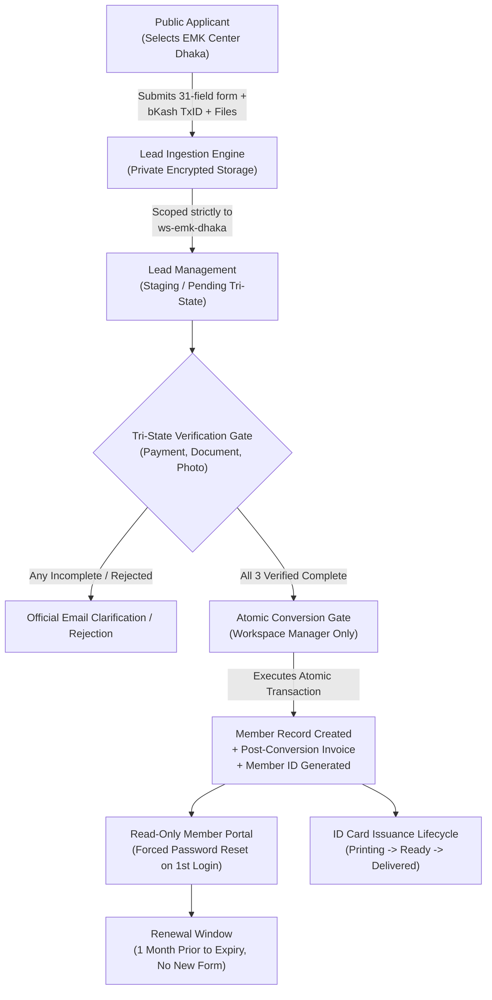

# MVP Boundaries & Governance Tracer Lifecycle

**Phase:** 01-discovery-decisions-and-acceptance-criteria  
**Plan:** 01-01  
**Status:** Approved Baseline  
**Governing Documents:** [Docs/emk-membership-crm-plan-revision-10.md](file:///d:/EMK_Protal/Docs/emk-membership-crm-plan-revision-10.md), [.planning/PROJECT.md](file:///d:/EMK_Protal/.planning/PROJECT.md)

---

## 1. Executive Summary & Core Vision

The EMK Membership CRM & Member Portal replaces legacy Zoho Forms and Zoho CRM instances with an integrated, modular membership CRM and read-only member portal natively embedded within the existing Hub web application.

The primary objective is eliminating external third-party software licensing overhead, unifying fragmented member records, safeguarding sensitive identity documentation, and enforcing robust multi-workspace data isolation. The platform launches exclusively for **EMK Center Dhaka** (`ws-emk-dhaka`) as the pilot workspace, establishing an extensible operational architecture capable of scaling to all six American Spaces in Bangladesh under Superadmin governance.

### Operational Envelope
- **Initial Target Workspace:** EMK Center Dhaka (`ws-emk-dhaka`)
- **Capacity Envelope:** 500 active members and 5 workspace staff members at initial release
- **Platform Host:** Integrated within the existing Laravel Hub infrastructure with dedicated domain boundaries

---

## 2. End-to-End Governance Tracer Lifecycle

The single end-to-end tracer lifecycle proves architectural traceability and data integrity from initial public touchpoint through member servicing and renewal. This golden path establishes the baseline for all downstream functional requirements and security verifications.

### Tracer Lifecycle Stages

#### Stage 1: Public Application Submission
1. The applicant accesses the public membership application web form.
2. The applicant selects **EMK Center Dhaka** from the American Spaces dropdown.
3. The applicant completes all 31 mandatory and conditional fields:
   - Personal information (First Name, Middle Name, Last Name, Sex, Date of Birth).
   - Residential and regional address fields (House No, Road No, Area, ZIP, Division, District).
   - Valid contact number (`+880XXXXXXXXXX`) and unique email address.
   - Professional, educational, and demographic details.
   - Conditional parent/guardian consent form upload for any applicant aged under 18 years per DEC-09 (D-09).
   - Required document upload (max 2 files, up to 4 MB each: national ID, passport, or birth certificate).
   - Required studio-compliant passport photo upload (1 file, up to 4 MB, white background, ears visible, no selfies).
   - Valid manual bKash Transaction ID (exactly 10 alphanumeric uppercase characters) per DEC-05 (D-05).
   - Acceptance checkbox for official Terms and Conditions.
4. Validation is strictly enforced server-side before request acceptance.

#### Stage 2: Tenant Ingestion and Private Storage
1. On valid submission, the submission engine routes the applicant data directly into a new **Lead** entity.
2. The record is permanently associated with the EMK Center Dhaka tenant workspace (`workspace_id = ws-emk-dhaka`) per DEC-01 (D-01).
3. Uploaded verification documents and portrait photos are written to private, access-controlled filesystem storage using secure system-generated UUID filenames. Direct public URL access to raw assets is prohibited.
4. An automated confirmation email is queued and dispatched via Laravel Horizon to the applicant's verified email.

#### Stage 3: Tri-State Verification Gate
1. Center Staff and Workspace Managers access the Lead within the `ws-emk-dhaka` CRM view.
2. Three independent verification dimensions must be reviewed and transitioned per DEC-03 (D-03):
   - **Payment Verification:** Manual validation of the 10-character bKash Transaction ID against transaction statements; duplicate Transaction IDs across all Leads/Members are blocked server-side (DEC-05).
   - **Document Verification:** Verification of identity credentials, age match, and parental consent documents if applicant is under 18 years (DEC-09).
   - **Photo Verification:** Visual inspection confirming studio background, lighting, attire, and absence of filters/selfies.
3. Each verification state transition logs the reviewer ID, timestamp, and notes. If items are missing or invalid, staff initiate threaded official emails from the Lead profile.

#### Stage 4: Controlled Atomic Lead-to-Member Conversion
1. The conversion action is restricted strictly to authorized Workspace Managers.
2. **Invariant:** The conversion action is disabled and blocked server-side until Payment, Document, and Photo verifications are all in `Complete` status (DEC-03).
3. The Workspace Manager triggers conversion:
   - Executed within an atomic database transaction.
   - Lead data, attachments, and payment evidence are copied into the persistent `Member` record.
   - A sequential or structured Member ID is generated.
   - A post-conversion invoice record is automatically created (DEC-03 / DEC-08).
   - Lead status transitions to `Converted`.
4. If an administrative conversion error occurs, a Workspace Manager may initiate a Conversion Reversal under DEC-04 (D-04) with mandatory documented justification and immutable audit logging.

#### Stage 5: Portal Account Activation & Credential Dispatch
1. Upon conversion, a member portal account is provisioned using the verified email and generated Member ID.
2. A temporary secure credential activation link is dispatched to the member.
3. On initial authentication, the portal forces an immediate password reset before granting account access per DEC-06 (D-06).
4. The member enters a strictly read-only portal view displaying approved personal details, membership status, validity dates, and official communications (DEC-06).

#### Stage 6: Physical ID Card Issuance
1. The member's profile enters the physical card issuance queue.
2. Issuance progresses sequentially through three verified lifecycle states:
   - `Provided for Printing`: Card data batch exported or queued for printing vendor.
   - `Card Printed & Ready`: Card received at EMK Center Dhaka reception; automated notification dispatched to member.
   - `Delivered`: Physical card handed to verified member at EMK Center reception.
3. Card loss or replacement records a structured reason and restarts the issuance cycle.

#### Stage 7: Renewal Workflow
1. The renewal window opens exactly one (1) month prior to membership term expiration.
2. Members submit renewal intent through the portal without resubmitting the 31-field public registration form per DEC-08 (D-08).
3. Renewal requires fee verification via manual bKash TxID verification.
4. On Workspace Manager confirmation, the membership validity is extended based on the active term configuration in the database (DEC-08).

---

## 3. Strict Boundary Matrix: In-Scope vs Out-of-Scope

The boundary between in-scope deliverables and excluded features governs architectural decisions, schema design, and resource allocation across all phases.

| Area / Feature | In-Scope (Phase 1 Baseline) | Out-of-Scope (Excluded from v1) | Architectural Citation |
|---|---|---|---|
| **Multi-Tenancy** | Single launch workspace: EMK Center Dhaka (`ws-emk-dhaka`). Server-side query scoping, route protection, and isolated exports. | Self-service tenant creation; cross-workspace visibility for workspace staff; multi-tenant sharing of leads without Superadmin mediation. | DEC-01 (D-01) |
| **System Architecture** | Modular application architecture with declared actions in a central registry. Integrated inside existing Hub application. | Arbitrary runtime code evaluation; dynamic third-party plugin loading engines; microservice partitioning outside Hub monolith. | DEC-02 (D-02) |
| **Lead Verification** | Tri-State verification gate (Payment, Document, Photo). Independent state tracking, notes, and evidence logging. | Single-click bypass of verification steps; conversion of unverified leads; automated biometric photo verification. | DEC-03 (D-03) |
| **Conversion Management** | Atomic Lead-to-Member conversion; controlled Conversion Reversal protocol with mandatory reason recording. | Deletion of converted leads; silent reversals; auto-conversion without explicit Workspace Manager authorization. | DEC-04 (D-04) |
| **Payment Collection** | Manual verification of 10-character uppercase bKash Transaction ID; system-wide duplicate TxID prevention. | Direct automated online payment gateway checkout (SSLCommerz/bKash API); automatic bank reconciliation; credit card processing. | DEC-05 (D-05) |
| **Member Portal** | Strictly read-only member profile view; formal staff-reviewed profile change requests; forced password reset on first login. | Direct member self-editing of core profile data; member self-cancellation; public member directory. | DEC-06 (D-06) |
| **Identity Updates** | Dedicated Email Change Request workflow requiring Workspace Manager review, notification, and audit logging. | Self-service email updates by member without staff authorization; unverified email changes. | DEC-07 (D-07) |
| **Terms & Pricing** | Configurable database records for membership terms and fee structures; start date defaults to Manager approval date. | Hard-coded two-year membership terms; fixed static fees in application code; automatic lifetime memberships without approval. | DEC-08 (D-08) |
| **Applicant Compliance** | Mandatory parent/guardian consent form upload for applicants under 18 years calculated from Date of Birth. | In-person physical notarization requirement; automated digital signature verification beyond uploaded consent form. | DEC-09 (D-09) |
| **Payment Integration** | Decoupled payment provider adapter boundary isolating Lead and Member domain models from payment mechanism. | Hardcoded bKash database tables; tightly coupled payment logic preventing future gateway adoption. | DEC-10 (D-10) |
| **Audit & Governance** | Append-only immutable audit trail capturing actor, timestamp, entity diffs (excluding secrets), read-only even for Admins. | Editable audit records; storage of cleartext passwords, tokens, or payment secrets in audit payloads; audit deletion. | DEC-11 (D-11) |
| **Portal Interactions** | Read-only profile view, change request submissions, renewal requests, card readiness notification. | Event ticket purchasing; attendance tracking/logging; facility room booking; direct messaging chat system. | Out-of-Scope Baseline |
| **Capacity Baseline** | Designed, indexed, and tested for initial operational capacity of 500 members and 5 workspace staff. | High-throughput distributed clustering (>100k concurrent users); distributed multi-region database sharding. | Capacity Envelope Baseline |

---

## 4. Downstream Traceability Matrix

Every in-scope boundary established in this document directly constrains downstream delivery phases:

- **Phase 2 (Architecture & Data Model):** Schema definitions for `leads`, `members`, `invoices`, `verification_states`, and `audit_logs` must enforce the Invariant boundaries specified in DEC-01 through DEC-11.
- **Phase 3 (Foundation):** File storage configuration must implement private disk storage rules for applicant identity documents and photos.
- **Phase 4 (Identity & Access):** Livewire components and Eloquent models must implement global tenancy scopes mapping exclusively to `workspace_id`.
- **Phase 5 (Form Builder):** 31-field schema and conditional under-18 consent logic must match Section 2 Tracer Stage 1.
- **Phase 6 (Leads & Conversion):** Tri-State gate and atomic transaction boundary must enforce Section 2 Tracer Stages 3 & 4.
- **Phase 7 (Members & ID Cards):** 3-stage physical card tracking and post-conversion invoice generation must follow Section 2 Stages 4 & 6.
- **Phase 9 (Member Portal):** Read-only portal controls and dedicated email change request workflow must enforce Section 2 Stage 5.
