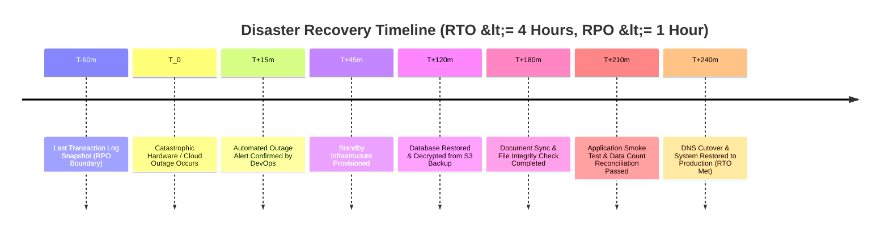
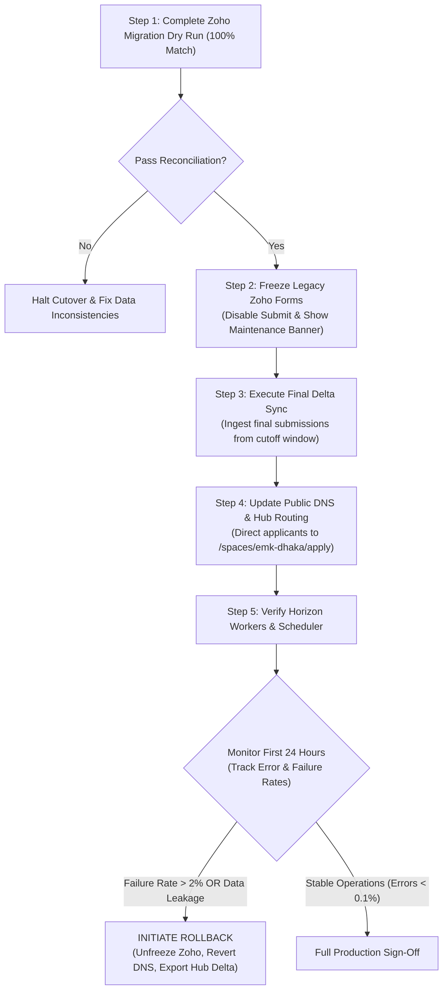
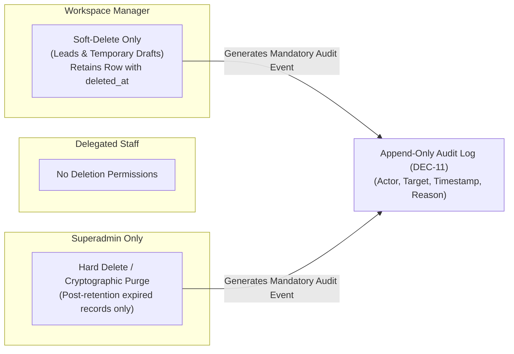

# Operational Recovery Targets, Rollback Criteria, Migration Inventory, and Privacy Baseline

**Phase:** 01-discovery-decisions-and-acceptance-criteria  
**Plan:** 01-03  
**Status:** Approved Operational Specification  
**Governing Documents:** [Docs/emk-membership-crm-plan-revision-10.md](file:///d:/EMK_Protal/Docs/emk-membership-crm-plan-revision-10.md) (Sections 4, 8 & 9), [MVP-BOUNDARIES.md](file:///d:/EMK_Protal/.planning/phases/01-discovery-decisions-and-acceptance-criteria/MVP-BOUNDARIES.md), [DECISION-REGISTER.md](file:///d:/EMK_Protal/.planning/phases/01-discovery-decisions-and-acceptance-criteria/DECISION-REGISTER.md)  
**Requirements Reference:** DISC-05, DEC-01 (D-01), DEC-09 (D-09), DEC-11 (D-11), GAP-P1-04, GAP-P1-05, GAP-P1-06

---

## 1. Capacity Envelope & Measurable Recovery Targets

In accordance with **DISC-05**, **GAP-P1-06**, and Section 9 of the primary specification, the operational capacity and disaster recovery thresholds are formalized below. 

Unqualified statements such as *"system must tolerate any outage"* or ambiguous questionnaires are explicitly rejected in favor of deterministic, auditable engineering Service Level Objectives (SLOs).

### Operational Capacity Envelope (Pilot Launch: ws-emk-dhaka)

| Capacity Dimension | Production Baseline Target | Peak / Stress Capacity | Design Implication |
|---|---|---|---|
| **Active Member Population** | **500 active members** | Up to 2,500 active records | Indexed MySQL schema; query pagination limit 25/50; cached statistics. |
| **Concurrent Staff Users** | **5 concurrent staff users** (Information Desk, Manager) | Up to 15 concurrent staff sessions | Optimistic UI locking; Livewire polling throttled to 15s intervals. |
| **Public Form Submissions** | 10 to 20 submissions / day | **50 simultaneous form submissions / hour** | Form submission rate limiting (10 req/min/IP); queued background jobs for emails. |
| **Document Storage Volume** | ~500 MB (1MB / applicant) | 10 GB encrypted document storage | Private disk driver; chunked file upload streaming; automatic EXIF strip. |
| **Queue Throughput** | ~50 jobs / hour | 500 queued jobs / hour | Redis-backed Laravel Horizon queue; dedicated email and document workers. |

### Availability & Recovery SLOs

1. **Availability Target:**
   - **99.5% Uptime** during primary operational hours (**9:00 AM – 9:00 PM Bangladesh Standard Time, BST**), permitting no more than 1.8 hours of unscheduled downtime per month.
   - Planned maintenance windows are restricted to off-peak hours (Sunday 1:00 AM – 5:00 AM BST) with prior administrative broadcast.
2. **Recovery Point Objective (RPO):**
   - **RPO <= 1 hour**. In the event of catastrophic data corruption or infrastructure failure, the maximum allowable data loss is bounded at 60 minutes of transactions.
   - Enforced via continuous binary transaction logging (`binlog`) with hourly automated snapshot replication to offsite cloud storage.
3. **Recovery Time Objective (RTO):**
   - **RTO <= 4 hours**. The total duration from confirmed outage declaration to a fully operational, data-reconciled production instance serving staff and members cannot exceed 240 minutes.
   - Enforced via codified Docker/container deployment scripts and automated restore runbooks.

---

## 2. Backup and Disaster Recovery Runbook

To guarantee compliance with the RPO <= 1h and RTO <= 4h targets, backup and verification procedures follow a strict automated schedule.

### Backup Strategy & Storage Architecture

| Asset Type | Backup Mechanism | Cadence | Encryption Standard | Destination Target | Retention Policy |
|---|---|---|---|---|---|
| **Relational Database** | Full logical mysqldump with `--single-transaction` + continuous binlog | Daily at 02:00 BST (Dump); Hourly (Binlogs) | AES-256 (GPG signed envelope) | Offsite Private S3-compatible Object Storage | Rolling 30 days daily; 12 monthly archives |
| **Applicant Documents** | Incremental rsync of encrypted private storage (`/storage/app/private/documents`) | Daily at 03:00 BST | AES-256 Server-Side Encryption (SSE-S3) | Offsite Glacier / Cold Storage | Aligned with retention schedule (5 years) |
| **Platform Configurations** | Encrypted versioned repository of environment templates (secrets excluded) | On deployment change | AES-256 (Git-crypt / Vault) | Encrypted infrastructure repository | Indefinite version history |

### Automated Restore Verification Drill (Monthly)

Backups that are not routinely tested for recovery are considered unverified. On the **first Sunday of every calendar month at 04:00 BST**, an automated CI/CD disaster recovery drill executes on the staging environment:
1. Pulls the latest production database dump and encrypted document archive from offsite storage.
2. Decrypts and restores the schema onto a clean staging MySQL database instance.
3. Validates foreign key integrity, row counts across `users`, `leads`, `members`, and `invoices`, and ensures `audit_logs` consistency.
4. Verifies document decryption by sampling 10 random applicant ID scans and studio photos.
5. Emits a signed `BackupVerificationReport` to the DevOps and Superadmin notification channel; fails with an alert if any step exceeds 45 minutes or encounters checksum errors.

---

## 3. Production Cutover and Rollback Criteria

The cutover from legacy Zoho Forms and Zoho CRM to the Laravel Hub Membership CRM follows a gated, zero-data-loss protocol.

### 1. Step-by-Step Cutover Sequence
1. **Pre-Cutover Reconciliation:** Complete a full staging dry run of the Zoho migration pipeline with 100% data count and field integrity match.
2. **Staff Training Sign-Off:** Confirm all 5 EMK Center Dhaka staff users have completed simulated lead verification and ID card processing in the staging environment.
3. **Form Freeze (Cutoff T-0):** At 20:00 BST on cutover evening, disable submission buttons on legacy Zoho Forms and publish an announcement banner directing applicants to the scheduled maintenance notice.
4. **Final Delta Ingestion:** Execute an incremental export and import of any leads or members created in Zoho within the preceding 48 hours.
5. **DNS & Reverse Proxy Switch:** Update web server routing to expose `/spaces/emk-dhaka/apply` as the canonical public membership form.
6. **Queue & Background Worker Ignition:** Launch Laravel Horizon with dedicated queues (`high_priority`, `emails`, `documents`, `default`) and verify cron daemon triggers.
7. **Production Smoke Test:** Execute a simulated live test submission, staff verification, and conversion with a tagged test account (`TEST-MEMBER-001`), verifying audit logs and email dispatch before purging the test record.

### 2. Quantifiable Rollback Triggers

An immediate, emergency rollback to Zoho is triggered if any of the following objective thresholds are breached within the first 24 hours of cutover:

| Trigger ID | Rollback Criterion Threshold | Detection Mechanism | Severity |
|---|---|---|---|
| **TR-01** | **Submission Failure Rate > 2%** of public form submission attempts | Sentry / CloudWatch error rate monitoring | Critical |
| **TR-02** | **Critical Data Discrepancy > 0.1%** between ingested records and source Zoho data | Automated reconciliation script audit | Critical |
| **TR-03** | **Any Cross-Workspace Data Leakage** (staff observing records outside `ws-emk-dhaka`) | Security audit log trigger (DEC-01) | Critical |
| **TR-04** | **Mail Delivery Failure Rate > 5%** across notification queues | Horizon failed job metrics | High |
| **TR-05** | **Document Storage Corruption** (uploaded documents failing decryption or hash check) | File upload smoke check | Critical |

### 3. Emergency Rollback Execution Protocol
If a rollback trigger is breached, the Superadmin and DevOps lead initiate the reversal within 30 minutes:
1. **Re-activate Legacy Forms:** Unfreeze legacy Zoho Forms and remove maintenance banners.
2. **Revert DNS / URL Redirects:** Redirect the membership application URL back to the legacy Zoho Form endpoint.
3. **Export Delta Submissions:** Execute `php artisan migration:export-hub-delta` to extract all new applications submitted to the Laravel Hub during the cutover window into Zoho-compliant CSV format.
4. **Import Delta to Zoho:** Upload the delta CSV into Zoho CRM, preserving applicant timestamps and bKash transaction IDs.
5. **Issue Incident Handoff:** Notify EMK Center management, log an immutable incident record in `audit_logs`, and convene a post-mortem review.

---

## 4. Zoho Migration Inventory Baseline (GAP-P1-05)

Per **GAP-P1-05**, historical records from Zoho Forms and Zoho CRM will be migrated into the Laravel Hub database prior to public cutover. The technical mapping and preservation invariants are established below:

### Migration Ingestion Entities

| Entity Class | Legacy Zoho Source | Destination Hub Table | Key Target Attributes | Ingestion Strategy & Quality Rules |
|---|---|---|---|---|
| **Leads** | Zoho Forms (Raw Submissions) & Zoho CRM Leads | `leads` | `first_name`, `last_name`, `email`, `phone`, `bkash_tx_id`, `zoho_id`, `workspace_id` | Historical unapproved or abandoned leads imported in `rejected` or `archived` status. Unresolved leads imported in `under_review`. |
| **Members** | Zoho CRM Contacts / Members | `members` | `member_id_number`, `full_name`, `email`, `phone`, `start_date`, `expiry_date`, `member_status`, `zoho_id` | Only verified, active or previously active members imported. Legacy member IDs mapped or standardized. |
| **Identity Documents** | Zoho Forms File Attachments (NID / Passport) | `documents` (Private Encrypted Disk) | `file_path`, `mime_type`, `original_filename`, `document_type`, `workspace_id` | Files downloaded via Zoho API, encrypted with AES-256, and stored under safe UUID filenames (`/storage/app/private/documents/{uuid}.dat`). |
| **Studio Photos** | Zoho CRM Profile Photos | `documents` (Private Encrypted Disk) | `file_path`, `document_type = 'studio_photo'` | Scaled, stripped of EXIF metadata, and encrypted on private disk. |
| **Parental Consents** | Zoho Forms Minor Attachments | `documents` (Private Encrypted Disk) | `file_path`, `document_type = 'guardian_consent'` | Scoped strictly to minor applicants per DEC-09. |

### Mandatory Migration Invariants
1. **Preservation of Original Zoho Record ID (`zoho_id`):**
   - Every migrated row in `leads`, `members`, and `invoices` **must** store the source Zoho unique identifier in a dedicated, indexed `zoho_id VARCHAR(64) NULL` column.
   - Enables bi-directional auditing, prevents duplicate ingestion during incremental syncs, and facilitates delta reconciliation.
2. **Inactive Member Portal Account Staging:**
   - Member portal accounts (`users` table with `guard = 'member'`) for migrated records are imported in an **`inactive` state** (`is_claimed = false`, `password = NULL`).
   - Portal accounts are activated only when an existing member completes the official "Claim Your Account" verification flow using their verified email and Member ID, triggering a secure first-time password set (DEC-06).

---

## 5. Privacy, Youth Protection, and Retention Baseline (GAP-P1-04)

In accordance with **GAP-P1-04**, **DEC-09 (D-09)**, and **DEC-11 (D-11)**, the platform establishes definitive data privacy, minor protection, and record retention baselines.

### 1. Youth Protection & Minor Data Isolation (DEC-09 / D-09)
- **Age Calculation:** Age is calculated dynamically on the server from Date of Birth at the exact timestamp of application submission.
- **Mandatory Consent Invariant:** Any applicant under 18 years of age (minor) **must** have an uploaded, verified Parental/Guardian Consent Form (`guardian_consent`). Applications lacking this artifact are blocked server-side from conversion.
- **Segregated Document Storage:** Minor identity documents and consent forms are tagged with a `youth_protection = true` flag and stored in a restricted subdirectory.
- **Restricted Staff Access:** Frontline student interns or temporary event volunteers are restricted from accessing minor identity scans; only the designated Workspace Manager and verified staff with `leads.verify_documents` authority may inspect youth records.

### 2. Comprehensive Data Retention Schedule

| Record Classification | Active Retention Period | Post-Lifecycle Treatment | Legal / Operational Justification |
|---|---|---|---|
| **Active Member Master Records** | Indefinite (duration of active status) | N/A | Operational CRM servicing and membership benefits. |
| **Expired Member Records** | **5 years** post-expiration date | Anonymized / Soft-deleted; financial transaction ledger retained | Facilitates renewal without re-verification; aligns with institutional audit cycles. |
| **Rejected Lead Submissions** | **1 year** from rejection date | Automatically soft-deleted | Preserved to identify immediate fraudulent reapplications or duplicate bKash TxID recycling. |
| **Uploaded Identity Scans (NID / Passport)** | Lifetime of membership + 1 year post-expiration | Secure cryptographic erasure from private storage | Minimizes liability and compliance risk regarding biometric / personal identity data. |
| **Post-Conversion & Renewal Invoices** | **7 years** from transaction date | Archived to financial ledger | Satisfies regulatory financial and tax compliance obligations. |
| **Append-Only Audit Logs (DEC-11)** | **10 years** immutable retention | Read-only cold storage | Security forensics, fraud investigation, and cross-workspace auditability. |

### 3. Deletion Hierarchy & Safeguards (DEC-11 / D-11)

1. **Staff Deletion Prohibition:** Delegated Staff users have zero deletion authority across all entities.
2. **Workspace Manager Soft-Deletion:** Workspace Managers possess soft-delete authority over Leads and Draft Forms within their workspace only (`deleted_at` timestamp populated; records excluded from default queries via Eloquent `SoftDeletes`). Managers **cannot** hard-delete any record or clear audit logs.
3. **Superadmin Hard-Deletion Authority:** Permanent cryptographic purging (hard deletion) is restricted exclusively to the `superadmin` role, executable only in accordance with the formal 5-year retention schedule or upon documented regulatory instruction.
4. **Audit Trail Immutability (DEC-11 / D-11):** Every soft-delete, hard-delete, or archival operation writes an immutable event into `audit_logs` capturing the actor's user ID, IP address, exact timestamp, target entity type, entity ID, and mandatory deletion rationale. Audit log records can never be updated or deleted by any user or administrator.
