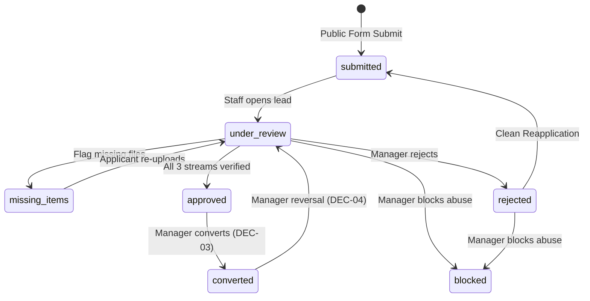
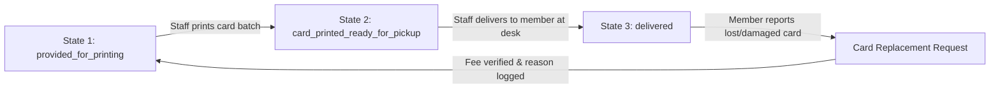

# Lead, Member, and ID Card Status Dictionaries and State Transition Invariants

**Phase:** 01-discovery-decisions-and-acceptance-criteria  
**Plan:** 01-02 (Task 3)  
**Status:** Approved Lifecycle Specification  
**Governing Documents:** [Docs/emk-membership-crm-plan-revision-10.md](file:///d:/EMK_Protal/Docs/emk-membership-crm-plan-revision-10.md) (Sections 5, 6, 7, 9), [.planning/PROJECT.md](file:///d:/EMK_Protal/.planning/PROJECT.md)  
**Governing Decisions:** DEC-03 (D-03), DEC-04 (D-04), DEC-08 (D-08), DEC-11 (D-11), DISC-03

---

## 1. Overview & Lifecycle Scope

This document specifies the definitive lifecycle state machines, allowed status transitions, transition guard conditions, atomic conversion protocols, reversal procedures, and ID card tracking for the EMK Membership CRM.

It fulfills **DISC-03**, implements the Conversion Reversal Protocol per **DEC-04 (D-04)**, establishes dynamic expiry and database-configurable terms per **DEC-08 (D-08)**, and enforces audit trail immutability per **DEC-11 (D-11)**.

The lifecycles specified herein encompass:
1. **Lead Lifecycle:** Public submission to review, missing items, approval, rejection, blocking, and conversion.
2. **Atomic Lead-to-Member Conversion:** 10-step transactional conversion invariant.
3. **Conversion Reversal Protocol:** Time-bounded, auditable rollback mechanism.
4. **Member Status Lifecycle:** Active, Inactive, Restricted, Revoked states.
5. **Membership Terms & Renewal Lifecycle:** Dynamic term configuration, early/late renewal rules.
6. **ID Card Issuance Lifecycle:** 3-stage physical plastic card issuance and replacement workflow.

---

## 2. Lead Status Dictionary & State Transitions

### 2.1 Lead Status Dictionary

| Status Key | Display Name | Category | Description |
|---|---|---|---|
| `draft` | Draft | Inactive | Incomplete public form submission stored in client local storage / session. |
| `submitted` | Submitted | Active Review | Form submitted and validated; Lead record created; awaiting staff pickup. |
| `under_review` | Under Review | Active Review | Reviewer has opened the record; tri-state verifications are in progress. |
| `missing_items` | Missing Items | Pending Applicant | Staff identified missing/unreadable files; notification sent to applicant. |
| `approved` | Approved | Ready | Tri-State verifications complete; approved by Workspace Manager; awaiting conversion. |
| `converted` | Converted | Terminal (Success) | Member profile generated; Lead is immutable; links to active Member ID. |
| `rejected` | Rejected | Terminal (Closed) | Application declined by Manager with reason code; applicant may reapply. |
| `blocked` | Blocked | Terminal (Sanctioned) | Email flagged by Workspace Manager due to fraud/abuse; prevents reapplication. |

### 2.2 Lead State Transition Matrix



| Current Status (From) | Target Status (To) | Authorized Role | Guard Conditions & Pre-checks | Trigger / Side Effects |
|---|---|---|---|---|
| `[*] (New)` | `submitted` | Public Applicant | All 31 fields pass client & server validation; bKash TxID unique. | Creates Lead in `ws-emk-dhaka` (or Superadmin pool); sends receipt email. |
| `submitted` | `under_review` | Staff / Manager | Lead exists in reviewer's workspace. | Reviewer assigned; verification streams initialized to `pending`. |
| `under_review` | `missing_items` | Staff / Manager | Document or Photo stream flagged with unreadable files or missing consent. | Sends official missing items email with secure upload link; pauses review. |
| `missing_items` | `under_review` | Public Applicant | Applicant uploads requested replacement files via secure token. | Updates files; notifies assigned staff; resets stream to `in_progress`. |
| `under_review` | `approved` | Workspace Manager | All 3 Tri-State streams status == `verified` (Payment, Document, Photo). | Enables "Convert to Member" action button in Manager dashboard. |
| `approved` | `converted` | Workspace Manager | `ConversionAllowed == true` (DEC-03); DB lock on Lead. | Executes 10-step atomic conversion transaction; creates Member & ID card. |
| `under_review` | `rejected` | Workspace Manager | Minimum one stream rejected or application invalid; reason code mandatory. | Records rejection code; notifies applicant; preserves history on timeline. |
| `rejected` | `submitted` | Public Applicant | Reapplying with clean form; applicant email not blocked. | Creates new Lead record; links previous rejected Lead on staff timeline. |
| `under_review` / `rejected` | `blocked` | Workspace Manager | Confirmed abusive submissions, forged receipts, or harassment. | Enters email into workspace blocklist; aborts all pending submissions. |
| `converted` | `under_review` | Workspace Manager | **DEC-04 Reversal:** within 30 days of conversion; no subsequent activity. | Reverses Member record; voids invoice; rolls back Lead to `under_review`. |

### 2.3 Reapplication and Blocking Protocol
- **Clean Reapplication:** Rejection does not permanently ban an applicant. Applicants may submit a new 31-field form with a fresh bKash Transaction ID.
- **Historical Visibility:** When reviewing staff open a reapplication, the CRM automatically surfaces a **Previous Application History Banner** displaying the past submission dates, reviewing staff, and specific rejection reason codes.
- **Abuse Prevention:** If an applicant repeatedly submits fraudulent transaction IDs or abusive files, the Workspace Manager can transition the status to `blocked`. Any subsequent attempt to submit an application with that email is rejected at the submission boundary.

---

## 3. Atomic Lead-to-Member Conversion Protocol

### 3.1 Conversion Invariant & Authority
Lead-to-Member conversion is an irreversible (except via formal DEC-04 reversal), legally binding administrative action. It can be triggered **exclusively by a Workspace Manager** (or Superadmin) within the assigned workspace.

Per **DEC-03 (D-03)**, the conversion transaction strictly enforces that Payment, Document, and Photo streams are all `verified` and the Lead status is `approved`.

### 3.2 The 10-Step Transactional Execution Sequence
The entire conversion executes inside a single database transaction (`DB::transaction` with pessimistic locking `lockForUpdate` on the Lead record):

1. **Verify Invariants:** Confirm `isConversionAllowed($lead) === true`. Assert no active Member already exists for `lead.email`.
2. **Assign Member ID:** Generate formatted alphanumeric Member ID according to Section 4 (e.g., `EMK-2026-00001`).
3. **Instantiate Member Record:** Copy verified applicant demographic, address, contact, and professional fields into the `members` table.
4. **Calculate Dynamic Dates (DEC-08):**
   - `membership_start_date` = Current timestamp of Manager approval (`now()`).
   - `membership_end_date` = `membership_start_date + duration_months` of the selected `membership_terms` record.
5. **Secure Document Re-association:**
   - Move or re-associate uploaded private documents and studio photo to the member's private directory: `/storage/app/private/members/{member_uuid}/`.
   - Maintain original filenames in metadata while securing storage paths under cryptographically generated hashes.
6. **Generate Post-Conversion Invoice:**
   - Create record in `invoices` table with status `paid`.
   - Record bKash Transaction ID, verified amount (BDT), payment date, and invoice number (`INV-{YEAR}-{SEQ}`).
7. **Create ID Card Record:**
   - Create initial record in `id_cards` table in state `provided_for_printing` linked to the new Member ID and photo path.
8. **Update Lead Status:**
   - Transition Lead status from `approved` to `converted`. Set `converted_member_id` foreign key.
9. **Dispatch Portal Welcome Notification:**
   - Queue background job via Laravel Horizon to dispatch welcome email with portal activation link and temporary password credential setup.
10. **Emit Immutable Audit Log Entry (DEC-11):**
    - Record `conversion_completed` event in `audit_logs` capturing Manager ID, Lead ID, Member ID, timestamp, and verification snapshot.

---

## 4. Member ID Format and Generation Scheme

### 4.1 Structural Pattern
Member IDs are standardized across all American Spaces using the following composite structure:

$$\mathbf{\{SPACE\_CODE\}-\{YEAR\}-\{5\_DIGIT\_SEQ\}}$$

Example for EMK Center Dhaka in the year 2026:
$$\mathbf{EMK-2026-00001}$$

### 4.2 Field Components
- `SPACE_CODE`: 3-character uppercase alphanumeric identifier of the American Space:
  - `EMK`: EMK Center Dhaka
  - `AMC`: American Center Dhaka
  - `BAR`: Barishal Corner
  - `CTG`: Chattogram Corner
  - `RAJ`: Rajshahi Corner
  - `SYL`: Sylhet Corner
- `YEAR`: 4-digit calendar year of initial conversion (e.g., `2026`). The year remains fixed for the lifetime of that member, preserving historical cohort tracking through renewals.
- `5_DIGIT_SEQ`: 5-digit zero-padded monotonic sequence number (from `00001` to `99999`), scoped per Space and Year. Sequences are generated using an atomic sequence table with row-level locking to guarantee no collisions or gaps under concurrent approvals.

---

## 5. Conversion Reversal Protocol (DEC-04 / D-04)

### 5.1 Business Purpose & Authority
To recover from operational errors (e.g., wrong applicant approved in error, fraudulent bKash chargeback discovered immediately after approval, or mistaken identity match), a **Workspace Manager** possesses authorized authority to execute a **Conversion Reversal**.

### 5.2 Mandatory Safeguards & Prerequisites
A conversion reversal is restricted by the following automated system guards:
1. **Time Window Guard:** Reversal can only be performed within **30 calendar days** of the original conversion date. After 30 days, reversal is permanently disabled.
2. **Transaction Guard:** Member must have zero subsequent invoices, renewal records, or administrative transactions. If subsequent transactions exist, reversal is prohibited.
3. **Mandatory Reason String:** The Manager must input a detailed justification string of **at least 20 characters**.
4. **Two-Factor Manager Confirmation:** The Manager must explicitly re-enter their administrative password or complete 2FA to confirm the reversal.

### 5.3 Transactional Rollback Actions
When confirmed, the system executes the following atomic rollback:
1. **Member Record:** Status updated to `archived_reversed`. Portal access login disabled immediately (`login_enabled = false`). Active sessions invalidated.
2. **Invoices:** Associated post-conversion invoice marked `void_reversed` with reason noted.
3. **ID Card:** Any pending or printed card in `id_cards` marked `voided_reversal`.
4. **Lead Record:** Status rolled back from `converted` to `under_review`. Verification states preserved for re-inspection.
5. **Immutable Audit Event:** Audit log records `conversion_reversed` with actor ID, timestamp, justification text, prior state snapshot, and rolled-back entities.

---

## 6. Member Status Dictionary & Administrative Controls

### 6.1 Member Status Dictionary

| Status Key | Display Name | Access Status | Description |
|---|---|---|---|
| `active` | Active | Granted | Membership is current; expiration date is in the future; full portal and facility access. |
| `inactive` | Inactive (Expired) | Suspended | Expiration date has passed without approved renewal; portal access locked to renewal page only. |
| `restricted` | Restricted | Suspended | Temporarily suspended by Global Admin / Superadmin due to disciplinary or policy investigation. |
| `revoked` | Revoked | Terminated | Permanently terminated by Superadmin per formal EMK management instruction. |

### 6.2 Administrative Restrictions & Revocations
- **Self-Cancellation Prohibited:** Members have no portal action to cancel or deactivate their membership.
- **Administrative Authority:** Only a **Global Admin or Superadmin** can transition a member to `restricted` or `revoked`. Workspace Managers cannot unilaterally revoke memberships.
- **Formal Instruction Required:** Admin must record a formal EMK Management Directive reference code and detailed explanation before executing a restriction or revocation.
- **System Reactions:**
  - `restricted`: Member portal displays notice: *"Your membership account is currently under administrative review. Please contact the EMK Center front desk."*
  - `revoked`: Member portal displays: *"This membership account has been terminated."* All facility check-in privileges are invalidated.

---

## 7. Configurable Membership Terms and Renewal Lifecycle

### 7.1 Database-Configurable Terms Schema (DEC-08 / D-08)
Membership terms and fee structures are managed as dynamic database records in the `membership_terms` table:

```sql
CREATE TABLE membership_terms (
    id BIGINT UNSIGNED AUTO_INCREMENT PRIMARY KEY,
    workspace_id VARCHAR(50) NOT NULL,
    name VARCHAR(100) NOT NULL,            -- e.g., 'Standard 1-Year Membership'
    code VARCHAR(50) NOT NULL,            -- e.g., 'term_standard_1yr'
    duration_months INT UNSIGNED NOT NULL, -- e.g., 12
    fee_bdt DECIMAL(10,2) NOT NULL,       -- e.g., 1000.00
    is_active BOOLEAN DEFAULT TRUE,
    created_at TIMESTAMP,
    updated_at TIMESTAMP
);
```
*Note:* The system strictly prohibits hard-coded two-year defaults or static prices.

### 7.2 Renewal Lifecycle Protocol
1. **Renewal Window:**
   - Opens automatically **30 calendar days** prior to `membership_end_date`.
   - Automated notification email dispatched to member: *"Your EMK Center membership expires on [Date]. Click here to renew."*
   - Member portal displays renewal banner with term selection and bKash payment instructions.
2. **Simplified Renewal Submission:**
   - Members do **not** re-submit the 31-field application form.
   - Portal renewal form requires only:
     1. Desired Term selection from active `membership_terms`.
     2. New 10-character bKash Transaction ID.
3. **Early Renewal Calculation:**
   - If renewed prior to expiration (during the 30-day window):
   - The new term duration is appended to the *existing expiration date*:
     $$\text{New End Date} = \text{Current End Date} + \text{Term Duration}$$
   - No membership days are lost due to early payment.
4. **Late Renewal (Post-Expiration):**
   - If membership has already transitioned to `inactive` (expired):
   - Renewal requires Workspace Manager payment verification.
   - The new membership start date begins on the **Manager Approval Date**:
     $$\text{New End Date} = \text{Approval Date} + \text{Term Duration}$$

---

## 8. ID Card Issuance Lifecycle (3 Sequential States)

To manage physical PVC plastic identification card manufacturing, batching, and physical collection, every Member record tracks an associated ID card through three sequential states:



### 8.1 Sequential Card States

| State # | State Key | Display Name | Trigger & Operational Meaning |
|---|---|---|---|
| **State 1** | `provided_for_printing` | Provided for Printing | Created automatically upon Lead-to-Member conversion or replacement approval. Card details (Name, Member ID, Photo, Expiry) queued in printing batch. |
| **State 2** | `card_printed_ready_for_pickup` | Card Printed & Ready for Pickup | Front desk staff prints PVC badge, inspects quality, and checks the card into the pickup drawer. **Automatically triggers notification email to Member**: *"Your EMK Center membership card is ready for collection at the front desk."* |
| **State 3** | `delivered` | Delivered | Member visits front desk. Staff verifies recipient identity, logs collection timestamp, and records staff user ID. Card is officially marked delivered. |

### 8.2 Card Replacement Workflow
1. If a member loses or damages their card, they submit a Replacement Request via portal or front desk.
2. Staff logs mandatory `replacement_reason` (e.g., `LOST_CARD`, `DAMAGED_CARD`, `NAME_CHANGE`).
3. If a card replacement fee is configured in `membership_terms` (e.g., 200 BDT), bKash TxID is verified by Manager.
4. Upon approval, prior card record is transitioned to `superseded_replaced`.
5. A new ID card record is instantiated in State 1 (`provided_for_printing`), restarting the issuance cycle.

---

## 9. Downstream Phase Binding

- **Phase 2 (Architecture):** Implements `lead_status`, `member_status`, `id_card_status` enums, transition invariants, and database triggers.
- **Phase 6 (Leads CRM):** Implements the Lead state machine, review queues, and atomic conversion transaction service.
- **Phase 7 (Members & ID Cards):** Implements the Member profile lifecycle, expiry scheduler, and 3-stage ID card management desk.
- **Phase 9 (Member Portal):** Implements the renewal request modal and read-only status displays.
