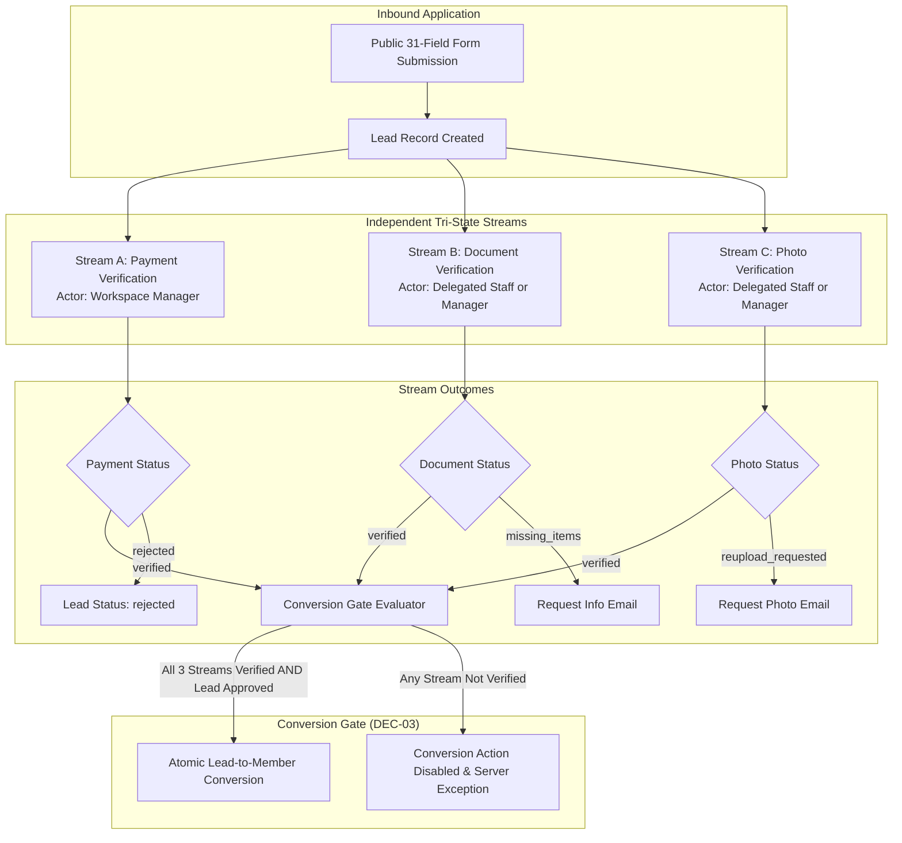

# Tri-State Verification Protocol, Evidence Schemas, and Conversion Invariants

**Phase:** 01-discovery-decisions-and-acceptance-criteria  
**Plan:** 01-02 (Task 2)  
**Status:** Approved Verification Specification  
**Governing Documents:** [Docs/emk-membership-crm-plan-revision-10.md](file:///d:/EMK_Protal/Docs/emk-membership-crm-plan-revision-10.md) (Section 5, Section 6, Section 9), [.planning/PROJECT.md](file:///d:/EMK_Protal/.planning/PROJECT.md)  
**Governing Decisions:** DEC-03 (D-03), DEC-05 (D-05), DEC-09 (D-09), DISC-03

---

## 1. Overview & Architectural Intent

In accordance with requirement **DISC-03** and architectural decision **DEC-03 (D-03)**, the EMK Membership CRM decouples the application verification workflow into three independent, concurrent review streams:
1. **Stream A: Payment Verification**
2. **Stream B: Document Verification**
3. **Stream C: Photo Verification**

This independent Tri-State verification model ensures that different staff members or managers can review payment receipts, personal identification papers, and badge studio photos asynchronously without blocking one another.

However, all three streams converge at the **Atomic Lead-to-Member Conversion Gate**. Conversion into an active Member is strictly prohibited until every single verification stream has achieved a verified status.

---

## 2. Tri-State Verification Architecture Overview



---

## 3. Stream A: Payment Verification Protocol

### 3.1 Purpose & Authority
Verifies that the applicant has deposited the correct membership registration fee into the EMK Center bKash merchant account using the declared 10-character bKash Transaction ID.
- **Reviewer Authority:** **Workspace Manager** only (or Superadmin). Delegated staff cannot approve or reject payments.
- **Review Protocol:** Manual reconciliation against the official bKash Merchant Portal / statement. Per **DEC-05 (D-05)**, no redundant second-person review is required.

### 3.2 State Dictionary
- `pending`: Default initial state upon form submission.
- `in_progress`: Workspace Manager is actively inspecting the merchant portal.
- `verified`: Transaction confirmed in bKash statement; fee amount matches configured term fee.
- `rejected`: Transaction ID does not exist, amount is insufficient, or ID is a fraudulent duplicate.

### 3.3 Duplicate TxID Pre-Check Guard
Before review, the system runs an automated database check on `bkash_txid`:
- If `bkash_txid` already exists in `leads` (any status) or `invoices.payment_reference`:
  - Review panel displays an urgent warning: `[WARNING: DUPLICATE bKash TXID DETECTED in Lead #... / Member #...]`.
  - Default review action is set to `rejected` with reason code `DUPLICATE_TXID`.

### 3.4 Payment Evidence Schema
When Payment Verification is transitioned, the following payload is stored in `lead_verifications` (type: `payment`):

```json
{
  "stream": "payment",
  "status": "verified",
  "verified_by_user_id": "usr_01h9manager",
  "verified_at": "2026-11-03T15:10:00Z",
  "bkash_txid": "BLK7X9Q12M",
  "amount_received_bdt": 1000.00,
  "expected_amount_bdt": 1000.00,
  "payment_method": "bkash_manual",
  "merchant_statement_date": "2026-11-03",
  "payment_verification_notes": "Confirmed in bKash Merchant statement. Sender mobile +8801712345678.",
  "rejection_reason_code": null,
  "rejection_notes": null
}
```

---

## 4. Stream B: Document Verification Protocol

### 4.1 Purpose & Authority
Verifies applicant identity authenticity, consistency with submitted form data (Name, Date of Birth, Sex), and mandatory parental/guardian consent if the applicant is under 18 years old per **DEC-09 (D-09)**.
- **Reviewer Authority:** Delegated Staff (with `leads.verify_documents` permission) or Workspace Manager.

### 4.2 State Dictionary
- `pending`: Default initial state.
- `in_progress`: Staff is examining uploaded document files.
- `verified`: Identity document is clear, valid, unexpired, matches submitted name and DOB; and parental consent is confirmed if under 18.
- `missing_items`: Uploaded document is unreadable, blurred, cropped, or missing the guardian consent form. Does not reject application; pauses review to request re-upload.
- `rejected`: Document is confirmed fraudulent, belongs to another individual, or identity cannot be substantiated.

### 4.3 Missing Items Communication Protocol
If set to `missing_items`:
1. Reviewer checks specific missing elements (e.g., `["NID Back Side Missing", "Parental Consent Signature Missing"]`).
2. System queues official Information Desk email template to applicant specifying required documents.
3. Lead status transitions to `missing_items`.
4. Applicant receives upload token allowing submission of replacement files without creating a new lead or paying a new fee.

### 4.4 Document Evidence Schema

```json
{
  "stream": "document",
  "status": "verified",
  "verified_by_user_id": "usr_01h9staff",
  "verified_at": "2026-11-03T15:20:00Z",
  "id_document_type": "national_id",
  "id_document_number": "19951234567890123",
  "name_matches_form": true,
  "dob_matches_form": true,
  "under_18_consent_required": true,
  "under_18_consent_verified": true,
  "guardian_name": "Ayesha Begum",
  "guardian_contact_phone": "+8801798765432",
  "document_verification_notes": "NID front and back verified. Parental consent form verified and signed by mother.",
  "missing_items_list": [],
  "rejection_reason_code": null
}
```

---

## 5. Stream C: Photo Verification Protocol

### 5.1 Purpose & Authority
Verifies that the uploaded photo complies strictly with the studio passport specification required for physical PVC membership card printing (Phase 7).
- **Reviewer Authority:** Delegated Staff (with `leads.verify_photos` permission) or Workspace Manager.

### 5.2 State Dictionary
- `pending`: Default initial state.
- `in_progress`: Staff inspecting photo against badge standards.
- `verified`: Photo satisfies all 5 mandatory compliance checklist items.
- `reupload_requested`: Photo is a selfie, has coloured/patterned background, or has visible glasses. Prompts applicant to upload compliant studio photo.
- `rejected`: Inappropriate content or confirmed impersonation.

### 5.3 Mandatory 5-Point Compliance Checklist
Staff must individually evaluate and check each of the 5 criteria:
1. `white_background` (Pass/Fail): Plain solid white background. No textures, outdoor scenes, shadows, or coloured walls.
2. `no_glasses` (Pass/Fail): No eyeglasses, sunglasses, or glare.
3. `ears_visible` (Pass/Fail): Both ears clearly visible (hair tucked back; religious headwear allows face oval).
4. `regular_attire` (Pass/Fail): Standard professional or everyday attire.
5. `no_selfie` (Pass/Fail): Portrait shot taken from direct frontal angle; no handheld perspective, tilt, or filters.

### 5.4 Photo Evidence Schema

```json
{
  "stream": "photo",
  "status": "verified",
  "verified_by_user_id": "usr_01h9staff",
  "verified_at": "2026-11-03T15:25:00Z",
  "compliance_checklist": {
    "white_background": true,
    "no_glasses": true,
    "ears_visible": true,
    "regular_attire": true,
    "no_selfie": true
  },
  "dimensions": {
    "width_px": 600,
    "height_px": 600
  },
  "photo_verification_notes": "Studio quality passport photo approved for plastic badge printing.",
  "reupload_reason": null,
  "rejection_reason_code": null
}
```

---

## 6. The Atomic Conversion Gating Invariant (DEC-03 / D-03)

### 6.1 Formal Invariant Formula
A Lead cannot be converted into a Member unless the following Boolean expression evaluates to `true`:

$$\text{ConversionAllowed} = (\text{Payment} = \text{'verified'}) \land (\text{Document} = \text{'verified'}) \land (\text{Photo} = \text{'verified'}) \land (\text{Lead} = \text{'approved'})$$

In code specification:
```php
public function isConversionAllowed(Lead $lead): bool
{
    return $lead->payment_verification_status === VerificationStatus::VERIFIED
        && $lead->document_verification_status === VerificationStatus::VERIFIED
        && $lead->photo_verification_status === VerificationStatus::VERIFIED
        && $lead->status === LeadStatus::APPROVED;
}
```

### 6.2 Multi-Layer Invariant Enforcement
1. **UI Layer (Livewire):** The "Convert to Member" button is disabled and greyed out with an explanatory tooltip (`"All 3 verifications (Payment, Document, Photo) and Manager Approval must be verified to convert"`) whenever `ConversionAllowed === false`.
2. **Domain Service Layer:** The conversion service asserts `isConversionAllowed($lead)` inside the database transaction:
   ```php
   if (!$this->isConversionAllowed($lead)) {
       throw new UnmetConversionInvariantException(
           "Cannot convert Lead #{$lead->id}: Verification streams incomplete."
       );
   }
   ```
3. **Database Constraint:** Triggers and foreign key constraints prevent Member creation without an approved, verified Lead origin reference.

---

## 7. Standardized Rejection Reason Taxonomy

When a stream or the overall lead is rejected, reviewers must choose from this standardized taxonomy. This prevents vague free-text notes and ensures applicants receive clear, actionable feedback.

| Stream | Rejection Code | Description | Applicant-Facing Notification Text |
|---|---|---|---|
| **Payment** | `INVALID_TXID` | TxID does not exist in bKash network | *"The provided bKash Transaction ID could not be found in our merchant portal records."* |
| **Payment** | `AMOUNT_MISMATCH` | Paid amount does not match term fee | *"The deposited amount does not match the required membership fee."* |
| **Payment** | `DUPLICATE_TXID` | TxID already used on another lead/invoice | *"This bKash Transaction ID has already been recorded for another membership application."* |
| **Payment** | `TRANSACTION_NOT_FOUND` | Merchant record not located within 72 hrs | *"We could not verify the transaction with bKash within the review period."* |
| **Document** | `DOCUMENT_UNREADABLE` | File blurry, cropped, or illegible | *"The uploaded identity document is unreadable or blurry. Please provide a clear scan."* |
| **Document** | `EXPIRED_ID` | Identity credential has expired | *"The submitted identity document has expired. Please provide a valid, current ID."* |
| **Document** | `NAME_MISMATCH` | Name on ID differs from application form | *"The name on the identity document does not match the name entered in the application form."* |
| **Document** | `MISSING_GUARDIAN_CONSENT` | Minor applicant missing signed consent | *"Applicants under 18 years of age must upload a signed Parental/Guardian Consent Form."* |
| **Photo** | `NON_COMPLIANT_BACKGROUND` | Background is coloured, patterned, or textured | *"Photo background must be plain, solid white."* |
| **Photo** | `SELFIE_DETECTED` | Casual selfie, tilted angle, or filter | *"Selfies and filtered photos cannot be accepted. Please provide a formal studio passport photo."* |
| **Photo** | `GLASSES_OBSCURING_FACE` | Eyeglasses or sunglasses present | *"Eyeglasses and sunglasses must be removed for membership card photos."* |
| **Photo** | `EARS_COVERED` | Ears obscured by hair or headwear | *"Both ears must be clearly visible for identity verification."* |
| **Photo** | `LOW_RESOLUTION` | Image resolution below 300x300 or pixelated | *"The photo resolution is too low for badge printing. Please upload a high-resolution image."* |

---

## 8. Downstream Phase Binding

- **Phase 2 (Architecture & Security):** Implements `lead_verifications` table schema, composite foreign keys, and `UnmetConversionInvariantException`.
- **Phase 6 (Leads CRM):** Implements the tri-state tabbed UI, checkbox checklists, and the guarded conversion action button.
- **Phase 8 (Official Email):** Binds rejection reason codes to email template merge variables.
