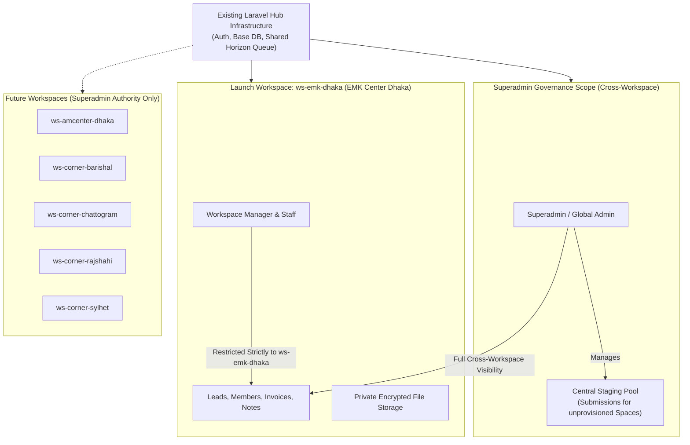

# Workspace-to-Space Mapping Baseline and Tenancy Isolation Contract

**Phase:** 01-discovery-decisions-and-acceptance-criteria  
**Plan:** 01-01  
**Status:** Approved Baseline  
**Governing Documents:** [Docs/emk-membership-crm-plan-revision-10.md](file:///d:/EMK_Protal/Docs/emk-membership-crm-plan-revision-10.md) (Sections 2, 4 & 9), [.planning/PROJECT.md](file:///d:/EMK_Protal/.planning/PROJECT.md)

---

## 1. Launch Tenancy Architecture

In accordance with DISC-02 and DEC-01 (D-01), the EMK Membership CRM operates as a multi-workspace platform natively embedded inside the existing Laravel Hub web application.

Rather than running independent distributed microservices or separate database instances per office, multi-tenancy is structured around logical **Workspaces** sharing the Hub core infrastructure while strictly isolating all CRM domain records, staff access, file assets, and operational workflows.

### Pilot Launch Workspace
- **Workspace Identifier:** `ws-emk-dhaka`
- **Associated Space:** EMK Center Dhaka (`EMK-DHK`)
- **Status:** Active / Production Launch
- **Deployment Strategy:** Initial active operational workspace. All other American Spaces route to a Superadmin staging pool until dedicated workspaces are provisioned by Superadmin.



---

## 2. The Six American Spaces Directory

The platform recognizes all six officially designated American Spaces across Bangladesh. The directory establishes standard codes, entity classifications, and workspace binding status:

| # | Space Name | Space Code | Category | Division | District | Launch Workspace ID | Initial Routing Target |
|---|---|---|---|---|---|---|---|
| **1** | American Center Dhaka | `AC-DHK` | Center | Dhaka | Dhaka | *(Pending Superadmin Provisioning)* | Superadmin Central Staging Pool |
| **2** | **EMK Center Dhaka** | `EMK-DHK` | **Center** | **Dhaka** | **Dhaka** | **`ws-emk-dhaka`** | **Launch Workspace (`ws-emk-dhaka`)** |
| **3** | Barishal American Corner | `CR-BAR` | Corner | Barishal | Barishal | *(Pending Superadmin Provisioning)* | Superadmin Central Staging Pool |
| **4** | Chattogram American Corner | `CR-CTG` | Corner | Chattogram | Chattogram | *(Pending Superadmin Provisioning)* | Superadmin Central Staging Pool |
| **5** | Rajshahi American Corner | `CR-RAJ` | Corner | Rajshahi | Rajshahi | *(Pending Superadmin Provisioning)* | Superadmin Central Staging Pool |
| **6** | Sylhet American Corner | `CR-SYL` | Corner | Sylhet | Sylhet | *(Pending Superadmin Provisioning)* | Superadmin Central Staging Pool |

---

## 3. Application Routing and Submission Staging Rules

### Public Form American Spaces Dropdown
1. The public membership application form displays all six American Spaces as choices in Field #4 (`american_spaces`), matching official public requirements.
2. **EMK Center Dhaka Submissions:** When an applicant selects "EMK Center Dhaka", the ingestion engine directly assigns `workspace_id = 'ws-emk-dhaka'`, immediately routing the resulting Lead to the EMK Center staff queue.
3. **Other American Spaces Submissions:** When an applicant selects any of the other five Spaces (American Center Dhaka, Barishal, Chattogram, Rajshahi, Sylhet), the ingestion engine tags the record with `workspace_id = NULL` (or `staging`) and sets `target_space_code` to the selected Space code.
4. **Staging Pool Administration:** These staging submissions are visible and manageable exclusively by Global Admin and Superadmin roles. Workspace Managers and staff at `ws-emk-dhaka` have zero visibility into other Spaces' applications.
5. **Future Workspace Provisioning:** The authority to create new workspaces and reassign staging leads to newly provisioned workspaces is exclusively reserved for the Superadmin role (GAP-P1-01 / DEC-01).

---

## 4. Server-Side Tenancy Isolation Contract

To prevent information disclosure, lateral privilege escalation, and cross-office data contamination, workspace isolation is enforced **server-side** at multiple defensive layers:

```
[ Incoming Request / Livewire Action ]
               │
               ▼
   [ Layer 1: Middleware Guard ]
      - Validates authenticated user has active workspace binding
      - Rejects mismatch between route {workspace} and user workspace
               │
               ▼
   [ Layer 2: Livewire Hydration Guard ]
      - Re-evaluates workspace authorization on every Livewire cycle
      - Strips or validates client-injected model IDs
               │
               ▼
   [ Layer 3: Eloquent Global Scope ]
      - Forces: WHERE workspace_id = auth()->user()->workspace_id
      - Applies automatically to Leads, Members, Invoices, Notes, Audits
               │
               ▼
   [ Layer 4: Storage & Export Barrier ]
      - File paths namespaced by workspace UUID
      - CSV/Excel export queries bounded by tenant scope
```

### Invariant Isolation Rules

1. **Eloquent Global Scope Enforcement:**
   - All tenant-owned domain models (`Lead`, `Member`, `Invoice`, `LeadVerification`, `ActivityNote`, and `AuditLog`) MUST implement a tenant global scope (e.g., `TenantScope` / `BelongsToWorkspace`).
   - For all non-Superadmin authenticated queries, the database engine enforces:
     ```php
     static::addGlobalScope('workspace', function (Builder $builder) {
         if (auth()->check() && !auth()->user()->isSuperAdmin()) {
             $builder->where('workspace_id', auth()->user()->workspace_id);
         }
     });
     ```
   - Raw SQL queries or bypasses using `withoutGlobalScope` are strictly prohibited in application controllers, Livewire components, and reports.

2. **Route and Livewire Parameter Tampering Defense:**
   - Any URL parameter or route prefix specifying a workspace (e.g., `/crm/{workspace}/leads/{id}`) must be validated in an authorization middleware:
     ```php
     if (!auth()->user()->isSuperAdmin() && $request->route('workspace') !== auth()->user()->workspace_id) {
         abort(403, 'Unauthorized workspace access.');
     }
     ```
   - Livewire component properties (`$leadId`, `$memberId`) are validated during component hydration to confirm that the requested entity belongs to the user's active `workspace_id`. Tampering triggers an immediate HTTP `403 Forbidden` response without disclosing whether the targeted record exists in another workspace.

3. **Workspace Discovery Prevention:**
   - Tenant discovery is disabled. Center staff and Workspace Managers have zero administrative visibility into other active or pending workspaces.
   - Any UI workspace switcher or dropdown displays only the single workspace assigned to the staff user. Only Superadmin accounts receive multi-workspace selection options.

4. **Data Export & Reporting Isolation:**
   - Export actions (CSV and Excel downloads) execute strictly within the active workspace filter.
   - Workspace staff cannot export aggregated multi-center metrics or cross-workspace lead records.
   - All export actions are recorded in the immutable audit log with tenant metadata.

5. **Private Document Storage Namespacing:**
   - Uploaded applicant identity credentials, student certificates, and studio portrait photos are stored on a private, non-public storage disk.
   - Disk directories are organized using isolated tenant namespaces:
     ```
     storage/app/private/workspaces/{workspace_id}/leads/{lead_uuid}/
     storage/app/private/workspaces/{workspace_id}/members/{member_uuid}/
     ```
   - Serving files requires passing through a controller action that verifies `workspace_id` ownership before streaming file contents.

---

## 5. Superadmin Governance and Multi-Space Expansion

1. **Superadmin Reservation:** The Superadmin retains exclusive rights to:
   - Provision new workspaces for American Center Dhaka and the Corners in Barishal, Chattogram, Rajshahi, and Sylhet.
   - Assign Workspace Managers to newly provisioned workspaces.
   - Drain or migrate records from the Central Staging Pool into newly provisioned workspaces.
   - Access unified cross-workspace analytics, audit logs, and compliance reporting.
2. **Decoupled Architecture:** Downstream implementation (Phase 2 Data Architecture and Phase 4 Identity) must define schema relationships where `spaces` and `workspaces` are distinct relational entities, allowing 1:1 or 1:N flexibility when the Superadmin activates additional American Spaces.
