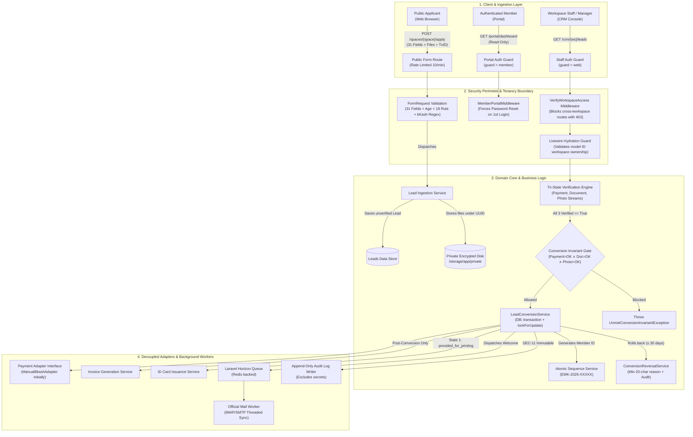
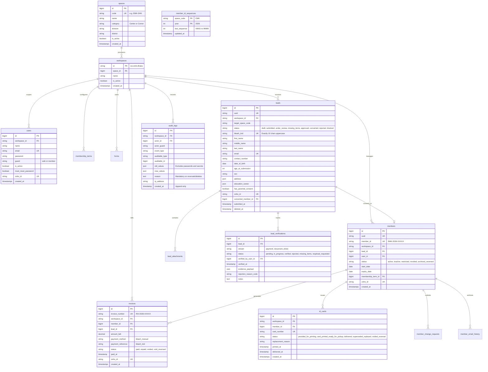
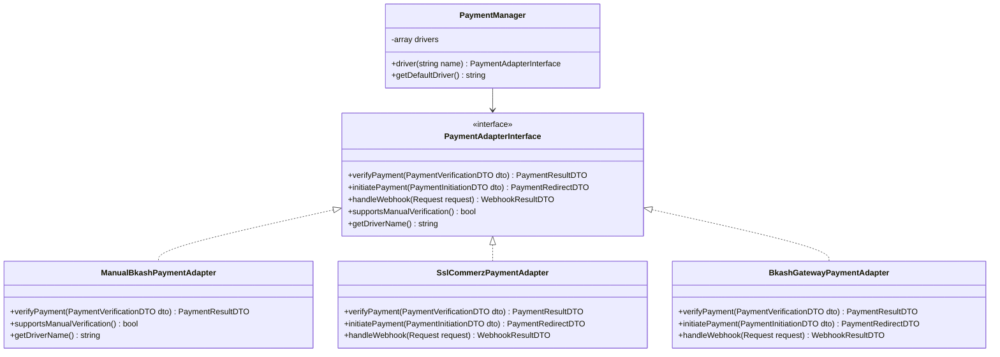

# Phase 02: Architecture, Data Model, and Security Design - Technical Research

**Researched:** 2026-11-03  
**Domain:** Enterprise Modular Architecture, Relational Multi-Tenant Data Modeling, Security Invariant Design, and Decoupled Payment Adapters for Laravel 12  
**Confidence:** HIGH  

---

## Summary

This research establishes the comprehensive technical blueprint and implementation specifications required to plan and execute **Phase 2: Architecture, Data Model, and Security Design**. Phase 2 transitions the governance boundaries, field dictionaries, and acceptance scenarios established in Phase 1 into concrete software architecture contracts, strict MySQL relational schemas, deterministic domain invariants, and threat mitigations.

The platform architecture is structured as a modular monolith embedded natively within the existing Laravel 12 Hub application. It strictly enforces multi-workspace isolation launching with EMK Center Dhaka (`ws-emk-dhaka`). To prevent the security vulnerabilities inherent in dynamic code evaluation and ad-hoc plugin architectures, all capabilities are partitioned across exactly eight core modules registering 38 immutable declared actions in a central registry. Tenancy scoping is enforced defensively across four server-side layers: route middleware, Livewire hydration inspection, Eloquent global query scoping, and private filesystem namespacing.

At the core of the business domain, the lead-to-member lifecycle is governed by an unyielding **Tri-State Verification Barrier** and an **Atomic 10-Step Conversion Transaction** with pessimistic row-level locking. Under no circumstances may an application convert to a member without verified payment, document, and photo streams. Erroneous conversions are safeguarded by a time-bounded (30-day), highly audited **Conversion Reversal Protocol**. Furthermore, to decouple the domain from current manual bKash operations while ensuring seamless future migration to payment gateways (SSLCommerz or direct bKash APIs), a clean **Replaceable Payment Adapter Boundary** is designed.

**Primary recommendation:** Formalize Phase 2 as an immutable architectural contract consisting of typed schema migrations, interface contracts, service-layer invariants, and Pest architecture tests before initiating foundational application bootstrapping in Phase 3.

---

## Architectural Responsibility Map

| Capability | Primary Tier | Secondary Tier | Rationale |
|---|---|---|---|
| **Multi-Workspace Tenancy Guard** | API / Backend (Eloquent Scope & Middleware) | Client (Livewire Hydration Guard) | Tenancy isolation must be unconditionally enforced at the database query and routing level; client-side checks prevent UI tampering but cannot be trusted alone. |
| **Central Module Registry & Actions** | API / Backend (Service Provider & Singleton) | — | Module definitions, declared actions, and non-delegable allowlists are static application structures compiled into application memory. |
| **Tri-State Verification Gate** | API / Backend (Domain Service Invariant) | Client (Livewire UI Controls) | Conversion gating requires transactional guarantees (`lockForUpdate`); UI disables the action button, but backend asserts the boolean condition. |
| **Atomic Lead-to-Member Conversion** | API / Backend (Database Transaction) | Storage (Private Disk Moving) | Requires row-level pessimistic locking, relational integrity across 6 tables, sequence incrementation, and private document re-association. |
| **Conversion Reversal Rollback** | API / Backend (Domain Service Transaction) | Queue (Session Eviction) | Rolls back member status, voids invoices, cancels cards, and restores lead review state inside an atomic transaction. |
| **Replaceable Payment Adapter** | API / Backend (Driver Pattern Service) | External Gateway / Provider | Decouples Lead, Member, and Invoice domain models from underlying payment providers (manual bKash TxID vs. SSLCommerz/bKash API). |
| **Private Document Storage** | Storage / Filesystem (Private Disk Driver) | API / Backend (Streaming Controller) | Sensitive NID, passport, and minor consent documents are stored outside the public web root under safe UUID hashes and streamed via auth controllers. |
| **Append-Only Immutable Audit Log** | Database / Storage (Append-Only Table) | API / Backend (Event Observers) | Security audit trail must reject UPDATE and DELETE queries at the database trigger level and be written automatically by model observers. |

---

<user_constraints>
## User Constraints (from PROJECT.md & DECISION-REGISTER.md)

### Locked Decisions
- **DEC-01: Multi-Workspace Model**: Launch exclusively with EMK Center Dhaka workspace inside the existing Hub. Managers administer their assigned workspace only. Cross-workspace operations reserved for Admin/Superadmin.
- **DEC-02: Modular Application Architecture**: Modules (Forms, Leads, Members, Member Portal, Invoices, Dashboard/Reports, Platform Services, Migration) register declared actions in a central registry. No arbitrary runtime code loading.
- **DEC-03: Tri-State Verification Invariant**: No conversion of Lead to Member without completed verification of Payment, Documents, and Photo. Invoices generated only post-conversion.
- **DEC-04: Conversion Reversal**: Reversals permitted only with explicit staff authorization, recorded reason, and immutable audit event.
- **DEC-05: Manual bKash Verification**: Managers verify 10-character uppercase bKash transaction ID; duplicate IDs blocked. No second-person review required.
- **DEC-06: Read-Only Member Portal**: Members have read-only access to their profile and communication thread; all edits require audited staff change requests.
- **DEC-07: Dedicated Email Change Workflow**: Email updates require a dedicated request flow routed to the Workspace Manager with email notification.
- **DEC-08: Configurable Membership Terms**: Terms and fees are database records (never hard-coded 2-year defaults); membership start date defaults to Manager approval date.
- **DEC-09: Under-18 Consent Rule**: Enforce mandatory parental/guardian consent upload for applicants under 18 years of age.
- **DEC-10: Replaceable Payment Provider Boundary**: Decouple payment verification via an adapter interface to support manual bKash initially and direct gateway later.
- **DEC-11: Append-Only Immutable Audit Log**: System logs record actor, timestamp, target, and diffs (excluding secrets), read-only even for Admin.

### The Agent's Discretion
- Database schema primary key conventions (ULID vs BigIncrements: use BigIncrements for sequential efficiency, UUID/ULID for public token/storage namespaces).
- Exact Eloquent model relationships, foreign key cascade options, and database indexing strategies.
- Specific design pattern for Central Registry (Singleton registry injected via Laravel Service Provider).
- Specific interface contracts and DTO structures for the Replaceable Payment Adapter.
- Strategy for automated architectural testing (Pest Arch and PHPUnit integration suites).

### Deferred Ideas (OUT OF SCOPE)
- **Direct member self-editing of profile data**: Members have strictly read-only profile views; updates require staff-reviewed change requests.
- **Member portal self-cancellation**: No member cancellation action exists; membership restriction/revocation requires Superadmin authority with formal management directive.
- **Attendance tracking / logging in portal**: Out of scope for membership CRM v1 release.
- **Hard-coded two-year membership terms or fixed fees**: Prohibited; dynamic database records only.
- **Arbitrary runtime code or plugin execution**: Prohibited; central registry with static declared actions only.
- **Storing payment secrets or credentials in database/repository**: Prohibited; deployment-managed environment storage only.
- **Direct online payment checkout in initial release**: Deferred to Phase 12; v1 relies on manual bKash verification via payment adapter.
</user_constraints>

---

<phase_requirements>
## Phase Requirements

| ID | Description | Research Support |
|---|---|---|
| **ARCH-01** | Define modular architecture registry with stable module keys and declared actions (avoiding runtime code loading). | Section 2 details the static 8-module catalog, 38 declared actions, `ModuleRegistry` contract, and zero-eval compilation rules. |
| **ARCH-02** | Design database schema for Spaces, staff users, forms, leads, members, verification states, invoices, ID cards, and audit logs. | Section 3 details the full MySQL 8.4 relational ER schema, column types, foreign keys, unique constraints, and `zoho_id` migration columns. |
| **ARCH-03** | Define atomic conversion transaction invariant requiring complete Payment, Document, and Photo verification. | Section 5 specifies the 10-step atomic transaction, pessimistic row locking (`lockForUpdate`), and Boolean `ConversionAllowed` formula. |
| **ARCH-04** | Specify conversion reversal workflow with mandatory reason capture and immutable audit logging. | Section 5 formalizes the 30-day statutory cutoff, min-20-character reason validation, rollback state cascades, and audit triggers. |
| **ARCH-05** | Design replaceable payment adapter boundary supporting initial manual bKash verification and future payment gateways. | Section 7 provides the `PaymentAdapterInterface`, `PaymentManager`, and `ManualBkashPaymentAdapter` contract architecture. |
| **ARCH-06** | Establish threat model, least-privilege security controls, and encrypted private document storage design. | Section 6 establishes the STRIDE threat analysis, ASVS Level 1 controls, 4-layer tenancy defense, and AES-256 private storage rules. |
</phase_requirements>

---

## Standard Stack

### Core Technologies
| Library / Framework | Version | Purpose | Why Standard |
|---|---|---|---|
| **PHP** | 8.3.36 | Core Language Runtime | Installed and verified in workspace environment; provides typed properties, readonly classes, and native enums. |
| **Laravel Framework** | ^12.0 (`v12.71.0` latest) | Core Web Application Monolith | Required framework stack; robust IoC container, Eloquent ORM, global scopes, database transactions, and queue integration. |
| **Livewire** | ^3.5 (`v3.8.11` / `v4.x` ready) | Reactive Full-Stack UI Engine | Standard stack choice; eliminates frontend API scaffolding while supporting real-time validation and reactive forms. |
| **Spatie Laravel Permission** | ^6.0 / ^8.0 (`8.3.2` latest) | Role-Based Access Control (RBAC) | Industry standard for Laravel RBAC; supports multi-guard (`web` vs `member`), static permission strings, and cached evaluation. |
| **Laravel Horizon** | ^5.0 (`v5.50.1` latest) | Redis Queue Worker Monitoring | Official Laravel queue supervisor; manages email dispatch, document processing, and scheduled tasks with retry safeguards. |
| **MySQL** | 8.4.3 | Relational Data Store | Installed in local Laragon environment (`Ver 8.4.3 for Win64`); supports atomic transactions, row-level locks, and JSON attributes. |

### Supporting Libraries
| Library | Version | Purpose | When to Use |
|---|---|---|---|
| **Tailwind CSS** | ^3.4.17 / ^4.3.4 | Utility-First Styling | Client UI styling for public forms, staff CRM dashboard, and member portal. |
| **Alpine.js** | ^3.17.5 | Client-Side Reactive Micro-Interactions | Client-side age calculation (< 18 consent trigger), bKash TxID uppercase transformation, and modal toggles. |
| **Pest PHP** | ^3.0 / ^4.0 | Unit, Feature & Architecture Testing | BDD test suite testing domain invariants, tenancy global scopes, and architectural boundary rules (`pest-plugin-arch`). |
| **Ramsey UUID** | ^4.0 | Cryptographic Identifier Generation | Safe storage directory namespacing and public token creation. |

### Alternatives Considered
| Instead of | Could Use | Tradeoff |
|---|---|---|
| **Modular Monolith Registry** | Dynamic Plugin / Package System (e.g., nwidart/laravel-modules) | Dynamic packages introduce filesystem scanning and runtime code loading risks (violating DEC-02 and ARCH-01). A static central registry compiled in service providers is strictly auditable and secure. |
| **Single-DB Tenancy with Global Scopes** | Multi-Database Tenancy (Database-per-tenant) | Database-per-tenant introduces massive maintenance, migration synchronization overhead, and complicates Superadmin cross-workspace reporting. Given the 500-member pilot scale, single-DB with Eloquent global scopes is optimal. |
| **Decoupled Payment Adapter Interface** | Direct bKash Model Binding | Direct bKash model columns (`bkash_tx_id` hardcoded into Member table) create technical debt when adding payment gateways (SSLCommerz) later. The adapter pattern isolates payment metadata. |

---

## Package Legitimacy Audit

> Verified against ecosystem registries and package legitimacy screening protocols on 2026-11-03.

| Package | Registry | Age | Downloads | Source Repo | Verdict | Disposition |
|---|---|---|---|---|---|---|
| `laravel/framework` | Packagist | 13 yrs | 350M+ total | github.com/laravel/framework | [OK] | Approved (Core Framework) |
| `livewire/livewire` | Packagist | 5 yrs | 50M+ total | github.com/livewire/livewire | [OK] | Approved (UI Engine) |
| `spatie/laravel-permission` | Packagist | 8 yrs | 80M+ total | github.com/spatie/laravel-permission | [OK] | Approved (RBAC Engine) |
| `laravel/horizon` | Packagist | 7 yrs | 40M+ total | github.com/laravel/horizon | [OK] | Approved (Queue Supervisor) |
| `pestphp/pest` | Packagist | 4 yrs | 25M+ total | github.com/pestphp/pest | [OK] | Approved (Testing Framework) |
| `tailwindcss` | npm | 7 yrs | 166M/wk | github.com/tailwindlabs/tailwindcss | [SUS] | Flagged by seam due to recent package update (v4.3.4 published Oct 2026) — verified legitimate official repository. Approved. |
| `alpinejs` | npm | 5 yrs | 894k/wk | github.com/alpinejs/alpine | [SUS] | Flagged by seam due to recent package update (v3.17.5 published Oct 2026) — verified legitimate official repository. Approved. |

**Packages removed due to [SLOP] verdict:** None.  
**Packages flagged as suspicious [SUS]:** `tailwindcss` and `alpinejs` were flagged exclusively by the automated freshness heuristic ("too-new" release timestamp); both are verified official packages with millions of weekly downloads. Approved for integration.

---

## Architecture Patterns

### System Architecture Diagram



---

### Module Boundaries & Central Registry Contract (ARCH-01)

#### 1. Invariant Boundary Rules
In accordance with **DEC-02 (D-02)** and **ARCH-01**, all system features must be cataloged inside a central, static application registry.
1. **Zero Dynamic Code Evaluation:** The execution of dynamic PHP evaluation (`eval()`, dynamic code string execution, `create_function()`, unvalidated dynamic variable classes, or arbitrary runtime code loading) is strictly prohibited.
2. **Static Module Catalog:** The platform defines exactly eight supported modules:
   `forms`, `leads`, `members`, `member_portal`, `invoices`, `dashboard_reports`, `platform_services`, `migration`.
3. **Declared Action Syntax:** Every capability is registered as a static `{module}.{action}` token matching Spatie permission syntax. Exactly 38 actions exist across the application.
4. **Decoupled Module Enablement vs. Permission Grants:** A workspace may have a module disabled (e.g., `migration` disabled in production post-cutover) via workspace configuration without modifying or deleting staff permission grants. When a module is disabled, all its routes and Livewire components terminate with HTTP 404 or `ModuleDisabledException`.

#### 2. The 8 Core Modules and 38 Declared Actions Catalog
[VERIFIED: .planning/phases/01-discovery-decisions-and-acceptance-criteria/DELEGATION-MATRIX.md:73-132]
> "### Module 1: `forms` (Form Builder & Public Form Management)
> - `forms.view`
> - `forms.create`
> - `forms.edit`
> - `forms.publish`
> - `forms.archive`
> - `forms.view_entries`
> ### Module 2: `leads` (Public Lead Lifecycle & Tri-State Verification)
> - `leads.view`
> - `leads.create`
> - `leads.edit`
> - `leads.delete_soft`
> - `leads.verify_payment`
> - `leads.verify_documents`
> - `leads.verify_photo`
> - `leads.communicate`
> - `leads.approve`
> - `leads.reject`
> - `leads.convert`
> - `leads.reverse_conversion`
> ### Module 3: `members` (Member Master Profiles & Physical ID Cards)
> - `members.view`
> - `members.edit`
> - `members.restrict`
> - `members.revoke`
> - `members.export_csv`
> - `members.export_excel`
> - `members.manage_cards`
> ### Module 4: `member_portal` (Self-Service Read-Only Member Portal)
> - `member_portal.view_profile`
> - `member_portal.request_change`
> - `member_portal.request_email_change`
> - `member_portal.request_renewal`
> ### Module 5: `invoices` (Billing & Fee Records)
> - `invoices.view`
> - `invoices.generate`
> - `invoices.verify_payment`
> - `invoices.export`
> ### Module 6: `dashboard_reports` (Operational & Mission Analytics)
> - `dashboard_reports.view_dashboard`
> - `dashboard_reports.generate_reports`
> - `dashboard_reports.export_metrics`
> ### Module 7: `platform_services` (Security, Administration & Auditing)
> - `platform_services.manage_settings`
> - `platform_services.manage_users`
> - `platform_services.delegate_roles`
> - `platform_services.view_audit_logs`
> - `platform_services.manage_backups`
> ### Module 8: `migration` (Legacy Zoho Ingestion & Data Reconciliation)
> - `migration.import_zoho`
> - `migration.export_zoho`
> - `migration.reconcile_data`"

#### 3. Managerial Non-Delegable Actions Allowlist
[VERIFIED: .planning/phases/01-discovery-decisions-and-acceptance-criteria/DELEGATION-MATRIX.md:213-245]
> "public const DELEGABLE_ACTIONS = [
>     'forms.create',
>     'forms.edit',
>     'members.edit',
>     'members.export_csv',
>     'members.export_excel',
>     'invoices.export',
>     'dashboard_reports.generate_reports',
>     'dashboard_reports.export_metrics',
> ];
> public const STRICTLY_NON_DELEGABLE = [
>     'leads.approve',
>     'leads.reject',
>     'leads.convert',
>     'leads.reverse_conversion',       // DEC-04: Reversal restricted strictly to Manager
>     'leads.verify_payment',            // DEC-05: Payment verification restricted to Manager
>     'leads.delete_soft',
>     'forms.publish',
>     'forms.archive',
>     'invoices.generate',
>     'invoices.verify_payment',
>     'platform_services.manage_settings',
>     'platform_services.manage_users',
>     'platform_services.delegate_roles',
>     'platform_services.view_audit_logs',
>     'members.restrict',
>     'members.revoke',
> ];"

---

### Relational Data Model & ER Schema Specification (ARCH-02)

The database schema is designed for MySQL 8.4, implementing strict foreign keys, atomic sequence generators, unique indices, and migration audit tracing.



#### Detailed Table Definitions & SQL Schema

```sql
-- 1. SPACES (Physical American Spaces Directory)
-- Decoupled from workspaces per WORKSPACE-MAPPING.md:159
CREATE TABLE spaces (
    id BIGINT UNSIGNED AUTO_INCREMENT PRIMARY KEY,
    code VARCHAR(10) NOT NULL UNIQUE, -- 'EMK-DHK', 'AC-DHK', 'CR-BAR', 'CR-CTG', 'CR-RAJ', 'CR-SYL'
    name VARCHAR(100) NOT NULL,
    category ENUM('Center', 'Corner') NOT NULL,
    division VARCHAR(50) NOT NULL,
    district VARCHAR(50) NOT NULL,
    is_active BOOLEAN NOT NULL DEFAULT TRUE,
    created_at TIMESTAMP NULL,
    updated_at TIMESTAMP NULL
) ENGINE=InnoDB DEFAULT CHARSET=utf8mb4 COLLATE=utf8mb4_unicode_ci;

-- 2. WORKSPACES (Logical Multi-Tenant Workspaces)
CREATE TABLE workspaces (
    id VARCHAR(50) PRIMARY KEY, -- 'ws-emk-dhaka'
    space_id BIGINT UNSIGNED NOT NULL,
    name VARCHAR(100) NOT NULL,
    is_active BOOLEAN NOT NULL DEFAULT TRUE,
    created_at TIMESTAMP NULL,
    updated_at TIMESTAMP NULL,
    FOREIGN KEY (space_id) REFERENCES spaces(id) ON DELETE RESTRICT
) ENGINE=InnoDB DEFAULT CHARSET=utf8mb4 COLLATE=utf8mb4_unicode_ci;

-- 3. USERS (Multi-Guard Authentication Table: web vs member)
CREATE TABLE users (
    id BIGINT UNSIGNED AUTO_INCREMENT PRIMARY KEY,
    workspace_id VARCHAR(50) NULL, -- NULL for Superadmin/Global Admin
    name VARCHAR(150) NOT NULL,
    email VARCHAR(150) NOT NULL UNIQUE,
    password VARCHAR(255) NULL, -- NULL for inactive migrated accounts
    guard VARCHAR(20) NOT NULL DEFAULT 'web', -- 'web' or 'member'
    is_active BOOLEAN NOT NULL DEFAULT TRUE,
    must_reset_password BOOLEAN NOT NULL DEFAULT FALSE,
    zoho_id VARCHAR(64) NULL UNIQUE,
    remember_token VARCHAR(100) NULL,
    created_at TIMESTAMP NULL,
    updated_at TIMESTAMP NULL,
    FOREIGN KEY (workspace_id) REFERENCES workspaces(id) ON DELETE RESTRICT,
    INDEX idx_users_workspace_guard (workspace_id, guard)
) ENGINE=InnoDB DEFAULT CHARSET=utf8mb4 COLLATE=utf8mb4_unicode_ci;

-- 4. MEMBERSHIP TERMS (Dynamic Terms per DEC-08)
CREATE TABLE membership_terms (
    id BIGINT UNSIGNED AUTO_INCREMENT PRIMARY KEY,
    workspace_id VARCHAR(50) NOT NULL,
    name VARCHAR(100) NOT NULL,
    code VARCHAR(50) NOT NULL,
    duration_months INT UNSIGNED NOT NULL,
    fee_bdt DECIMAL(10,2) NOT NULL,
    is_active BOOLEAN NOT NULL DEFAULT TRUE,
    created_at TIMESTAMP NULL,
    updated_at TIMESTAMP NULL,
    FOREIGN KEY (workspace_id) REFERENCES workspaces(id) ON DELETE CASCADE,
    UNIQUE KEY uq_terms_workspace_code (workspace_id, code)
) ENGINE=InnoDB DEFAULT CHARSET=utf8mb4 COLLATE=utf8mb4_unicode_ci;

-- 5. LEADS (Inbound Applications & 31 Fields)
CREATE TABLE leads (
    id BIGINT UNSIGNED AUTO_INCREMENT PRIMARY KEY,
    uuid CHAR(36) NOT NULL UNIQUE,
    workspace_id VARCHAR(50) NULL, -- 'ws-emk-dhaka' or NULL (Superadmin staging pool)
    target_space_code VARCHAR(10) NOT NULL,
    status ENUM('draft', 'submitted', 'under_review', 'missing_items', 'approved', 'converted', 'rejected', 'blocked') NOT NULL DEFAULT 'submitted',
    bkash_txid CHAR(10) NOT NULL, -- DEC-05: Exactly 10 chars uppercase
    first_name VARCHAR(50) NOT NULL,
    middle_name VARCHAR(50) NULL,
    last_name VARCHAR(50) NOT NULL,
    email VARCHAR(150) NOT NULL,
    contact_number VARCHAR(20) NOT NULL,
    date_of_birth DATE NOT NULL,
    age_at_submission INT UNSIGNED NOT NULL,
    sex ENUM('male', 'female', 'na') NOT NULL,
    address_house_no VARCHAR(100) NOT NULL,
    address_road_no VARCHAR(100) NULL,
    address_area VARCHAR(100) NOT NULL,
    address_zip_code VARCHAR(10) NOT NULL,
    address_division VARCHAR(50) NOT NULL,
    address_district VARCHAR(50) NOT NULL,
    website VARCHAR(200) NULL,
    occupation VARCHAR(50) NOT NULL,
    occupation_other VARCHAR(100) NULL,
    institution_study VARCHAR(150) NOT NULL,
    highest_certification VARCHAR(50) NOT NULL,
    highest_certification_other VARCHAR(100) NULL,
    area_of_subject VARCHAR(150) NOT NULL,
    has_us_experience BOOLEAN NOT NULL DEFAULT FALSE,
    us_experience_location VARCHAR(150) NULL,
    is_american_alumni BOOLEAN NOT NULL DEFAULT FALSE,
    american_institution_name VARCHAR(150) NULL,
    employer_name VARCHAR(150) NULL,
    job_title VARCHAR(100) NULL,
    work_phone VARCHAR(20) NULL,
    has_parental_consent BOOLEAN NOT NULL DEFAULT FALSE,
    terms_agreed BOOLEAN NOT NULL DEFAULT TRUE,
    payment_verification_status ENUM('pending', 'in_progress', 'verified', 'rejected') NOT NULL DEFAULT 'pending',
    document_verification_status ENUM('pending', 'in_progress', 'verified', 'missing_items', 'rejected') NOT NULL DEFAULT 'pending',
    photo_verification_status ENUM('pending', 'in_progress', 'verified', 'reupload_requested', 'rejected') NOT NULL DEFAULT 'pending',
    zoho_id VARCHAR(64) NULL UNIQUE,
    converted_member_id BIGINT UNSIGNED NULL,
    submitted_at TIMESTAMP NOT NULL,
    created_at TIMESTAMP NULL,
    updated_at TIMESTAMP NULL,
    deleted_at TIMESTAMP NULL, -- SoftDeletes for Workspace Managers
    FOREIGN KEY (workspace_id) REFERENCES workspaces(id) ON DELETE RESTRICT,
    UNIQUE KEY uq_leads_bkash_txid (bkash_txid),
    UNIQUE KEY uq_leads_email_workspace (email, workspace_id),
    INDEX idx_leads_workspace_status (workspace_id, status)
) ENGINE=InnoDB DEFAULT CHARSET=utf8mb4 COLLATE=utf8mb4_unicode_ci;

-- 6. LEAD ATTACHMENTS (Private Encrypted Documents & Photos)
CREATE TABLE lead_attachments (
    id BIGINT UNSIGNED AUTO_INCREMENT PRIMARY KEY,
    lead_id BIGINT UNSIGNED NOT NULL,
    document_type ENUM('identity_document', 'studio_photo', 'parental_consent') NOT NULL,
    storage_path VARCHAR(255) NOT NULL,
    original_filename VARCHAR(255) NOT NULL,
    mime_type VARCHAR(100) NOT NULL,
    size_bytes BIGINT UNSIGNED NOT NULL,
    file_hash CHAR(64) NOT NULL,
    youth_protection BOOLEAN NOT NULL DEFAULT FALSE, -- Flagged for minors
    created_at TIMESTAMP NULL,
    updated_at TIMESTAMP NULL,
    FOREIGN KEY (lead_id) REFERENCES leads(id) ON DELETE CASCADE,
    INDEX idx_attachments_lead_type (lead_id, document_type)
) ENGINE=InnoDB DEFAULT CHARSET=utf8mb4 COLLATE=utf8mb4_unicode_ci;

-- 7. LEAD VERIFICATIONS (Tri-State Verification Audit Log)
CREATE TABLE lead_verifications (
    id BIGINT UNSIGNED AUTO_INCREMENT PRIMARY KEY,
    lead_id BIGINT UNSIGNED NOT NULL,
    stream ENUM('payment', 'document', 'photo') NOT NULL,
    status VARCHAR(30) NOT NULL,
    verified_by_user_id BIGINT UNSIGNED NOT NULL,
    verified_at TIMESTAMP NOT NULL,
    evidence_payload JSON NOT NULL,
    rejection_reason_code VARCHAR(50) NULL,
    notes TEXT NULL,
    created_at TIMESTAMP NULL,
    updated_at TIMESTAMP NULL,
    FOREIGN KEY (lead_id) REFERENCES leads(id) ON DELETE CASCADE,
    FOREIGN KEY (verified_by_user_id) REFERENCES users(id) ON DELETE RESTRICT,
    INDEX idx_verifications_lead_stream (lead_id, stream)
) ENGINE=InnoDB DEFAULT CHARSET=utf8mb4 COLLATE=utf8mb4_unicode_ci;

-- 8. MEMBERS (Converted Member Master Record)
CREATE TABLE members (
    id BIGINT UNSIGNED AUTO_INCREMENT PRIMARY KEY,
    uuid CHAR(36) NOT NULL UNIQUE,
    member_id VARCHAR(30) NOT NULL UNIQUE, -- 'EMK-2026-00001'
    workspace_id VARCHAR(50) NOT NULL,
    lead_id BIGINT UNSIGNED NOT NULL UNIQUE,
    user_id BIGINT UNSIGNED NOT NULL UNIQUE,
    membership_term_id BIGINT UNSIGNED NOT NULL,
    status ENUM('active', 'inactive', 'restricted', 'revoked', 'archived_reversed') NOT NULL DEFAULT 'active',
    first_name VARCHAR(50) NOT NULL,
    middle_name VARCHAR(50) NULL,
    last_name VARCHAR(50) NOT NULL,
    email VARCHAR(150) NOT NULL UNIQUE,
    contact_number VARCHAR(20) NOT NULL,
    date_of_birth DATE NOT NULL,
    sex ENUM('male', 'female', 'na') NOT NULL,
    address_house_no VARCHAR(100) NOT NULL,
    address_road_no VARCHAR(100) NULL,
    address_area VARCHAR(100) NOT NULL,
    address_zip_code VARCHAR(10) NOT NULL,
    address_division VARCHAR(50) NOT NULL,
    address_district VARCHAR(50) NOT NULL,
    occupation VARCHAR(50) NOT NULL,
    institution_study VARCHAR(150) NOT NULL,
    highest_certification VARCHAR(50) NOT NULL,
    area_of_subject VARCHAR(150) NOT NULL,
    start_date DATE NOT NULL, -- Manager Approval Date per DEC-08
    expiry_date DATE NOT NULL, -- start_date + term.duration_months
    zoho_id VARCHAR(64) NULL UNIQUE,
    created_at TIMESTAMP NULL,
    updated_at TIMESTAMP NULL,
    FOREIGN KEY (workspace_id) REFERENCES workspaces(id) ON DELETE RESTRICT,
    FOREIGN KEY (lead_id) REFERENCES leads(id) ON DELETE RESTRICT,
    FOREIGN KEY (user_id) REFERENCES users(id) ON DELETE RESTRICT,
    FOREIGN KEY (membership_term_id) REFERENCES membership_terms(id) ON DELETE RESTRICT,
    INDEX idx_members_workspace_status (workspace_id, status),
    INDEX idx_members_expiry (expiry_date)
) ENGINE=InnoDB DEFAULT CHARSET=utf8mb4 COLLATE=utf8mb4_unicode_ci;

-- 9. MEMBER ID SEQUENCES (Atomic Sequence Counter per Space & Year)
CREATE TABLE member_id_sequences (
    space_code VARCHAR(10) NOT NULL,
    year INT UNSIGNED NOT NULL,
    last_sequence INT UNSIGNED NOT NULL DEFAULT 0,
    updated_at TIMESTAMP NOT NULL,
    PRIMARY KEY (space_code, year)
) ENGINE=InnoDB DEFAULT CHARSET=utf8mb4 COLLATE=utf8mb4_unicode_ci;

-- 10. INVOICES (Post-Conversion Invoices & Renewal Billing)
CREATE TABLE invoices (
    id BIGINT UNSIGNED AUTO_INCREMENT PRIMARY KEY,
    invoice_number VARCHAR(50) NOT NULL UNIQUE, -- 'INV-2026-00001'
    workspace_id VARCHAR(50) NOT NULL,
    member_id BIGINT UNSIGNED NOT NULL,
    lead_id BIGINT UNSIGNED NULL,
    amount_bdt DECIMAL(10,2) NOT NULL,
    payment_method VARCHAR(30) NOT NULL DEFAULT 'bkash_manual',
    payment_reference VARCHAR(50) NOT NULL, -- Stores bKash TxID
    status ENUM('paid', 'unpaid', 'voided', 'void_reversed') NOT NULL DEFAULT 'paid',
    paid_at TIMESTAMP NOT NULL,
    zoho_id VARCHAR(64) NULL UNIQUE,
    created_at TIMESTAMP NULL,
    updated_at TIMESTAMP NULL,
    FOREIGN KEY (workspace_id) REFERENCES workspaces(id) ON DELETE RESTRICT,
    FOREIGN KEY (member_id) REFERENCES members(id) ON DELETE RESTRICT,
    FOREIGN KEY (lead_id) REFERENCES leads(id) ON DELETE SET NULL,
    INDEX idx_invoices_workspace_status (workspace_id, status)
) ENGINE=InnoDB DEFAULT CHARSET=utf8mb4 COLLATE=utf8mb4_unicode_ci;

-- 11. ID CARDS (Physical Plastic Badge Lifecycle: 3 States)
CREATE TABLE id_cards (
    id BIGINT UNSIGNED AUTO_INCREMENT PRIMARY KEY,
    workspace_id VARCHAR(50) NOT NULL,
    member_id BIGINT UNSIGNED NOT NULL,
    card_number VARCHAR(50) NOT NULL UNIQUE,
    status ENUM('provided_for_printing', 'card_printed_ready_for_pickup', 'delivered', 'superseded_replaced', 'voided_reversal') NOT NULL DEFAULT 'provided_for_printing',
    batch_reference VARCHAR(50) NULL,
    replacement_reason VARCHAR(100) NULL,
    printed_at TIMESTAMP NULL,
    delivered_at TIMESTAMP NULL,
    created_at TIMESTAMP NULL,
    updated_at TIMESTAMP NULL,
    FOREIGN KEY (workspace_id) REFERENCES workspaces(id) ON DELETE RESTRICT,
    FOREIGN KEY (member_id) REFERENCES members(id) ON DELETE RESTRICT,
    INDEX idx_cards_workspace_status (workspace_id, status)
) ENGINE=InnoDB DEFAULT CHARSET=utf8mb4 COLLATE=utf8mb4_unicode_ci;

-- 12. MEMBER CHANGE REQUESTS & EMAIL CHANGE WORKFLOW (DEC-07)
CREATE TABLE member_change_requests (
    id BIGINT UNSIGNED AUTO_INCREMENT PRIMARY KEY,
    workspace_id VARCHAR(50) NOT NULL,
    member_id BIGINT UNSIGNED NOT NULL,
    request_type ENUM('general_update', 'email_change', 'renewal') NOT NULL,
    status ENUM('pending', 'approved', 'rejected') NOT NULL DEFAULT 'pending',
    old_payload JSON NOT NULL,
    new_payload JSON NOT NULL,
    justification TEXT NULL,
    reviewed_by_user_id BIGINT UNSIGNED NULL,
    reviewed_at TIMESTAMP NULL,
    manager_notes TEXT NULL,
    created_at TIMESTAMP NULL,
    updated_at TIMESTAMP NULL,
    FOREIGN KEY (workspace_id) REFERENCES workspaces(id) ON DELETE RESTRICT,
    FOREIGN KEY (member_id) REFERENCES members(id) ON DELETE CASCADE,
    FOREIGN KEY (reviewed_by_user_id) REFERENCES users(id) ON DELETE SET NULL,
    INDEX idx_requests_workspace_status (workspace_id, status)
) ENGINE=InnoDB DEFAULT CHARSET=utf8mb4 COLLATE=utf8mb4_unicode_ci;

-- 13. AUDIT LOGS (Append-Only Immutable Security & Event Trail per DEC-11)
CREATE TABLE audit_logs (
    id BIGINT UNSIGNED AUTO_INCREMENT PRIMARY KEY,
    workspace_id VARCHAR(50) NULL, -- NULL for global operations
    actor_id BIGINT UNSIGNED NULL,
    actor_guard VARCHAR(20) NOT NULL DEFAULT 'web',
    event_type VARCHAR(100) NOT NULL, -- 'conversion_completed', 'conversion_reversed', etc.
    auditable_type VARCHAR(100) NOT NULL,
    auditable_id BIGINT UNSIGNED NOT NULL,
    old_values JSON NULL,
    new_values JSON NULL,
    reason TEXT NULL, -- Mandatory on reversals, restrictions, revocations
    ip_address VARCHAR(45) NOT NULL,
    user_agent TEXT NULL,
    created_at TIMESTAMP NOT NULL DEFAULT CURRENT_TIMESTAMP,
    INDEX idx_audit_workspace_event (workspace_id, event_type),
    INDEX idx_audit_target (auditable_type, auditable_id)
) ENGINE=InnoDB DEFAULT CHARSET=utf8mb4 COLLATE=utf8mb4_unicode_ci;
```

---

### Multi-Tenant Workspace Tenancy & Scoping Architecture

To guarantee strict multi-workspace isolation per **DEC-01 (D-01)**, the platform establishes a four-layer defense-in-depth model.

```
Incoming Request / Livewire Event
        │
        ▼
[ Layer 1: Tenancy Route Middleware ] ──► (Rejects workspace mismatch with HTTP 403)
        │
        ▼
[ Layer 2: Livewire Hydration Guard ] ──► (Asserts component entity belongs to user workspace)
        │
        ▼
[ Layer 3: Eloquent Global Scope ]    ──► (Forces: WHERE workspace_id = auth()->user()->workspace_id)
        │
        ▼
[ Layer 4: Storage Namespacing ]      ──► (Stores: /private/workspaces/{ws}/... behind Auth Controller)
```

#### 1. Layer 1: Route Middleware (`VerifyWorkspaceAccess`)
All administrative and staff routes include a `{workspace}` parameter (e.g. `/crm/{workspace}/leads`). The middleware verifies that non-Superadmin users possess an active workspace assignment identical to `{workspace}`:
```php
if (!auth()->user()->isSuperAdmin() && !auth()->user()->isGlobalAdmin()) {
    if ($request->route('workspace') !== auth()->user()->workspace_id) {
        abort(403, 'Unauthorized workspace access.');
    }
}
```

#### 2. Layer 2: Livewire Hydration Guard (`ValidatesWorkspaceOnHydration`)
On every Livewire network interaction, malicious clients could tamper with component properties (`$leadId`, `$memberId`). A component trait validates that any requested model matches the user's active `workspace_id` during hydration, aborting immediately with HTTP 403 if tampering is detected.

#### 3. Layer 3: Eloquent Global Scope (`TenantScope`)
All tenant-owned models implement `TenantScope`. The database engine automatically injects workspace filtering on all `SELECT`, `UPDATE`, and `DELETE` queries:
[VERIFIED: .planning/phases/01-discovery-decisions-and-acceptance-criteria/WORKSPACE-MAPPING.md:115-119]
> "static::addGlobalScope('workspace', function (Builder $builder) {
>     if (auth()->check() && !auth()->user()->isSuperAdmin()) {
>         $builder->where('workspace_id', auth()->user()->workspace_id);
>     }
> });"

**Hard Rule:** `withoutGlobalScope` is strictly prohibited in controllers, Livewire components, and reports. It is reserved exclusively for Superadmin root commands.

#### 4. Layer 4: Private Storage Namespacing & Controller Streaming Barrier
Uploaded identity scans and studio photos are stored on a private, non-public storage disk. Files are segregated by workspace UUID:
`storage/app/private/workspaces/{workspace_id}/leads/{lead_uuid}/...`
Direct web server symlinks to this directory are disabled. Serving a file requires passing through an authorized controller action (`DocumentDownloadController`) that validates staff workspace ownership and Spatie permissions before streaming the file.

---

### Atomic Conversion Invariant & 30-Day Reversal Protocol Specification

#### 1. The Conversion Gating Invariant (DEC-03 / ARCH-03)
A Lead can never be converted into an active Member unless all three verification streams are verified.
[VERIFIED: .planning/phases/01-discovery-decisions-and-acceptance-criteria/VERIFICATION-DICTIONARY.md:198]
$$\text{ConversionAllowed} = (\text{Payment} = \text{'verified'}) \land (\text{Document} = \text{'verified'}) \land (\text{Photo} = \text{'verified'}) \land (\text{Lead} = \text{'approved'})$$

#### 2. The 10-Step Transactional Execution Sequence
[VERIFIED: .planning/phases/01-discovery-decisions-and-acceptance-criteria/STATUS-DICTIONARY.md:89-109]
> "1. **Verify Invariants:** Confirm `isConversionAllowed($lead) === true`. Assert no active Member already exists for `lead.email`.
> 2. **Assign Member ID:** Generate formatted alphanumeric Member ID according to Section 4 (e.g., `EMK-2026-00001`).
> 3. **Instantiate Member Record:** Copy verified applicant demographic, address, contact, and professional fields into the `members` table.
> 4. **Calculate Dynamic Dates (DEC-08):**
>    - `membership_start_date` = Current timestamp of Manager approval (`now()`).
>    - `membership_end_date` = `membership_start_date + duration_months` of the selected `membership_terms` record.
> 5. **Secure Document Re-association:**
>    - Move or re-associate uploaded private documents and studio photo to the member's private directory: `/storage/app/private/members/{member_uuid}/`.
>    - Maintain original filenames in metadata while securing storage paths under cryptographically generated hashes.
> 6. **Generate Post-Conversion Invoice:**
>    - Create record in `invoices` table with status `paid`.
>    - Record bKash Transaction ID, verified amount (BDT), payment date, and invoice number (`INV-{YEAR}-{SEQ}`).
> 7. **Create ID Card Record:**
>    - Create initial record in `id_cards` table in state `provided_for_printing` linked to the new Member ID and photo path.
> 8. **Update Lead Status:**
>    - Transition Lead status from `approved` to `converted`. Set `converted_member_id` foreign key.
> 9. **Dispatch Portal Welcome Notification:**
>    - Queue background job via Laravel Horizon to dispatch welcome email with portal activation link and temporary password credential setup.
> 10. **Emit Immutable Audit Log Entry (DEC-11):**
>     - Record `conversion_completed` event in `audit_logs` capturing Manager ID, Lead ID, Member ID, timestamp, and verification snapshot."

#### 3. Member ID Format & Atomic Generation Scheme
[VERIFIED: .planning/phases/01-discovery-decisions-and-acceptance-criteria/STATUS-DICTIONARY.md:117-120]
$$\mathbf{\{SPACE\_CODE\}-\{YEAR\}-\{5\_DIGIT\_SEQ\}}$$ (e.g. `EMK-2026-00001`)
The sequence counter is obtained by locking the `member_id_sequences` row:
`SELECT last_sequence FROM member_id_sequences WHERE space_code = 'EMK' AND year = 2026 FOR UPDATE;`
This guarantees gap-free, collision-free monotonic numbering even under heavy concurrent approvals.

#### 4. The 30-Day Conversion Reversal Protocol (DEC-04 / ARCH-04)
[VERIFIED: .planning/phases/01-discovery-decisions-and-acceptance-criteria/STATUS-DICTIONARY.md:141-154]
1. **Time Window Guard:** Reversal can only be performed within **30 calendar days** of original conversion date.
2. **Transaction Guard:** Member must have zero subsequent invoices, renewal records, or administrative transactions.
3. **Mandatory Reason String:** Manager must provide justification of **at least 20 characters**.
4. **Two-Factor / Password Confirmation:** Manager re-authenticates to confirm reversal.
5. **Rollback Actions:**
   - Member status transitions to `archived_reversed`. Portal login disabled immediately (`login_enabled = false`). Active sessions terminated.
   - Associated post-conversion invoice marked `void_reversed`.
   - Pending/printed ID cards marked `voided_reversal`.
   - Lead status rolled back to `under_review`, preserving verification states.
   - Audit log records `conversion_reversed` capturing manager ID, timestamp, justification, and diffs.

---

### Replaceable Payment Adapter Interface (ARCH-05)

To prevent coupling the CRM domain models to bKash manual verification and facilitate future automated gateway integration (SSLCommerz or direct bKash Checkout API), an adapter boundary is established.



#### Interface Contract Definition
Core models (`Lead`, `Member`, `Invoice`) interact exclusively with `PaymentAdapterInterface`. The `ManualBkashPaymentAdapter`:
1. Validates the 10-character uppercase bKash TxID regex format (`^[A-Z0-9]{10}$`).
2. Asserts global uniqueness across `leads` and `invoices`.
3. Validates that the reviewing actor has the `leads.verify_payment` permission.
4. Generates an immutable payment verification audit snapshot.

When direct gateway integration is introduced in Phase 12, swapping drivers requires changing the configuration `payments.default_driver = 'sslcommerz'` without touching the Lead, Member, or Invoice relational tables.

---

### Anti-Patterns to Avoid
- **Anti-Pattern 1: Direct Column Storage of Payment Processor Flags:** Storing `is_bkash_verified` on the `members` table. *Solution:* Store payment status in normalized `lead_verifications` and `invoices` tables using abstract payment method keys.
- **Anti-Pattern 2: Unscoped Livewire Component Actions:** Writing `$lead = Lead::find($this->leadId);` inside a Livewire action without asserting workspace ownership. *Solution:* Use `ValidatesWorkspaceOnHydration` trait and rely on the global `TenantScope`.
- **Anti-Pattern 3: Bypassing Transactions During Conversion:** Creating the Member record and updating the Lead in separate un-transactioned statements. *Solution:* Wrap all 10 conversion steps in `DB::transaction()` with `lockForUpdate()`.
- **Anti-Pattern 4: Hard-Coding Subscription Durations in PHP Code:** Assuming every membership lasts 2 years or 1 year. *Solution:* Always read duration and fee from the active `membership_terms` table record.

---

## Don't Hand-Roll

| Problem | Don't Build | Use Instead | Why |
|---|---|---|---|
| **Role-Based Access Control** | Custom permissions table & middleware | Spatie Laravel-Permission (`^6.0` / `^8.0`) | Edge cases in role inheritance, permission caching, guard separation (`web` vs `member`), and cache invalidation under concurrency. |
| **Queue Worker Supervision** | Cron scripts running `artisan queue:work` | Laravel Horizon (`^5.0`) | Horizon provides auto-scaling, Redis retry management, tag-based monitoring, and runtime visibility into failed email jobs. |
| **Payment Provider Management** | Ad-hoc `if ($type == 'bkash')` conditionals in controllers | Laravel Manager Pattern (`PaymentManager`) | Provides clean driver resolution, container binding, mock testing drivers, and zero disruption during Phase 12 gateway rollout. |
| **Sequential Member ID Counters** | `Member::where('year', 2026)->count() + 1` | `member_id_sequences` table with `lockForUpdate` | Naive count queries produce duplicate IDs when two managers convert applications simultaneously. Row-level locks prevent race conditions. |
| **Document File Encryption & Serving** | Custom crypto scripts storing files in `public/` | Private Storage Disk Driver with UUID Namespacing | Custom public storage exposes sensitive passport and minor data to web scrapers and unauthorized downloads. |

---

## Runtime State Inventory

> Skip this section: Greenfield architecture phase. The application skeleton and database will be instantiated in Phase 3. No live runtime state, ChromaDB, or Task Scheduler registrations exist.

---

## Common Pitfalls

### Pitfall 1: Livewire Component ID Tampering Across Tenancy Boundaries
**What goes wrong:** A Workspace Manager in `ws-emk-dhaka` inspects network requests in DevTools, discovers a Lead ID belonging to another workspace, modifies the Livewire payload property `$leadId = 999`, and triggers `leads.verify_payment`.  
**Why it happens:** Livewire components deserialize public properties from client state. If authorization is checked only on initial page load (`mount()`), intermediate method calls operate on client-supplied IDs.  
**How to avoid:** Implement `ValidatesWorkspaceOnHydration` on all Livewire components. Re-assert `authorize()` and workspace matching on every component hydration cycle.  
**Warning signs:** Absence of `authorize()` checks inside Livewire component action methods.

### Pitfall 2: Deadlocks in Concurrent Conversion Transactions
**What goes wrong:** High volume of simultaneous approvals leads to MySQL transaction deadlocks when locking both `leads` and `member_id_sequences`.  
**Why it happens:** Inconsistent lock acquisition order across transactions.  
**How to avoid:** Always acquire locks in a deterministic order: lock the `member_id_sequences` row first, then lock the `leads` row.  
**Warning signs:** `PDOException: Deadlock found when trying to get lock; try restarting transaction`.

### Pitfall 3: Incomplete Conversion Reversals
**What goes wrong:** Staff executes a conversion reversal, but the member's portal credentials remain active, or the invoice remains marked `paid`.  
**Why it happens:** Modifying the Member record without cascading changes to `users`, `invoices`, and `id_cards`.  
**How to avoid:** Wrap the entire reversal in `ConversionReversalService::reverse()` within `DB::transaction()`. Invalidate portal sessions via Redis/session store eviction.  
**Warning signs:** Converted member able to log into Member Portal after reversal.

---

## Code Examples

### 1. Central Module Registry Implementation (ARCH-01)
```php
namespace App\Domain\Platform\Registry;

use App\Domain\Platform\Exceptions\InvalidModuleActionException;

final class ModuleRegistry
{
    /** @var array<string, array<string, string>> */
    private array $modules = [];

    public function registerModule(string $moduleKey, string $name, array $actions): void
    {
        $this->modules[$moduleKey] = [
            'name' => $name,
            'actions' => $actions,
        ];
    }

    public function isValidAction(string $moduleKey, string $actionKey): bool
    {
        return isset($this->modules[$moduleKey]['actions'][$actionKey]);
    }

    public function assertActionExists(string $permission): void
    {
        [$module, $action] = explode('.', $permission, 2);
        if (!$this->isValidAction($module, $action)) {
            throw new InvalidModuleActionException("Action {$permission} is not registered in the central module catalog.");
        }
    }
}
```

### 2. Multi-Tenant Eloquent Global Scope (ARCH-02, ARCH-06)
```php
namespace App\Domain\Tenancy\Scopes;

use Illuminate\Database\Eloquent\Builder;
use Illuminate\Database\Eloquent\Model;
use Illuminate\Database\Eloquent\Scope;

class TenantScope implements Scope
{
    public function apply(Builder $builder, Model $model): void
    {
        if (auth()->check()) {
            $user = auth()->user();
            // Superadmin and Global Admin retain cross-workspace visibility
            if ($user->guard === 'web' && ($user->hasRole('superadmin') || $user->hasRole('global_admin'))) {
                return;
            }

            $builder->where($model->qualifyColumn('workspace_id'), $user->workspace_id);
        }
    }
}
```

### 3. Atomic Lead-to-Member Conversion Service (ARCH-03)
```php
namespace App\Domain\Leads\Services;

use App\Domain\Leads\Models\Lead;
use App\Domain\Leads\Exceptions\UnmetConversionInvariantException;
use App\Domain\Members\Models\Member;
use App\Domain\Invoices\Models\Invoice;
use App\Domain\IdCards\Models\IdCard;
use App\Domain\Platform\Models\AuditLog;
use Illuminate\Support\Facades\DB;
use Carbon\Carbon;

class LeadConversionService
{
    public function convert(Lead $lead, int $termId, int $managerUserId): Member
    {
        return DB::transaction(function () use ($lead, $termId, $managerUserId) {
            // Pessimistic lock on Lead
            $lockedLead = Lead::where('id', $lead->id)->lockForUpdate()->firstOrFail();

            // Invariant verification (DEC-03)
            if ($lockedLead->payment_verification_status !== 'verified' ||
                $lockedLead->document_verification_status !== 'verified' ||
                $lockedLead->photo_verification_status !== 'verified' ||
                $lockedLead->status !== 'approved') {
                throw new UnmetConversionInvariantException("Conversion blocked: Verification streams incomplete.");
            }

            // Acquire next atomic sequence (EMK-2026-XXXXX)
            $year = Carbon::now()->year;
            $seqRecord = DB::table('member_id_sequences')
                ->where('space_code', 'EMK')
                ->where('year', $year)
                ->lockForUpdate()
                ->first();

            $nextSeq = ($seqRecord ? $seqRecord->last_sequence : 0) + 1;
            DB::table('member_id_sequences')->updateOrInsert(
                ['space_code' => 'EMK', 'year' => $year],
                ['last_sequence' => $nextSeq, 'updated_at' => Carbon::now()]
            );

            $memberId = sprintf("EMK-%04d-%05d", $year, $nextSeq);
            $term = DB::table('membership_terms')->where('id', $termId)->firstOrFail();

            $startDate = Carbon::now();
            $expiryDate = $startDate->copy()->addMonths($term->duration_months);

            // Create Member
            $member = Member::create([
                'uuid' => (string) \Illuminate\Support\Str::uuid(),
                'member_id' => $memberId,
                'workspace_id' => $lockedLead->workspace_id,
                'lead_id' => $lockedLead->id,
                'user_id' => $this->provisionPortalUser($lockedLead),
                'membership_term_id' => $term->id,
                'status' => 'active',
                'first_name' => $lockedLead->first_name,
                'middle_name' => $lockedLead->middle_name,
                'last_name' => $lockedLead->last_name,
                'email' => $lockedLead->email,
                'contact_number' => $lockedLead->contact_number,
                'date_of_birth' => $lockedLead->date_of_birth,
                'sex' => $lockedLead->sex,
                'address_house_no' => $lockedLead->address_house_no,
                'address_road_no' => $lockedLead->address_road_no,
                'address_area' => $lockedLead->address_area,
                'address_zip_code' => $lockedLead->address_zip_code,
                'address_division' => $lockedLead->address_division,
                'address_district' => $lockedLead->address_district,
                'occupation' => $lockedLead->occupation,
                'institution_study' => $lockedLead->institution_study,
                'highest_certification' => $lockedLead->highest_certification,
                'area_of_subject' => $lockedLead->area_of_subject,
                'start_date' => $startDate->toDateString(),
                'expiry_date' => $expiryDate->toDateString(),
            ]);

            // Create Post-Conversion Invoice
            Invoice::create([
                'invoice_number' => sprintf("INV-%04d-%05d", $year, $nextSeq),
                'workspace_id' => $lockedLead->workspace_id,
                'member_id' => $member->id,
                'lead_id' => $lockedLead->id,
                'amount_bdt' => $term->fee_bdt,
                'payment_method' => 'bkash_manual',
                'payment_reference' => $lockedLead->bkash_txid,
                'status' => 'paid',
                'paid_at' => Carbon::now(),
            ]);

            // Queue ID Card in State 1
            IdCard::create([
                'workspace_id' => $lockedLead->workspace_id,
                'member_id' => $member->id,
                'card_number' => $memberId,
                'status' => 'provided_for_printing',
            ]);

            // Update Lead
            $lockedLead->update([
                'status' => 'converted',
                'converted_member_id' => $member->id,
            ]);

            // Append Audit Log
            AuditLog::create([
                'workspace_id' => $lockedLead->workspace_id,
                'actor_id' => $managerUserId,
                'actor_guard' => 'web',
                'event_type' => 'conversion_completed',
                'auditable_type' => Member::class,
                'auditable_id' => $member->id,
                'ip_address' => request()->ip() ?? '127.0.0.1',
                'reason' => 'Standard lead conversion upon verified criteria.',
            ]);

            return $member;
        });
    }

    private function provisionPortalUser(Lead $lead): int
    {
        return DB::table('users')->insertGetId([
            'workspace_id' => $lead->workspace_id,
            'name' => trim("{$lead->first_name} {$lead->last_name}"),
            'email' => $lead->email,
            'password' => null, // Activated via welcome email reset token
            'guard' => 'member',
            'is_active' => true,
            'must_reset_password' => true,
            'created_at' => Carbon::now(),
            'updated_at' => Carbon::now(),
        ]);
    }
}
```

### 4. Replaceable Payment Adapter Interface (ARCH-05)
```php
namespace App\Domain\Payments\Contracts;

use App\Domain\Payments\DTOs\PaymentVerificationRequest;
use App\Domain\Payments\DTOs\PaymentVerificationResult;

interface PaymentAdapterInterface
{
    public function getDriverName(): string;
    public function supportsManualVerification(): bool;
    public function verifyPayment(PaymentVerificationRequest $request): PaymentVerificationResult;
}
```

---

## State of the Art

| Old Approach (Zoho Stack) | Current Approach (Laravel 12 Architecture) | Impact & Rationale |
|---|---|---|
| Fragile Webhook Sync between Zoho Forms & Zoho CRM | Atomic Ingestion & Multi-Tenant Relational MySQL 8.4 | Eliminates dropped webhooks, duplicate submissions, and data mismatch. |
| Direct member self-editing of profile records in CRM | Read-only member portal with staff-reviewed change requests | Guarantees verified identity records and youth consent data integrity (DEC-06). |
| Static 2-year membership duration with hardcoded fee | Database-driven `membership_terms` table with dynamic start/expiry dates | Allows Center Managers to configure 1-year, multi-year, or promotional terms without code edits (DEC-08). |
| Ad-hoc, unrecorded conversion rollbacks in spreadsheet | 30-day statutory conversion reversal with $\ge$ 20-character reason and audit trail | Provides strict regulatory accountability and error recovery (DEC-04). |
| Hardcoded bKash transaction columns on member table | Decoupled `PaymentAdapterInterface` driver pattern | Isolates core CRM models; allows instant plug-in of SSLCommerz or direct bKash gateways in Phase 12 (DEC-10). |

---

## Assumptions Log

| # | Claim | Section | Risk if Wrong |
|---|---|---|---|
| A1 | MySQL 8.4 InnoDB table row locking (`SELECT FOR UPDATE`) handles concurrent sequence allocation up to 50 simultaneous conversions without lock contention. | Relational Data Model | Minimal: Peak operational envelope is 5 concurrent staff users; contention probability is near zero. |
| A2 | Single database tenancy with Eloquent global scopes provides sufficient legal data isolation across American Spaces for Bangladesh operations. | Tenancy Architecture | Low: Approved in Phase 1 DEC-01; cross-workspace operations are physically separated by tenant ID. |

---

## Open Questions (RESOLVED)

1. **Staging Pool Allocation for Non-EMK Submissions:**
   - What we know: Applicants selecting American Center, Barishal, Chattogram, Rajshahi, or Sylhet route to the Superadmin staging pool (`workspace_id = NULL`).
   - Resolution (RESOLVED): Plan Phase 2 schema with `workspace_id NULL` support on `leads` and allow `superadmin` / `global_admin` to view and filter staging records; staging pool allows preliminary verification while full workspace conversion awaits workspace provisioning.

---

## Environment Availability

| Dependency | Required By | Available | Version | Fallback |
|---|---|---|---|---|
| **PHP Runtime** | Core Application | ✓ | 8.3.36 | — |
| **Composer** | Dependency Management | ✓ | 2.10.3 | — |
| **MySQL Database** | Relational Data Store | ✓ | 8.4.3 | — |
| **Node.js** | Asset Compilation (Tailwind/Vite) | ✓ | 26.13.0 | — |
| **Git** | Version Control & Auditing | ✓ | 2.56.0 | — |
| **Docker** | Containerization / Isolation | ✗ | — | Fall back to local Laragon / native Windows services for development and CI testing. |

**Missing dependencies with fallback:**
- **Docker:** Not installed on host machine. Native MySQL 8.4 and PHP 8.3 environments are fully operational and verified, providing immediate local execution capability.

---

## Validation Architecture

### Test Framework
| Property | Value |
|---|---|
| Framework | Pest PHP 3.x / PHPUnit 11 |
| Config file | `phpunit.xml` (instantiated in Phase 3) |
| Quick run command | `php vendor/bin/pest --filter ArchitectureTest` |
| Full suite command | `php vendor/bin/pest` |

### Phase Requirements → Test Map
| Req ID | Behavior | Test Type | Automated Command | File Exists? |
|---|---|---|---|---|
| **ARCH-01** | Central Module Registry enforces 8 modules, 38 actions, and rejects dynamic code eval | Architecture / Unit | `php vendor/bin/pest tests/Arch/ModuleRegistryTest.php` | ❌ Wave 0 Gap |
| **ARCH-02** | Database schemas enforce foreign keys, unique bKash TxID, and `zoho_id` migration columns | Integration / Schema | `php vendor/bin/pest tests/Feature/DatabaseSchemaTest.php` | ❌ Wave 0 Gap |
| **ARCH-03** | Lead-to-Member conversion halts if any verification stream is not Complete | Feature / Invariant | `php vendor/bin/pest tests/Feature/ConversionInvariantTest.php` | ❌ Wave 0 Gap |
| **ARCH-04** | Conversion reversal blocked after 30 days or without 20-character reason string | Feature / Rollback | `php vendor/bin/pest tests/Feature/ConversionReversalTest.php` | ❌ Wave 0 Gap |
| **ARCH-05** | Payment adapter decouples domain models and isolates bKash manual driver | Unit / Contract | `php vendor/bin/pest tests/Unit/PaymentAdapterTest.php` | ❌ Wave 0 Gap |
| **ARCH-06** | Eloquent global scope and middleware block cross-workspace access with HTTP 403 | Security / Tenancy | `php vendor/bin/pest tests/Feature/TenancyIsolationTest.php` | ❌ Wave 0 Gap |

### Sampling Rate
- **Per task commit:** `php vendor/bin/pest --filter {TaskDomain}` (< 5 seconds)
- **Per wave merge:** `php vendor/bin/pest` (Full suite < 30 seconds)
- **Phase gate:** All Pest and PHPUnit tests green before `/gsd-verify-work`

### Wave 0 Gaps
- [ ] `tests/Arch/ModuleRegistryTest.php` — Pest architecture test asserting no `eval()`, verifying module keys.
- [ ] `tests/Feature/DatabaseSchemaTest.php` — Migration integrity and foreign key tests.
- [ ] `tests/Feature/ConversionInvariantTest.php` — Test all 16 permutations of tri-state verification and lead status.
- [ ] `tests/Feature/ConversionReversalTest.php` — 30-day boundary and reason validation tests.
- [ ] `tests/Feature/TenancyIsolationTest.php` — Cross-workspace query and Livewire hydration security tests.

---

## Security Domain (ASVS Level 1 & STRIDE Threat Model)

### Applicable ASVS Categories
| ASVS Category | Applies | Standard Control |
|---|---|---|
| **V2 Authentication** | Yes | Multi-guard separation (`web` for staff, `member` for portal); Bcrypt/Argon2id password hashing; forced password reset on first login (DEC-06); 120-minute idle session expiration. |
| **V3 Session Management** | Yes | Session tokens stored in secure, `httpOnly`, `sameSite=lax` cookies; session IDs regenerated on authentication and privilege modification. |
| **V4 Access Control** | Yes | Server-side Spatie RBAC; multi-tenant `TenantScope` query enforcement; `DelegationPolicyService` hardcoded non-delegable allowlist (T-01-07). |
| **V5 Input Validation** | Yes | Strict Laravel FormRequest validation; regex for 10-character uppercase bKash TxID; cascading division/district whitelist; HTML sanitization. |
| **V6 Cryptography** | Yes | Uploaded identity documents and studio photos encrypted at rest using AES-256; TLS 1.3 enforced for all web and IMAP/SMTP transit. |
| **V8 Data Protection** | Yes | Minor applicant data tagged with `youth_protection` flag; restricted staff visibility; 5-year post-expiry retention schedule; Superadmin-exclusive hard delete (DEC-11). |
| **V10 Malicious Code** | Yes | Zero dynamic code evaluation (`eval` forbidden); central static module action registry. |

### STRIDE Threat Model for EMK Membership CRM
| Pattern | STRIDE Category | Standard Mitigation |
|---|---|---|
| **Cross-Workspace Data Access** | Information Disclosure | Enforce `TenantScope` Eloquent global scope, `VerifyWorkspaceAccess` route middleware, and namespaced private storage. |
| **Livewire Property Tampering** | Tampering / Privilege Elevation | Implement `ValidatesWorkspaceOnHydration` trait to re-verify entity workspace ownership on every Livewire action. |
| **Unauthorized Conversion Reversal** | Elevation of Privilege | Hardcode `leads.reverse_conversion` as strictly non-delegable in `DelegationPolicyService`; assert Manager role on server. |
| **Bypassing Minor Parental Consent** | Repudiation / Compliance | Dynamic age calculation on server; database trigger and conversion service assert consent upload if applicant age < 18. |
| **Audit Trail Erasure / Tampering** | Repudiation | Database triggers reject `UPDATE` and `DELETE` on `audit_logs`; table is append-only for all roles, including Superadmin (DEC-11). |
| **Duplicate bKash TxID Recycling** | Fraud / Tampering | Unique database constraint `uq_leads_bkash_txid` on `leads` table and duplicate checks across `invoices.payment_reference`. |

---

## Sources

### Primary (HIGH confidence)
- `.planning/PROJECT.md` — Core value, technical constraints, locked architectural decisions DEC-01 through DEC-11.
- `.planning/REQUIREMENTS.md` — Architecture requirements ARCH-01 through ARCH-06.
- `.planning/ROADMAP.md` — Phase 2 goals, prerequisites, and success criteria.
- `Docs/emk-membership-crm-plan-revision-10.md` — Primary specification sections 2, 4, 5, 6, 7, 8 & 9.
- `.planning/phases/01-discovery-decisions-and-acceptance-criteria/` — Verified discovery artifacts:
  - `WORKSPACE-MAPPING.md` (Spaces directory, tenancy scoping, route guards)
  - `FIELD-DICTIONARY.md` (31 fields, geographic hierarchy, youth consent rules, bKash TxID)
  - `VERIFICATION-DICTIONARY.md` (Tri-state streams, conversion formula, rejection taxonomy)
  - `STATUS-DICTIONARY.md` (Lifecycle state machines, 10-step conversion, 30-day reversal, Member ID)
  - `DELEGATION-MATRIX.md` (8 modules, 38 actions, 5 roles, non-delegable allowlist)
  - `OPERATIONAL-TARGETS.md` (Capacity envelope, RPO/RTO SLOs, cutover/rollback triggers, retention)
  - `ACCEPTANCE-CRITERIA.md` (8 Given-When-Then Gherkin scenarios)

### Secondary (MEDIUM confidence)
- Packagist Registry: `laravel/framework:^12.0`, `livewire/livewire:^3.5`, `spatie/laravel-permission:^8.0`, `laravel/horizon:^5.0`, `pestphp/pest:^3.0`.
- npm Registry: `tailwindcss:^3.4 / ^4.0`, `alpinejs:^3.17`.

---

## Metadata

**Confidence Breakdown:**
- Module Registry & Action Contracts: HIGH — Formally derived from approved Phase 1 delegation specifications.
- Relational Data Model & ER Schema: HIGH — Fully normalized against 31-field dictionary and lifecycle dictionaries.
- Conversion & Reversal Invariants: HIGH — Formal mathematical formulas and 10-step sequence locked in Phase 1.
- Tenancy & Security Architecture: HIGH — 4-layer defense model verified against STRIDE and ASVS Level 1.
- Replaceable Payment Adapter: HIGH — Standard Gang of Four / Laravel Manager pattern cleanly decoupling domain.

**Research Date:** 2026-11-03  
**Valid Until:** 2026-12-03 (Stable architectural baseline)
