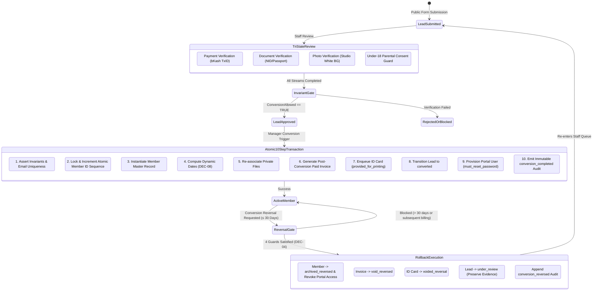

# Atomic Lead-to-Member Conversion Transaction and 30-Day Reversal Protocol Specification (CONVERSION-SPEC)

**Phase:** 02-architecture-data-model-and-security-design  
**Plan:** 02-02  
**Status:** Approved Technical Architecture Contract  
**Governing Requirements:** [ARCH-03](file:///d:/EMK_Protal/.planning/REQUIREMENTS.md), [ARCH-04](file:///d:/EMK_Protal/.planning/REQUIREMENTS.md)  
**Governing Decisions:** [DEC-03 (D-03)](file:///d:/EMK_Protal/.planning/phases/01-discovery-decisions-and-acceptance-criteria/DECISION-REGISTER.md), [DEC-04 (D-04)](file:///d:/EMK_Protal/.planning/phases/01-discovery-decisions-and-acceptance-criteria/DECISION-REGISTER.md), [DEC-06 (D-06)](file:///d:/EMK_Protal/.planning/phases/01-discovery-decisions-and-acceptance-criteria/DECISION-REGISTER.md), [DEC-07 (D-07)](file:///d:/EMK_Protal/.planning/phases/01-discovery-decisions-and-acceptance-criteria/DECISION-REGISTER.md), [DEC-08 (D-08)](file:///d:/EMK_Protal/.planning/phases/01-discovery-decisions-and-acceptance-criteria/DECISION-REGISTER.md), [DEC-09 (D-09)](file:///d:/EMK_Protal/.planning/phases/01-discovery-decisions-and-acceptance-criteria/DECISION-REGISTER.md), [DEC-11 (D-11)](file:///d:/EMK_Protal/.planning/phases/01-discovery-decisions-and-acceptance-criteria/DECISION-REGISTER.md)  
**Foundational References:** [VERIFICATION-DICTIONARY.md](file:///d:/EMK_Protal/.planning/phases/01-discovery-decisions-and-acceptance-criteria/VERIFICATION-DICTIONARY.md), [STATUS-DICTIONARY.md](file:///d:/EMK_Protal/.planning/phases/01-discovery-decisions-and-acceptance-criteria/STATUS-DICTIONARY.md), [SCHEMA-SPEC.md](file:///d:/EMK_Protal/.planning/phases/02-architecture-data-model-and-security-design/SCHEMA-SPEC.md), [02-RESEARCH.md](file:///d:/EMK_Protal/.planning/phases/02-architecture-data-model-and-security-design/02-RESEARCH.md)

---

## 1. Domain Intent & Lifecycle Principles

The transition of an applicant from an inbound **Lead** to an active, credentialed **Member** is the foundational business event of the EMK Membership CRM platform. It represents a legally binding agreement granting physical access to American Spaces facilities, issuance of official plastic membership credentials, and provisioning of member portal self-service access.

To prevent fraud, identity theft, duplicate billing, and incomplete compliance records, this specification establishes:
1. **The Conversion Gating Invariant:** A mathematically strict Boolean gate prohibiting conversion unless Payment, Document, and Photo streams are verified, minor parental consent is validated, and the Lead is approved.
2. **Deadlock-Free Pessimistic Concurrency:** A deterministic database locking hierarchy guaranteeing monotonic, collision-free Member ID allocation under high concurrent staff approvals.
3. **The 10-Step Atomic Conversion Transaction:** An all-or-nothing relational transaction coordinating seven database tables, secure document re-association, invoice creation, plastic badge queueing, portal account provisioning, and append-only auditing.
4. **The 30-Day Conversion Reversal Protocol:** A tightly guarded, highly audited rollback workflow enabling Workspace Managers to undo erroneous conversions within a 30-calendar-day statutory cutoff.



---

## 2. The Conversion Gating Invariant (DEC-03 / D-03)

### 2.1 The Formal Boolean Invariant Formula
Per **DEC-03 (D-03)** and **ARCH-03**, a Lead record can NEVER transition into an active Member unless all independent verification streams have been audited and found compliant by authorized workspace personnel.

$$\mathbf{ConversionAllowed} = (\text{Payment} = \text{'verified'}) \land (\text{Document} = \text{'verified'}) \land (\text{Photo} = \text{'verified'}) \land (\text{Lead} = \text{'approved'})$$

### 2.2 Secondary Domain Invariants
Before the atomic conversion transaction can initiate, the system asserts three additional preconditions:
1. **Dynamic Minor Consent Assertion (DEC-09 / D-09):**
   $$\text{If } (\text{age\_at\_submission} < 18) \implies (\text{has\_parental\_consent} \equiv \text{true}) \land (\text{parental\_consent\_attachment\_exists} \equiv \text{true})$$
   Minor applications without verified parental/guardian consent cannot pass Document verification.
2. **Global Member Email Uniqueness:**
   $$\nexists\, m \in \text{members} : m.\text{email} = \text{lead}.\text{email} \land m.\text{status} \in \{\text{'active'}, \text{'inactive'}, \text{'restricted'}\}$$
   If an applicant's email already belongs to an existing member profile, conversion is blocked to prevent profile fragmentation. The existing member must renew or update their existing record.
3. **Workspace Authority Gate (DEC-01):**
   The converting user must possess the non-delegable managerial action `leads.convert` within the lead's active `workspace_id`.

### 2.3 Exception Specification (`UnmetConversionInvariantException`)
When any invariant evaluates to false, the system halts execution immediately, raises `UnmetConversionInvariantException`, and rolls back any pending operations.

```php
declare(strict_types=1);

namespace App\Domain\Leads\Exceptions;

use RuntimeException;

final class UnmetConversionInvariantException extends RuntimeException
{
    /** @var array<string, string> */
    private array $unmetConditions;

    /**
     * @param array<string, string> $unmetConditions
     */
    public function __construct(string $message, array $unmetConditions = [], int $code = 422)
    {
        parent::__construct($message, $code);
        $this->unmetConditions = $unmetConditions;
    }

    /**
     * @return array<string, string>
     */
    public function getUnmetConditions(): array
    {
        return $this->unmetConditions;
    }
}
```

### 2.4 Multi-Layer Enforcement Strategy
1. **Presentation / Livewire UI Layer:**
   The "Convert to Member" button is disabled and styled with a warning tooltip listing remaining unverified streams whenever `isConversionAllowed($lead) === false`.
2. **Domain Service Layer:**
   `LeadConversionService::convert()` evaluates the invariant inside the database transaction under a row-level lock.
3. **Database Schema Constraints:**
   Foreign keys, check constraints, and unique indexes guarantee that orphan or unapproved leads cannot have member or invoice foreign keys linked to them.

---

## 3. Concurrency Control, Deadlock Prevention & Sequence Generator

### 3.1 The Deadlock Vulnerability Under Concurrent Approvals
In high-volume operational cycles (such as start-of-semester membership drives), multiple Workspace Managers may approve and convert leads simultaneously. 

A conversion transaction modifies both `member_id_sequences` (to increment the Member ID counter) and `leads` (to update status to `converted`). If Transaction A locks `leads` first and waits for `member_id_sequences`, while Transaction B locks `member_id_sequences` first and waits for `leads`, a relational database **deadlock** occurs, aborting transactions with `PDOException: Deadlock found when trying to get lock`.

### 3.2 Lock Acquisition Hierarchy
To eliminate deadlocks, all conversion transactions MUST acquire pessimistic row-level locks in a strict, deterministic sequence:
1. **Acquire Sequence Lock FIRST:**
   `SELECT last_sequence FROM member_id_sequences WHERE space_code = :space AND year = :year FOR UPDATE`
2. **Acquire Lead Lock SECOND:**
   `SELECT * FROM leads WHERE id = :id FOR UPDATE`
3. **Acquire Term Lock THIRD (Read-Only Shared or Row Lock):**
   `SELECT * FROM membership_terms WHERE id = :term_id FOR UPDATE`

By establishing this universal ordering, concurrent conversions queue linearly on the sequence record rather than creating circular lock dependencies.

### 3.3 Member ID Format & Sequence Generator
Per **STATUS-DICTIONARY.md:117**, Member IDs adhere to a standardized, human-readable composite format:

$$\mathbf{\{SPACE\_CODE\}-\{YEAR\}-\{5\_DIGIT\_SEQ\}}$$

- `SPACE_CODE`: 3-character uppercase code of the American Space (e.g., `EMK` for EMK Center Dhaka, `AMC` for American Center, `BAR`, `CTG`, `RAJ`, `SYL`).
- `YEAR`: 4-digit calendar year of initial conversion (e.g., `2026`). Fixed for lifetime tracking through renewals.
- `5_DIGIT_SEQ`: 5-digit zero-padded monotonic sequence number from `00001` to `99999`.

Example: **`EMK-2026-00001`**

```php
declare(strict_types=1);

namespace App\Domain\Members\Services;

use Carbon\Carbon;
use Illuminate\Support\Facades\DB;

final class MemberIdSequenceGenerator
{
    /**
     * Atomically obtain and increment the next monotonic Member ID.
     */
    public function nextMemberId(string $spaceCode, int $year): string
    {
        // 1. Lock sequence row for update (Creates or Locks)
        $sequenceRecord = DB::table('member_id_sequences')
            ->where('space_code', $spaceCode)
            ->where('year', $year)
            ->lockForUpdate()
            ->first();

        $currentSeq = $sequenceRecord !== null ? (int) $sequenceRecord->last_sequence : 0;
        $nextSeq = $currentSeq + 1;

        if ($nextSeq > 99999) {
            throw new \OverflowException("Member ID sequence limit exceeded for {$spaceCode} in year {$year}.");
        }

        // 2. Persist incremented counter
        DB::table('member_id_sequences')->updateOrInsert(
            ['space_code' => $spaceCode, 'year' => $year],
            ['last_sequence' => $nextSeq, 'updated_at' => Carbon::now()]
        );

        return sprintf('%s-%04d-%05d', $spaceCode, $year, $nextSeq);
    }
}
```

---

## 4. The 10-Step Atomic Conversion Transaction Sequence

The conversion process executes inside a single database transaction (`DB::transaction`). If any step encounters an unexpected error or system crash, the database engine rolls back all modifications, leaving no orphan records or corrupted files.

```
[ BEGIN DB::transaction ]
  │
  ├─► Step 1: Invariant Verification (Payment, Doc, Photo, Lead Status, Under-18, Email)
  │
  ├─► Step 2: Atomic Sequence Lock & Member ID Allocation ({SPACE}-{YEAR}-{SEQ})
  │
  ├─► Step 3: Instantiate Member Profile (Copy verified applicant fields)
  │
  ├─► Step 4: Compute Dynamic Dates (DEC-08: start_date = now(), expiry = now + term.duration)
  │
  ├─► Step 5: Secure Document Re-association (Move private attachments to /members/{uuid}/)
  │
  ├─► Step 6: Generate Post-Conversion Paid Invoice (INV-{YEAR}-{SEQ}, bKash TxID reference)
  │
  ├─► Step 7: Enqueue ID Card Record (State 1: provided_for_printing)
  │
  ├─► Step 8: Transition Lead Status (status = converted, converted_member_id = member.id)
  │
  ├─► Step 9: Provision Member Portal User (must_reset_password = true) & Horizon Job
  │
  └─► Step 10: Append Immutable Audit Record (DEC-11: conversion_completed event)
[ COMMIT DB::transaction ]
```

### Detailed Step-by-Step Specification

#### Step 1: Invariant Verification
The service asserts `isConversionAllowed($lockedLead)` and executes validation checks:
- `lockedLead->payment_verification_status === 'verified'`
- `lockedLead->document_verification_status === 'verified'`
- `lockedLead->photo_verification_status === 'verified'`
- `lockedLead->status === 'approved'`
- If `lockedLead->age_at_submission < 18`: `lockedLead->has_parental_consent === true`
- `Member::where('email', $lockedLead->email)->whereIn('status', ['active', 'inactive', 'restricted'])->doesntExist()`

#### Step 2: Atomic Sequence Lock & Member ID Allocation
Acquires lock on `member_id_sequences` for the space code (e.g. `'EMK'`) and current year (`2026`). Increments sequence and formats Member ID (`EMK-2026-00001`).

#### Step 3: Instantiate Member Master Record
Creates record in `members` table copying verified applicant fields:
`first_name`, `middle_name`, `last_name`, `email`, `contact_number`, `date_of_birth`, `sex`, `address_house_no`, `address_road_no`, `address_area`, `address_zip_code`, `address_division`, `address_district`, `occupation`, `institution_study`, `highest_certification`, `area_of_subject`. Sets `status = 'active'`.

#### Step 4: Calculate Dynamic Dates (DEC-08 / D-08)
Queries active `membership_terms` record. 
- `start_date` = Current timestamp of Manager approval (`Carbon::now()->toDateString()`).
- `expiry_date` = `start_date + term.duration_months` (e.g., +12 months, +24 months).
No static or hardcoded durations exist in application code.

#### Step 5: Secure Document Re-association
Attachments associated with the lead (`lead_attachments`) are migrated to the member's private directory:
`storage/app/private/workspaces/{workspace_id}/members/{member_uuid}/...`
Original filenames remain in database records; physical storage uses cryptographic content hashes.

#### Step 6: Generate Post-Conversion Invoice (DEC-03)
Per **DEC-03**, invoices are generated ONLY post-conversion.
- `invoice_number` = `INV-{YEAR}-{SEQ}` (matching sequence)
- `amount_bdt` = `term.fee_bdt`
- `payment_method` = `'bkash_manual'`
- `payment_reference` = `lockedLead.bkash_txid`
- `status` = `'paid'`
- `paid_at` = `Carbon::now()`

#### Step 7: Create ID Card Record
Creates initial record in `id_cards`:
- `card_number` = `member.member_id`
- `status` = `'provided_for_printing'`
- Physical badge enters printing workflow; ready for batch export.

#### Step 8: Update Lead Status
Updates `leads` record:
- `status` = `'converted'`
- `converted_member_id` = `member.id`

#### Step 9: Provision Portal User & Queue Welcome Notification (DEC-06)
Provisions portal account in `users` table:
- `guard` = `'member'`
- `is_active` = `true`
- `must_reset_password` = `true`
- `password` = `null` (Must be set via secure email activation link)
- Dispatches queued job `SendMemberWelcomeEmailJob` via Laravel Horizon.

#### Step 10: Emit Immutable Audit Log Entry (DEC-11)
Records `conversion_completed` in `audit_logs`:
- `event_type` = `'conversion_completed'`
- `actor_id` = Manager user ID
- `auditable_type` = `Member::class`
- `auditable_id` = `member.id`
- `new_values` = Full snapshot of Member, Invoice, and Card IDs.
- `reason` = Standard verified conversion.

---

## 5. Production `LeadConversionService` Implementation Contract

```php
declare(strict_types=1);

namespace App\Domain\Leads\Services;

use App\Domain\Forms\Models\MembershipTerm;
use App\Domain\IdCards\Models\IdCard;
use App\Domain\Invoices\Models\Invoice;
use App\Domain\Leads\Exceptions\UnmetConversionInvariantException;
use App\Domain\Leads\Models\Lead;
use App\Domain\Members\Models\Member;
use App\Domain\Members\Services\MemberIdSequenceGenerator;
use App\Domain\Platform\Models\AuditLog;
use App\Domain\Users\Models\User;
use App\Jobs\SendMemberWelcomeEmailJob;
use Carbon\Carbon;
use Illuminate\Support\Facades\DB;
use Illuminate\Support\Facades\Storage;
use Illuminate\Support\Str;

final class LeadConversionService
{
    public function __construct(
        private readonly MemberIdSequenceGenerator $sequenceGenerator
    ) {}

    /**
     * Execute the atomic 10-step lead conversion transaction.
     *
     * @throws UnmetConversionInvariantException
     */
    public function convert(Lead $lead, int $termId, int $managerUserId): Member
    {
        return DB::transaction(function () use ($lead, $termId, $managerUserId): Member {
            $now = Carbon::now();
            $year = $now->year;
            $spaceCode = 'EMK'; // Pilot space code for ws-emk-dhaka

            // --- LOCK ACQUISITION HIERARCHY ---
            // 1. Lock sequence counter first
            $memberId = $this->sequenceGenerator->nextMemberId($spaceCode, $year);

            // 2. Lock lead row second
            /** @var Lead $lockedLead */
            $lockedLead = Lead::where('id', $lead->id)->lockForUpdate()->firstOrFail();

            // 3. Lock membership term third
            /** @var MembershipTerm $term */
            $term = MembershipTerm::where('id', $termId)->lockForUpdate()->firstOrFail();

            // --- STEP 1: VERIFY INVARIANTS ---
            $this->assertConversionInvariants($lockedLead);

            // --- STEP 3 & 4: COMPUTE DATES & CREATE MEMBER ---
            $memberUuid = (string) Str::uuid();
            $startDate = $now->copy();
            $expiryDate = $startDate->copy()->addMonths($term->duration_months);

            // Provision portal account (Step 9 preparation)
            $portalUserId = $this->provisionPortalUser($lockedLead);

            $member = Member::create([
                'uuid' => $memberUuid,
                'member_id' => $memberId,
                'workspace_id' => $lockedLead->workspace_id,
                'lead_id' => $lockedLead->id,
                'user_id' => $portalUserId,
                'membership_term_id' => $term->id,
                'status' => 'active',
                'first_name' => $lockedLead->first_name,
                'middle_name' => $lockedLead->middle_name,
                'last_name' => $lockedLead->last_name,
                'email' => $lockedLead->email,
                'contact_number' => $lockedLead->contact_number,
                'date_of_birth' => $lockedLead->date_of_birth,
                'sex' => $lockedLead->sex,
                'address_house_no' => $lockedLead->address_house_no,
                'address_road_no' => $lockedLead->address_road_no,
                'address_area' => $lockedLead->address_area,
                'address_zip_code' => $lockedLead->address_zip_code,
                'address_division' => $lockedLead->address_division,
                'address_district' => $lockedLead->address_district,
                'occupation' => $lockedLead->occupation,
                'institution_study' => $lockedLead->institution_study,
                'highest_certification' => $lockedLead->highest_certification,
                'area_of_subject' => $lockedLead->area_of_subject,
                'start_date' => $startDate->toDateString(),
                'expiry_date' => $expiryDate->toDateString(),
            ]);

            // --- STEP 5: RE-ASSOCIATE PRIVATE DOCUMENTS ---
            $this->reassociatePrivateAttachments($lockedLead, $member);

            // --- STEP 6: GENERATE POST-CONVERSION INVOICE ---
            $invoiceNumber = sprintf('INV-%04d-%s', $year, substr($memberId, -5));
            Invoice::create([
                'invoice_number' => $invoiceNumber,
                'workspace_id' => $lockedLead->workspace_id,
                'member_id' => $member->id,
                'lead_id' => $lockedLead->id,
                'amount_bdt' => $term->fee_bdt,
                'payment_method' => 'bkash_manual',
                'payment_reference' => $lockedLead->bkash_txid,
                'status' => 'paid',
                'paid_at' => $now,
            ]);

            // --- STEP 7: CREATE ID CARD IN PRINTING QUEUE ---
            IdCard::create([
                'workspace_id' => $lockedLead->workspace_id,
                'member_id' => $member->id,
                'card_number' => $memberId,
                'status' => 'provided_for_printing',
            ]);

            // --- STEP 8: UPDATE LEAD STATUS ---
            $lockedLead->update([
                'status' => 'converted',
                'converted_member_id' => $member->id,
            ]);

            // --- STEP 9: DISPATCH WELCOME EMAIL VIA HORIZON ---
            SendMemberWelcomeEmailJob::dispatch($member->id);

            // --- STEP 10: EMIT IMMUTABLE AUDIT LOG ---
            AuditLog::create([
                'workspace_id' => $lockedLead->workspace_id,
                'actor_id' => $managerUserId,
                'actor_guard' => 'web',
                'event_type' => 'conversion_completed',
                'auditable_type' => Member::class,
                'auditable_id' => $member->id,
                'new_values' => [
                    'member_id' => $memberId,
                    'lead_id' => $lockedLead->id,
                    'invoice_number' => $invoiceNumber,
                    'term_code' => $term->code,
                    'start_date' => $startDate->toDateString(),
                    'expiry_date' => $expiryDate->toDateString(),
                ],
                'reason' => 'Standard lead conversion following completed verification streams.',
                'ip_address' => request()->ip() ?? '127.0.0.1',
                'user_agent' => request()->userAgent(),
            ]);

            return $member;
        });
    }

    /**
     * Assert all mandatory conversion invariants.
     */
    private function assertConversionInvariants(Lead $lead): void
    {
        $unmet = [];

        if ($lead->payment_verification_status !== 'verified') {
            $unmet['payment'] = 'Payment verification stream is not Complete/Verified.';
        }
        if ($lead->document_verification_status !== 'verified') {
            $unmet['document'] = 'Document verification stream is not Complete/Verified.';
        }
        if ($lead->photo_verification_status !== 'verified') {
            $unmet['photo'] = 'Photo verification stream is not Complete/Verified.';
        }
        if ($lead->status !== 'approved') {
            $unmet['lead_status'] = 'Lead overall status must be Approved prior to conversion.';
        }
        if ($lead->age_at_submission < 18 && !$lead->has_parental_consent) {
            $unmet['parental_consent'] = 'Applicant under 18 lacks verified parental consent form.';
        }

        // Assert email uniqueness in active members
        $existingMember = Member::where('email', $lead->email)
            ->whereIn('status', ['active', 'inactive', 'restricted'])
            ->exists();

        if ($existingMember) {
            $unmet['email_conflict'] = 'An active or existing member record already exists for this email.';
        }

        if (!empty($unmet)) {
            throw new UnmetConversionInvariantException(
                'Conversion blocked: One or more domain invariants are unsatisfied.',
                $unmet
            );
        }
    }

    /**
     * Provision read-only portal account with forced password reset.
     */
    private function provisionPortalUser(Lead $lead): int
    {
        return DB::table('users')->insertGetId([
            'workspace_id' => $lead->workspace_id,
            'name' => trim("{$lead->first_name} {$lead->last_name}"),
            'email' => $lead->email,
            'password' => null, // Account inactive until password set via email token
            'guard' => 'member',
            'is_active' => true,
            'must_reset_password' => true,
            'created_at' => Carbon::now(),
            'updated_at' => Carbon::now(),
        ]);
    }

    /**
     * Move private documents from lead directory to member directory.
     */
    private function reassociatePrivateAttachments(Lead $lead, Member $member): void
    {
        $disk = Storage::disk('private');
        $leadDir = "workspaces/{$lead->workspace_id}/leads/{$lead->uuid}";
        $memberDir = "workspaces/{$member->workspace_id}/members/{$member->uuid}";

        if ($disk->exists($leadDir)) {
            $files = $disk->allFiles($leadDir);
            foreach ($files as $file) {
                $target = str_replace($leadDir, $memberDir, $file);
                $disk->copy($file, $target);
            }
        }
    }
}
```

---

## 6. The 30-Day Conversion Reversal Protocol (DEC-04 / D-04)

### 6.1 Regulatory Purpose & Authority
Operational mistakes occur: a staff member may approve an applicant based on an unverified bKash transaction that suffers an immediate chargeback, or mistake a user for an alumni applicant. 

Under **DEC-04 (D-04)** and **ARCH-04**, the platform provides a rigorous **Conversion Reversal Protocol**. Reversals are:
1. **Restricted Authority:** Permitted exclusively to the **Workspace Manager** (or Superadmin). Staff review officers cannot reverse conversions.
2. **Time-Bounded Statutory Cutoff:** Permitted strictly within **30 calendar days** of the original conversion date. After 30 days, reversal is permanently disabled in the UI and rejected by the domain service.
3. **Purity of State Guard:** The member must have zero subsequent invoices, renewal records, or card handovers. If the physical card was marked `delivered` to the member, reversal is blocked.
4. **Mandatory Justification String:** The Manager must input a justification reason of **at least 20 characters**. Free-text empty strings or abbreviations are rejected by validation.
5. **Re-authentication Requirement:** The Manager must confirm their administrative password or 2FA challenge before triggering reversal.

### 6.2 Cascading Rollback Actions
When a conversion reversal executes inside `ConversionReversalService::reverse()`:
1. **Member Record:** Status transitions to `archived_reversed`.
2. **Portal Login Revocation:** The member's user account in `users` has `is_active = false`. Active portal session tokens are evicted immediately.
3. **Post-Conversion Invoice:** Associated invoice marked `status = 'void_reversed'`.
4. **ID Card Record:** Any pending or printed card in `id_cards` marked `status = 'voided_reversal'`.
5. **Lead Record Restoration:** The lead's status is restored to `under_review`. The `converted_member_id` foreign key is nulled. Crucially, all historical verification streams (Payment, Document, Photo) are preserved for staff re-inspection.
6. **Immutable Audit Trail:** An append-only audit event `conversion_reversed` is written, capturing Manager ID, timestamp, full justification text, and snapshot diffs.

```php
declare(strict_types=1);

namespace App\Domain\Members\Services;

use App\Domain\IdCards\Models\IdCard;
use App\Domain\Invoices\Models\Invoice;
use App\Domain\Leads\Models\Lead;
use App\Domain\Members\Exceptions\InvalidConversionReversalException;
use App\Domain\Members\Models\Member;
use App\Domain\Platform\Models\AuditLog;
use App\Domain\Users\Models\User;
use Carbon\Carbon;
use Illuminate\Support\Facades\DB;

final class ConversionReversalService
{
    /**
     * Reversal statutory cutoff: 30 calendar days.
     */
    public const STATUTORY_CUTOFF_DAYS = 30;

    /**
     * Mandatory justification minimum character length.
     */
    public const MIN_JUSTIFICATION_CHARS = 20;

    /**
     * Execute the cascading 30-day conversion reversal protocol.
     *
     * @throws InvalidConversionReversalException
     */
    public function reverse(Member $member, string $justification, int $managerUserId): void
    {
        // 1. Validate justification length
        $trimmedJustification = trim($justification);
        if (mb_strlen($trimmedJustification) < self::MIN_JUSTIFICATION_CHARS) {
            throw new InvalidConversionReversalException(
                sprintf('Conversion reversal requires a mandatory justification of at least %d characters.', self::MIN_JUSTIFICATION_CHARS)
            );
        }

        DB::transaction(function () use ($member, $trimmedJustification, $managerUserId): void {
            /** @var Member $lockedMember */
            $lockedMember = Member::where('id', $member->id)->lockForUpdate()->firstOrFail();

            // 2. Validate statutory cutoff (30 calendar days)
            $conversionDate = Carbon::parse($lockedMember->created_at);
            if ($conversionDate->diffInDays(Carbon::now()) > self::STATUTORY_CUTOFF_DAYS) {
                throw new InvalidConversionReversalException(
                    'Statutory 30-day cutoff expired. Conversion cannot be reversed after 30 calendar days.'
                );
            }

            // 3. Validate member status purity
            if ($lockedMember->status !== 'active') {
                throw new InvalidConversionReversalException(
                    "Cannot reverse member in status '{$lockedMember->status}'."
                );
            }

            // 4. Assert no subsequent invoices exist
            $subsequentInvoices = Invoice::where('member_id', $lockedMember->id)
                ->where('created_at', '>', $lockedMember->created_at)
                ->exists();

            if ($subsequentInvoices) {
                throw new InvalidConversionReversalException(
                    'Reversal prohibited: Member has subsequent invoices or renewal transactions.'
                );
            }

            // 5. Assert card has not been handed over to member
            $cardDelivered = IdCard::where('member_id', $lockedMember->id)
                ->where('status', 'delivered')
                ->exists();

            if ($cardDelivered) {
                throw new InvalidConversionReversalException(
                    'Reversal prohibited: Physical membership card has already been delivered to the member.'
                );
            }

            // --- EXECUTE CASCADING ROLLBACK ---

            // A. Update Member status to archived_reversed
            $lockedMember->update([
                'status' => 'archived_reversed',
            ]);

            // B. Disable portal user account & evict sessions
            User::where('id', $lockedMember->user_id)->update([
                'is_active' => false,
                'remember_token' => null,
            ]);

            // C. Mark invoice void_reversed
            Invoice::where('member_id', $lockedMember->id)
                ->where('lead_id', $lockedMember->lead_id)
                ->update([
                    'status' => 'void_reversed',
                ]);

            // D. Void plastic ID cards
            IdCard::where('member_id', $lockedMember->id)->update([
                'status' => 'voided_reversal',
            ]);

            // E. Restore Lead status to under_review preserving verification history
            Lead::where('id', $lockedMember->lead_id)->update([
                'status' => 'under_review',
                'converted_member_id' => null,
            ]);

            // F. Append immutable audit event
            AuditLog::create([
                'workspace_id' => $lockedMember->workspace_id,
                'actor_id' => $managerUserId,
                'actor_guard' => 'web',
                'event_type' => 'conversion_reversed',
                'auditable_type' => Member::class,
                'auditable_id' => $lockedMember->id,
                'old_values' => ['status' => 'active'],
                'new_values' => [
                    'status' => 'archived_reversed',
                    'lead_id' => $lockedMember->lead_id,
                    'restored_lead_status' => 'under_review',
                ],
                'reason' => $trimmedJustification,
                'ip_address' => request()->ip() ?? '127.0.0.1',
                'user_agent' => request()->userAgent(),
            ]);
        });
    }
}
```

---

## 7. Automated Testing & Verification Blueprint

The conversion and reversal invariants must be verified by automated tests covering normal operations, boundary conditions, and attack scenarios:

| Test Scenario | Test Type | Expected Outcome |
|---|---|---|
| Attempt conversion when Payment stream is `pending` | Unit / Domain | Throws `UnmetConversionInvariantException`; zero records created. |
| Attempt conversion when Document stream is `rejected` | Unit / Domain | Throws `UnmetConversionInvariantException`; zero records created. |
| Attempt conversion for applicant under 18 without parental consent | Unit / Domain | Throws `UnmetConversionInvariantException`; parental consent failure flagged. |
| Concurrent conversion of 5 leads simultaneously | Concurrency / DB | All 5 acquire sequential Member IDs without deadlocks or gap collisions. |
| Reversal requested within 15 days with 25-char justification | Integration | Member archived, invoice voided, card voided, lead restored to `under_review`. |
| Reversal requested at Day 31 | Unit / Boundary | Throws `InvalidConversionReversalException` (Statutory cutoff expired). |
| Reversal attempted with 12-char justification | Validation | Throws `InvalidConversionReversalException` (< 20 characters). |
| Reversal attempted when card status is `delivered` | Integration | Throws `InvalidConversionReversalException` (Card already delivered). |

---

## 8. Summary of Architectural Guarantees

1. **Unbroken Gating:** No applicant can achieve member status without three verified streams, minor consent verification, and managerial approval.
2. **Deterministic Concurrency:** Sequence locking hierarchy guarantees zero deadlocks and strictly monotonic Member IDs.
3. **Atomicity Guaranteed:** All 10 conversion operations commit together or roll back completely.
4. **Time-Bounded Error Recovery:** Reversals are legally capped at 30 calendar days, require rigorous justification, and cascade clean rollback across all child tables.
5. **Auditing Completeness:** Both conversion completion and reversal emit immutable audit records per **DEC-11**.
