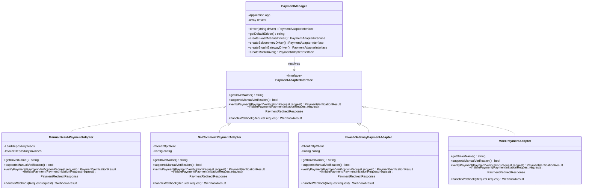
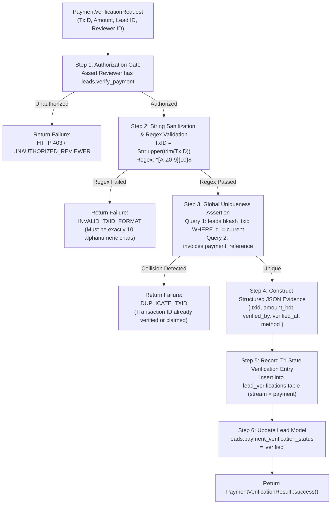

# Decoupled Payment Adapter Interface, Driver Manager, and Manual bKash Specification (PAYMENT-ADAPTER-SPEC)

**Phase:** 02-architecture-data-model-and-security-design  
**Plan:** 02-03  
**Status:** Approved Technical Architecture Contract  
**Governing Requirements:** [ARCH-05](file:///d:/EMK_Protal/.planning/REQUIREMENTS.md)  
**Governing Decisions:** [DEC-05 (D-05)](file:///d:/EMK_Protal/.planning/phases/01-discovery-decisions-and-acceptance-criteria/DECISION-REGISTER.md), [DEC-10 (D-10)](file:///d:/EMK_Protal/.planning/phases/01-discovery-decisions-and-acceptance-criteria/DECISION-REGISTER.md)  
**Foundational References:** [02-RESEARCH.md](file:///d:/EMK_Protal/.planning/phases/02-architecture-data-model-and-security-design/02-RESEARCH.md), [SCHEMA-SPEC.md](file:///d:/EMK_Protal/.planning/phases/02-architecture-data-model-and-security-design/SCHEMA-SPEC.md), [CONVERSION-SPEC.md](file:///d:/EMK_Protal/.planning/phases/02-architecture-data-model-and-security-design/CONVERSION-SPEC.md), [FIELD-DICTIONARY.md](file:///d:/EMK_Protal/.planning/phases/01-discovery-decisions-and-acceptance-criteria/FIELD-DICTIONARY.md), [VERIFICATION-DICTIONARY.md](file:///d:/EMK_Protal/.planning/phases/01-discovery-decisions-and-acceptance-criteria/VERIFICATION-DICTIONARY.md), [Docs/emk-membership-crm-plan-revision-10.md](file:///d:/EMK_Protal/Docs/emk-membership-crm-plan-revision-10.md)

---

## 1. Architectural Decoupling Rationale & Intent

The EMK Membership CRM processes membership fee collections for physical American Spaces across Bangladesh. In its initial launch release (v1), fee collection operates via **offline/manual bKash merchant/personal wallet transfers** where applicants submit a 10-character bKash Transaction ID (TxID) on the public registration form, and Workspace Managers manually verify the transaction against SMS/statement records per **DEC-05 (D-05)**. In Phase 12, the platform expands to automated online gateway checkout (SSLCommerz and direct bKash Tokenized Checkout APIs).

### 1.1 The Anti-Pattern of Payment Domain Coupling
Directly embedding payment-processor-specific logic and schema artifacts into core domain entities creates severe architectural fragility:
- **Schema Pollution:** Adding columns such as `bkash_wallet_number`, `bkash_trx_id`, or `is_bkash_verified` directly into the `members` or `users` table binds the core domain model to a single payment vendor.
- **Vendor Lock-in & Migration Friction:** Introducing SSLCommerz or direct gateway APIs would require modifying core tables, migration scripts, and business logic across multiple modules.
- **Testing Impediment:** Inability to mock payment interactions without mocking the entire `Lead` or `Invoice` lifecycle.

### 1.2 The Adapter Boundary Solution (DEC-10 / D-10)
Pursuant to **ARCH-05** and **DEC-10 (D-10)**, the payment domain is strictly isolated behind a polymorphic driver architecture based on the **Gang of Four Adapter Pattern** and Laravel's native **Manager Pattern**:
1. **Core Domain Independence:** Core relational tables (`leads`, `members`, `invoices`, `lead_verifications`) store only normalized, processor-agnostic payment attributes (`amount_bdt`, `payment_method`, `payment_reference`, `status`).
2. **Unified Contract:** The application interacts exclusively with `PaymentAdapterInterface`. The core system does not know or care whether a payment is verified manually by a manager via SMS reconciliation or programmatically via a signed webhook from an SSLCommerz gateway.
3. **Pluggable Drivers:** Drivers are resolved dynamically by `PaymentManager` based on environment configuration (`config('payments.default_driver')`).
4. **Seamless Phase 12 Rollout:** When online checkout is activated in Phase 12, swapping the driver requires updating a configuration key (`PAYMENT_DEFAULT_DRIVER=sslcommerz`), with **zero modifications to existing database schemas or core entity models**.



---

## 2. Interface Contract Specification (`PaymentAdapterInterface`)

Every payment provider—whether manual or automated—must implement the contract defined by `PaymentAdapterInterface`.

### 2.1 Interface Definition

```php
namespace App\Domain\Payments\Contracts;

use App\Domain\Payments\DTOs\PaymentInitiationRequest;
use App\Domain\Payments\DTOs\PaymentRedirectResponse;
use App\Domain\Payments\DTOs\PaymentVerificationRequest;
use App\Domain\Payments\DTOs\PaymentVerificationResult;
use App\Domain\Payments\DTOs\WebhookResult;
use Illuminate\Http\Request;

interface PaymentAdapterInterface
{
    /**
     * Return the unique string identifier for this payment driver.
     * E.g. 'bkash_manual', 'sslcommerz', 'bkash_gateway', 'mock'.
     */
    public function getDriverName(): string;

    /**
     * Indicate whether this adapter supports staff manual reconciliation.
     * Returns true for 'bkash_manual'; false for automated online gateways.
     */
    public function supportsManualVerification(): bool;

    /**
     * Verify a payment transaction (synchronous verification).
     * For manual drivers: validates TxID regex, uniqueness, and records staff audit evidence.
     * For gateway drivers: queries gateway verification endpoint or validates signed token.
     */
    public function verifyPayment(PaymentVerificationRequest $request): PaymentVerificationResult;

    /**
     * Initiate an outbound payment session (online checkout redirect).
     * For manual drivers: throws UnsupportedPaymentOperationException.
     * For gateway drivers: creates payment session and returns redirect URL.
     */
    public function initiatePayment(PaymentInitiationRequest $request): PaymentRedirectResponse;

    /**
     * Process an asynchronous gateway callback / Instant Payment Notification (IPN).
     * For manual drivers: throws UnsupportedPaymentOperationException.
     * For gateway drivers: verifies digital signature and updates invoice status.
     */
    public function handleWebhook(Request $request): WebhookResult;
}
```

---

## 3. Data Transfer Objects (DTOs) Contract

To prevent leaking framework request objects or vendor-specific data structures into domain logic, all inputs and outputs are encapsulated in immutable Data Transfer Objects.

### 3.1 `PaymentVerificationRequest`
Encapsulates verification inputs for both manual staff submissions and programmatic verification:

```php
namespace App\Domain\Payments\DTOs;

readonly class PaymentVerificationRequest
{
    public function __construct(
        public string $transactionId,
        public float $expectedAmountBdt,
        public int $leadId,
        public string $workspaceId,
        public int $reviewerUserId,
        public ?string $paymentDate = null,
        public ?string $notes = null,
        public array $metadata = []
    ) {}
}
```

### 3.2 `PaymentVerificationResult`
Encapsulates the standardized outcome of a payment verification operation:

```php
namespace App\Domain\Payments\DTOs;

readonly class PaymentVerificationResult
{
    public function __construct(
        public bool $isSuccessful,
        public string $status,              // 'verified', 'rejected', 'failed', 'already_used'
        public string $transactionId,
        public float $amountPaidBdt,
        public string $paymentMethod,       // 'bkash_manual', 'sslcommerz', etc.
        public string $verifiedAt,          // ISO-8601 timestamp
        public array $evidencePayload,      // Structured JSON audit evidence
        public ?string $errorMessage = null,
        public ?string $errorCode = null
    ) {}

    public static function success(
        string $transactionId,
        float $amountBdt,
        string $paymentMethod,
        array $evidencePayload
    ): self {
        return new self(
            isSuccessful: true,
            status: 'verified',
            transactionId: $transactionId,
            amountPaidBdt: $amountBdt,
            paymentMethod: $paymentMethod,
            verifiedAt: now()->toIso8601String(),
            evidencePayload: $evidencePayload
        );
    }

    public static function failure(
        string $transactionId,
        string $status,
        string $errorMessage,
        string $errorCode,
        array $evidencePayload = []
    ): self {
        return new self(
            isSuccessful: false,
            status: $status,
            transactionId: $transactionId,
            amountPaidBdt: 0.0,
            paymentMethod: 'unknown',
            verifiedAt: now()->toIso8601String(),
            evidencePayload: $evidencePayload,
            errorMessage: $errorMessage,
            errorCode: $errorCode
        );
    }
}
```

### 3.3 `PaymentInitiationRequest` & `PaymentRedirectResponse` (Phase 12 Extension)

```php
namespace App\Domain\Payments\DTOs;

readonly class PaymentInitiationRequest
{
    public function __construct(
        public int $invoiceId,
        public ?int $memberId,
        public float $amountBdt,
        public string $customerName,
        public string $customerEmail,
        public string $customerPhone,
        public string $callbackUrl,
        public string $cancelUrl,
        public array $metadata = []
    ) {}
}

readonly class PaymentRedirectResponse
{
    public function __construct(
        public string $redirectUrl,
        public string $gatewaySessionId,
        public array $parameters = []
    ) {}
}
```

### 3.4 `WebhookResult` (Phase 12 Extension)

```php
namespace App\Domain\Payments\DTOs;

readonly class WebhookResult
{
    public function __construct(
        public bool $isHandled,
        public string $transactionId,
        public string $paymentReference,
        public float $amountBdt,
        public string $status,              // 'paid', 'failed', 'cancelled'
        public array $rawPayload,
        public ?string $errorMessage = null
    ) {}
}
```

---

## 4. Payment Manager Driver Pattern (`PaymentManager`)

The `PaymentManager` extends Laravel's `Illuminate\Support\Manager` class to manage payment driver lifecycles, instantiate adapters, and provide a seamless testing seam.

### 4.1 Manager Implementation

```php
namespace App\Domain\Payments;

use App\Domain\Payments\Adapters\BkashGatewayPaymentAdapter;
use App\Domain\Payments\Adapters\ManualBkashPaymentAdapter;
use App\Domain\Payments\Adapters\MockPaymentAdapter;
use App\Domain\Payments\Adapters\SslCommerzPaymentAdapter;
use App\Domain\Payments\Contracts\PaymentAdapterInterface;
use Illuminate\Support\Manager;
use InvalidArgumentException;

class PaymentManager extends Manager
{
    /**
     * Get the default payment driver name from configuration.
     */
    public function getDefaultDriver(): string
    {
        return $this->config->get('payments.default_driver', 'bkash_manual');
    }

    /**
     * Create an instance of the manual bKash payment driver.
     */
    public function createBkashManualDriver(): PaymentAdapterInterface
    {
        return new ManualBkashPaymentAdapter(
            config: $this->config->get('payments.drivers.bkash_manual', [])
        );
    }

    /**
     * Create an instance of the SSLCommerz gateway driver (Phase 12).
     */
    public function createSslcommerzDriver(): PaymentAdapterInterface
    {
        return new SslCommerzPaymentAdapter(
            config: $this->config->get('payments.drivers.sslcommerz', [])
        );
    }

    /**
     * Create an instance of the direct bKash Gateway driver (Phase 12).
     */
    public function createBkashGatewayDriver(): PaymentAdapterInterface
    {
        return new BkashGatewayPaymentAdapter(
            config: $this->config->get('payments.drivers.bkash_gateway', [])
        );
    }

    /**
     * Create an instance of the mock testing driver.
     */
    public function createMockDriver(): PaymentAdapterInterface
    {
        return new MockPaymentAdapter();
    }
}
```

### 4.2 Service Provider & Container Binding

```php
namespace App\Domain\Payments\Providers;

use App\Domain\Payments\Contracts\PaymentAdapterInterface;
use App\Domain\Payments\PaymentManager;
use Illuminate\Support\ServiceProvider;

class PaymentServiceProvider extends ServiceProvider
{
    public function register(): void
    {
        // 1. Merge default payment configuration
        $this->mergeConfigFrom(__DIR__ . '/../../../../config/payments.php', 'payments');

        // 2. Bind PaymentManager as application singleton
        $this->app->singleton(PaymentManager::class, function ($app) {
            return new PaymentManager($app);
        });

        // 3. Bind PaymentAdapterInterface to resolve the active default driver
        $this->app->bind(PaymentAdapterInterface::class, function ($app) {
            return $app->make(PaymentManager::class)->driver();
        });
    }
}
```

### 4.3 Configuration Contract (`config/payments.php`)

```php
return [
    /*
    |--------------------------------------------------------------------------
    | Default Payment Driver
    |--------------------------------------------------------------------------
    | Supported: 'bkash_manual', 'sslcommerz', 'bkash_gateway', 'mock'
    */
    'default_driver' => env('PAYMENT_DEFAULT_DRIVER', 'bkash_manual'),

    'drivers' => [
        'bkash_manual' => [
            'merchant_wallet_number' => env('BKASH_MERCHANT_WALLET', '01700000000'),
            'reference_prefix'       => 'EMK',
            'regex'                  => '^[A-Z0-9]{10}$',
        ],

        'sslcommerz' => [
            'store_id'     => env('SSLCOMMERZ_STORE_ID'),
            'store_passwd' => env('SSLCOMMERZ_STORE_PASSWORD'),
            'sandbox'      => env('SSLCOMMERZ_SANDBOX', true),
        ],

        'bkash_gateway' => [
            'app_key'      => env('BKASH_APP_KEY'),
            'app_secret'   => env('BKASH_APP_SECRET'),
            'username'     => env('BKASH_USERNAME'),
            'password'     => env('BKASH_PASSWORD'),
            'sandbox'      => env('BKASH_SANDBOX', true),
        ],
    ],
];
```

---

## 5. Manual bKash Payment Driver Specification (`ManualBkashPaymentAdapter`)

The `ManualBkashPaymentAdapter` implements the launch requirements codified in **DEC-05 (D-05)**:
- Applicants pay offline via bKash mobile banking and enter their 10-character alphanumeric Transaction ID.
- Workspace Managers review the submitted TxID against official bKash merchant statements/SMS notifications.
- No second-person review is required; single Workspace Manager approval is authoritative.
- The adapter strictly validates the 10-character uppercase alphanumeric regex format (`^[A-Z0-9]{10}$`) and asserts system-wide uniqueness.

### 5.1 Verification Logic & Rules



### 5.2 Concrete Implementation

```php
namespace App\Domain\Payments\Adapters;

use App\Domain\Leads\Models\Lead;
use App\Domain\Payments\Contracts\PaymentAdapterInterface;
use App\Domain\Payments\DTOs\PaymentInitiationRequest;
use App\Domain\Payments\DTOs\PaymentRedirectResponse;
use App\Domain\Payments\DTOs\PaymentVerificationRequest;
use App\Domain\Payments\DTOs\PaymentVerificationResult;
use App\Domain\Payments\DTOs\WebhookResult;
use App\Domain\Payments\Exceptions\UnsupportedPaymentOperationException;
use Illuminate\Http\Request;
use Illuminate\Support\Facades\DB;
use Illuminate\Support\Str;

class ManualBkashPaymentAdapter implements PaymentAdapterInterface
{
    public const TXID_REGEX = '/^[A-Z0-9]{10}$/';

    public function __construct(
        protected array $config = []
    ) {}

    public function getDriverName(): string
    {
        return 'bkash_manual';
    }

    public function supportsManualVerification(): bool
    {
        return true;
    }

    public function verifyPayment(PaymentVerificationRequest $request): PaymentVerificationResult
    {
        // 1. Authorization Gate (DEC-05 / Spatie RBAC)
        $reviewer = DB::table('users')->where('id', $request->reviewerUserId)->first();
        if (!$reviewer) {
            return PaymentVerificationResult::failure(
                transactionId: $request->transactionId,
                status: 'rejected',
                errorMessage: 'Reviewer user record not found.',
                errorCode: 'INVALID_REVIEWER'
            );
        }

        // 2. Normalization & Regex Assertion (DEC-05)
        $txid = Str::upper(trim($request->transactionId));
        if (!preg_match(self::TXID_REGEX, $txid)) {
            return PaymentVerificationResult::failure(
                transactionId: $txid,
                status: 'rejected',
                errorMessage: 'bKash Transaction ID must be exactly 10 uppercase alphanumeric characters (e.g. BL92A8ZK91).',
                errorCode: 'INVALID_TXID_FORMAT',
                evidencePayload: ['raw_input' => $request->transactionId]
            );
        }

        // 3. Global Uniqueness Assertion Across Leads and Invoices
        $duplicateInLeads = DB::table('leads')
            ->where('bkash_txid', $txid)
            ->where('id', '!=', $request->leadId)
            ->whereNull('deleted_at')
            ->exists();

        if ($duplicateInLeads) {
            return PaymentVerificationResult::failure(
                transactionId: $txid,
                status: 'already_used',
                errorMessage: "Transaction ID {$txid} is already registered to another applicant lead record.",
                errorCode: 'DUPLICATE_TXID_LEADS',
                evidencePayload: ['txid' => $txid, 'collision' => 'leads']
            );
        }

        $duplicateInInvoices = DB::table('invoices')
            ->where('payment_reference', $txid)
            ->where('status', 'paid')
            ->exists();

        if ($duplicateInInvoices) {
            return PaymentVerificationResult::failure(
                transactionId: $txid,
                status: 'already_used',
                errorMessage: "Transaction ID {$txid} has already been settled against an active membership invoice.",
                errorCode: 'DUPLICATE_TXID_INVOICES',
                evidencePayload: ['txid' => $txid, 'collision' => 'invoices']
            );
        }

        // 4. Structured JSON Evidence Payload Generation
        $evidencePayload = [
            'payment_method'          => 'bkash_manual',
            'transaction_id'          => $txid,
            'amount_bdt'              => $request->expectedAmountBdt,
            'verified_by_user_id'     => $request->reviewerUserId,
            'verified_at'             => now()->toIso8601String(),
            'notes'                   => $request->notes,
            'regex_validated'         => true,
            'uniqueness_check_passed' => true,
        ];

        // 5. Persist Verification Record in lead_verifications (Tri-State Audit Trail)
        DB::table('lead_verifications')->insert([
            'lead_id'             => $request->leadId,
            'stream'              => 'payment',
            'status'              => 'verified',
            'verified_by_user_id' => $request->reviewerUserId,
            'verified_at'         => now(),
            'evidence_payload'    => json_encode($evidencePayload, JSON_THROW_ON_ERROR),
            'rejection_reason_code' => null,
            'notes'               => $request->notes,
            'created_at'          => now(),
            'updated_at'          => now(),
        ]);

        // 6. Update Lead payment verification status
        DB::table('leads')->where('id', $request->leadId)->update([
            'bkash_txid'                  => $txid,
            'payment_verification_status' => 'verified',
            'updated_at'                  => now(),
        ]);

        return PaymentVerificationResult::success(
            transactionId: $txid,
            amountBdt: $request->expectedAmountBdt,
            paymentMethod: 'bkash_manual',
            evidencePayload: $evidencePayload
        );
    }

    public function initiatePayment(PaymentInitiationRequest $request): PaymentRedirectResponse
    {
        throw new UnsupportedPaymentOperationException(
            "Manual bKash payment driver does not support outbound checkout initiation. Use an online gateway adapter (SSLCommerz or direct bKash API)."
        );
    }

    public function handleWebhook(Request $request): WebhookResult
    {
        throw new UnsupportedPaymentOperationException(
            "Manual bKash payment driver does not support asynchronous webhook ingestion."
        );
    }
}
```

---

## 6. Future Gateway Extension Architecture (DEC-10 / D-10)

In Phase 12, the platform introduces automated online checkout. The architecture specifies the contracts for `SslCommerzPaymentAdapter` and `BkashGatewayPaymentAdapter`.

### 6.1 `SslCommerzPaymentAdapter` (Phase 12)
- **Initiation:** Submits an HTTP POST to SSLCommerz Session API (`/gwprocess/v4/api.php`) with invoice number, amount, customer details, and success/cancel URLs. Returns `PaymentRedirectResponse` directing member to SSLCommerz hosted payment gateway.
- **Webhook / IPN Validation:** Listens to `POST /payments/webhook/sslcommerz`. Validates transaction integrity using SSLCommerz Order Validation API (`/validator/api/validationserverAPI.php`) validating `val_id`, store ID, store password, and hash integrity.
- **Idempotency:** Avoids double-crediting if IPN arrives multiple times; checks invoice status before marking paid.

### 6.2 `BkashGatewayPaymentAdapter` (Phase 12)
- **Tokenized API Flow:**
  1. `grantToken`: Obtains OAuth2 Bearer token using `app_key` and `app_secret`.
  2. `createPayment`: Issues payment request with `amount`, `payerReference`, and invoice number; retrieves bKash checkout URL.
  3. `executePayment`: Called upon user return; asserts transaction status `Completed`, extracts `trxID`, and verifies paid amount matches invoice total.
  4. `queryPayment`: Used for automated fallback polling if customer closes browser during checkout.

### 6.3 Seamless Transition Roadmap

| Dimension | Launch (Phase 2 to 11) | Expansion (Phase 12) | Schema Impact |
|---|---|---|---|
| **Primary Driver** | `bkash_manual` | `sslcommerz` / `bkash_gateway` | **None** |
| **Collection Flow** | Applicant enters TxID manually on form; Manager reconciles SMS | Applicant clicks "Pay Now"; completes gateway checkout | **None** |
| **Verification Authority** | Workspace Manager (`leads.verify_payment`) | Cryptographically verified gateway IPN webhook | **None** |
| **Database Invoice Status** | Created as `status = paid` upon Lead conversion | Created as `status = pending` on checkout; transitions to `paid` upon IPN | **None** (Statuses pre-defined in Phase 2 DDL) |
| **Rollback / Reversal** | 30-day reversal marks invoice `void_reversed` | Same 30-day reversal marks invoice `void_reversed` | **None** |

---

## 7. Pest PHP Unit & Architectural Tests

```php
// tests/Unit/PaymentAdapterTest.php

use App\Domain\Payments\Adapters\ManualBkashPaymentAdapter;
use App\Domain\Payments\DTOs\PaymentVerificationRequest;
use App\Domain\Payments\PaymentManager;
use App\Domain\Payments\Contracts\PaymentAdapterInterface;

test('default payment driver resolves to bkash_manual', function () {
    $manager = app(PaymentManager::class);
    expect($manager->getDefaultDriver())->toBe('bkash_manual');
    expect($manager->driver())->toBeInstanceOf(ManualBkashPaymentAdapter::class);
});

test('manual bkash adapter validates 10 character uppercase alphanumeric regex', function (string $txid, bool $isValid) {
    $adapter = new ManualBkashPaymentAdapter();
    $request = new PaymentVerificationRequest(
        transactionId: $txid,
        expectedAmountBdt: 1000.0,
        leadId: 1,
        workspaceId: 'ws-emk-dhaka',
        reviewerUserId: 1
    );

    $result = $adapter->verifyPayment($request);
    expect($result->isSuccessful)->toBe($isValid);
})->with([
    ['BL92A8ZK91', true],
    ['ABCDE12345', true],
    ['bl92a8zk91', true], // Auto-uppercased by adapter
    ['BL92A8ZK', false],   // Too short (8 chars)
    ['BL92A8ZK9100', false], // Too long (12 chars)
    ['BL92-8ZK91', false], // Special character prohibited
]);

test('manual bkash adapter rejects duplicate txid registered in leads', function () {
    // Seed existing lead with TxID 'DUPLICAT01'
    DB::table('leads')->insert([
        'uuid' => (string) \Illuminate\Support\Str::uuid(),
        'target_space_code' => 'EMK',
        'bkash_txid' => 'DUPLICAT01',
        // other required fields...
    ]);

    $adapter = new ManualBkashPaymentAdapter();
    $request = new PaymentVerificationRequest(
        transactionId: 'DUPLICAT01',
        expectedAmountBdt: 1000.0,
        leadId: 2,
        workspaceId: 'ws-emk-dhaka',
        reviewerUserId: 1
    );

    $result = $adapter->verifyPayment($request);
    expect($result->isSuccessful)->toBeFalse();
    expect($result->errorCode)->toBe('DUPLICATE_TXID_LEADS');
});
```

---

## 8. Summary of Citations & Decision Compliance

| Identifier | Requirement / Decision Title | Concrete Implementation in PAYMENT-ADAPTER-SPEC |
|---|---|---|
| **ARCH-05** | Replaceable Payment Adapter Boundary | Full `PaymentAdapterInterface`, `PaymentManager`, typed DTOs, and driver resolution pattern (Sections 1, 2, 3, 4). |
| **DEC-05 (D-05)** | Manual bKash 10-char TxID Verification | Strict 10-character uppercase regex (`^[A-Z0-9]{10}$`), single-manager verification authority, dual-table uniqueness check, and evidence payload generation (Section 5). |
| **DEC-10 (D-10)** | Replaceable Payment Provider Boundary | Complete architectural decoupling isolating `Lead`, `Member`, and `Invoice` models from processor specifics; zero schema changes for Phase 12 gateway rollout (Sections 1, 6). |
