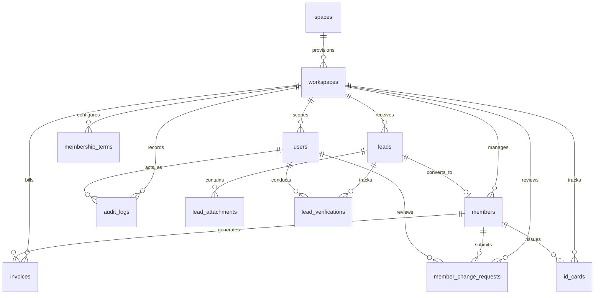

# Relational ER Schema, Table Specifications, and Migration Integrity Baseline

**Phase:** 02-architecture-data-model-and-security-design  
**Plan:** 02-01 (Task 2)  
**Status:** Approved Relational Data Specification  
**Governing Requirements:** ARCH-02, ARCH-06  
**Governing Decisions:** DEC-01 (D-01), DEC-02 (D-02), DEC-03 (D-03), DEC-04 (D-04), DEC-05 (D-05), DEC-06 (D-06), DEC-07 (D-07), DEC-08 (D-08), DEC-09 (D-09), DEC-11 (D-11), DISC-01, DISC-03  
**Threat Mitigations:** T-02-02 (bKash Duplicate Submission & Tampering), T-02-01 (Module & Schema Isolation)

---

## 1. Executive Summary & Design Principles

This document defines the authoritative relational database architecture and MySQL 8.4 schema specifications for the EMK Membership CRM platform embedded within the Laravel 12 Hub monolith.

The schema implements:
1. **Decoupled Physical vs Logical Tenancy:** Clear separation between physical American Spaces directory (`spaces`) and operational tenant boundaries (`workspaces`), launching with EMK Center Dhaka (`ws-emk-dhaka`) while enabling zero-downtime onboarding of other Spaces per **DEC-01 (D-01)**.
2. **Exhaustive 13-Table Schema:** Complete DDL definitions for all core entities: `spaces`, `workspaces`, `users`, `membership_terms`, `leads`, `lead_attachments`, `lead_verifications`, `members`, `member_id_sequences`, `invoices`, `id_cards`, `member_change_requests`, and `audit_logs`.
3. **Data Integrity & Fraud Prevention:** Enforces unique constraint `uq_leads_bkash_txid` on the 10-character uppercase bKash Transaction ID per **DEC-05 (D-05)**, pre-conversion blocking per **DEC-03 (D-03)**, and youth parental consent tracking per **DEC-09 (D-09)**.
4. **Dynamic Terms & Governance:** Eradicates hardcoded durations by configuring term lengths and fees in `membership_terms` per **DEC-08 (D-08)**, and records membership start dates anchored to Manager approval dates.
5. **Auditability & Migration Baseline:** Appends immutable audit records into `audit_logs` per **DEC-11 (D-11)** and preserves indexed `zoho_id` columns across `users`, `leads`, `members`, and `invoices` for legacy migration reconciliation per **DEC-02 (D-02)**.

---

## 2. Relational Entity-Relationship Diagram



---

## 3. Physical Spaces vs Logical Workspaces Decoupling

Per **DEC-01 (D-01)** and **WORKSPACE-MAPPING.md**, physical American Spaces locations are decoupled from logical application workspaces:
- **`spaces` (Directory Table):** Represents physical American Spaces facilities across Bangladesh. Initialized with all six locations:
  1. `EMK-DHK`: EMK Center (Dhaka)
  2. `AC-DHK`: The American Center (Dhaka)
  3. `CR-BAR`: American Corner Barishal
  4. `CR-CTG`: American Corner Chattogram
  5. `CR-RAJ`: American Corner Rajshahi
  6. `CR-SYL`: American Corner Sylhet
- **`workspaces` (Tenancy Boundary):** Represents isolated operational CRM boundaries. Launches exclusively with:
  - `ws-emk-dhaka` (EMK Center Dhaka Workspace).
  - Unmapped spaces remain inactive in `workspaces`. Inbound applications selecting other spaces are routed to a centralized Superadmin staging pool (`workspace_id = NULL`), preventing data leaks into Dhaka workspace queues.

---

## 4. Complete DDL Table Specifications (13 Tables)

All tables use `ENGINE=InnoDB`, `DEFAULT CHARSET=utf8mb4`, and `COLLATE=utf8mb4_unicode_ci` for complete UTF-8 multilingual support.

```sql
-- =============================================================================
-- TABLE 1: spaces (Physical American Spaces Directory)
-- Decoupled from tenant workspaces per DEC-01 (D-01) and WORKSPACE-MAPPING.md
-- =============================================================================
CREATE TABLE spaces (
    id BIGINT UNSIGNED AUTO_INCREMENT PRIMARY KEY,
    code VARCHAR(10) NOT NULL UNIQUE, -- 'EMK-DHK', 'AC-DHK', 'CR-BAR', 'CR-CTG', 'CR-RAJ', 'CR-SYL'
    name VARCHAR(100) NOT NULL,
    category ENUM('Center', 'Corner') NOT NULL,
    division VARCHAR(50) NOT NULL,
    district VARCHAR(50) NOT NULL,
    is_active BOOLEAN NOT NULL DEFAULT TRUE,
    created_at TIMESTAMP NULL,
    updated_at TIMESTAMP NULL
) ENGINE=InnoDB DEFAULT CHARSET=utf8mb4 COLLATE=utf8mb4_unicode_ci;

-- =============================================================================
-- TABLE 2: workspaces (Logical Multi-Tenant Boundary)
-- Launches with 'ws-emk-dhaka' per DEC-01 (D-01)
-- =============================================================================
CREATE TABLE workspaces (
    id VARCHAR(50) PRIMARY KEY, -- 'ws-emk-dhaka'
    space_id BIGINT UNSIGNED NOT NULL,
    name VARCHAR(100) NOT NULL,
    is_active BOOLEAN NOT NULL DEFAULT TRUE,
    created_at TIMESTAMP NULL,
    updated_at TIMESTAMP NULL,
    FOREIGN KEY (space_id) REFERENCES spaces(id) ON DELETE RESTRICT
) ENGINE=InnoDB DEFAULT CHARSET=utf8mb4 COLLATE=utf8mb4_unicode_ci;

-- =============================================================================
-- TABLE 3: users (Multi-Guard Authentication Table: web vs member)
-- Scoped to workspace; NULL workspace_id reserved for Superadmin / Global Admin
-- =============================================================================
CREATE TABLE users (
    id BIGINT UNSIGNED AUTO_INCREMENT PRIMARY KEY,
    workspace_id VARCHAR(50) NULL,
    name VARCHAR(150) NOT NULL,
    email VARCHAR(150) NOT NULL UNIQUE,
    password VARCHAR(255) NULL, -- NULL for migrated accounts awaiting password setup
    guard VARCHAR(20) NOT NULL DEFAULT 'web', -- 'web' (staff) or 'member' (portal)
    is_active BOOLEAN NOT NULL DEFAULT TRUE,
    must_reset_password BOOLEAN NOT NULL DEFAULT FALSE,
    zoho_id VARCHAR(64) NULL UNIQUE, -- Legacy Zoho contact ID
    remember_token VARCHAR(100) NULL,
    created_at TIMESTAMP NULL,
    updated_at TIMESTAMP NULL,
    FOREIGN KEY (workspace_id) REFERENCES workspaces(id) ON DELETE RESTRICT,
    INDEX idx_users_workspace_guard (workspace_id, guard),
    INDEX idx_users_email (email)
) ENGINE=InnoDB DEFAULT CHARSET=utf8mb4 COLLATE=utf8mb4_unicode_ci;

-- =============================================================================
-- TABLE 4: membership_terms (Dynamic Term Configuration per DEC-08)
-- Prevents hardcoded duration/fees; configurable per workspace
-- =============================================================================
CREATE TABLE membership_terms (
    id BIGINT UNSIGNED AUTO_INCREMENT PRIMARY KEY,
    workspace_id VARCHAR(50) NOT NULL,
    name VARCHAR(100) NOT NULL, -- e.g. 'Standard 1-Year Membership', 'Student 2-Year'
    code VARCHAR(50) NOT NULL, -- 'std-1yr', 'std-2yr'
    duration_months INT UNSIGNED NOT NULL, -- 12, 24, etc.
    fee_bdt DECIMAL(10,2) NOT NULL, -- 500.00, 1000.00
    is_active BOOLEAN NOT NULL DEFAULT TRUE,
    created_at TIMESTAMP NULL,
    updated_at TIMESTAMP NULL,
    FOREIGN KEY (workspace_id) REFERENCES workspaces(id) ON DELETE CASCADE,
    UNIQUE KEY uq_terms_workspace_code (workspace_id, code),
    INDEX idx_terms_workspace_active (workspace_id, is_active)
) ENGINE=InnoDB DEFAULT CHARSET=utf8mb4 COLLATE=utf8mb4_unicode_ci;

-- =============================================================================
-- TABLE 5: leads (Inbound Applications, 31 Fields, Verification States)
-- Enforces bKash TxID unique constraint (uq_leads_bkash_txid) per DEC-05 (D-05)
-- =============================================================================
CREATE TABLE leads (
    id BIGINT UNSIGNED AUTO_INCREMENT PRIMARY KEY,
    uuid CHAR(36) NOT NULL UNIQUE,
    workspace_id VARCHAR(50) NULL, -- 'ws-emk-dhaka' or NULL (Staging pool)
    target_space_code VARCHAR(10) NOT NULL, -- e.g. 'EMK-DHK'
    status ENUM('draft', 'submitted', 'under_review', 'missing_items', 'approved', 'converted', 'rejected', 'blocked') NOT NULL DEFAULT 'submitted',
    bkash_txid CHAR(10) NOT NULL, -- DEC-05: Exactly 10 characters uppercase
    first_name VARCHAR(50) NOT NULL,
    middle_name VARCHAR(50) NULL,
    last_name VARCHAR(50) NOT NULL,
    email VARCHAR(150) NOT NULL,
    contact_number VARCHAR(20) NOT NULL,
    date_of_birth DATE NOT NULL,
    age_at_submission INT UNSIGNED NOT NULL,
    sex ENUM('male', 'female', 'na') NOT NULL,
    address_house_no VARCHAR(100) NOT NULL,
    address_road_no VARCHAR(100) NULL,
    address_area VARCHAR(100) NOT NULL,
    address_zip_code VARCHAR(10) NOT NULL,
    address_division VARCHAR(50) NOT NULL,
    address_district VARCHAR(50) NOT NULL,
    website VARCHAR(200) NULL,
    occupation VARCHAR(50) NOT NULL,
    occupation_other VARCHAR(100) NULL,
    institution_study VARCHAR(150) NOT NULL,
    highest_certification VARCHAR(50) NOT NULL,
    highest_certification_other VARCHAR(100) NULL,
    area_of_subject VARCHAR(150) NOT NULL,
    has_us_experience BOOLEAN NOT NULL DEFAULT FALSE,
    us_experience_location VARCHAR(150) NULL,
    is_american_alumni BOOLEAN NOT NULL DEFAULT FALSE,
    american_institution_name VARCHAR(150) NULL,
    employer_name VARCHAR(150) NULL,
    job_title VARCHAR(100) NULL,
    work_phone VARCHAR(20) NULL,
    has_parental_consent BOOLEAN NOT NULL DEFAULT FALSE, -- DEC-09: Required if age < 18
    terms_agreed BOOLEAN NOT NULL DEFAULT TRUE,
    payment_verification_status ENUM('pending', 'in_progress', 'verified', 'rejected') NOT NULL DEFAULT 'pending',
    document_verification_status ENUM('pending', 'in_progress', 'verified', 'missing_items', 'rejected') NOT NULL DEFAULT 'pending',
    photo_verification_status ENUM('pending', 'in_progress', 'verified', 'reupload_requested', 'rejected') NOT NULL DEFAULT 'pending',
    zoho_id VARCHAR(64) NULL UNIQUE, -- Legacy Zoho Lead/Form ID
    converted_member_id BIGINT UNSIGNED NULL,
    submitted_at TIMESTAMP NOT NULL,
    created_at TIMESTAMP NULL,
    updated_at TIMESTAMP NULL,
    deleted_at TIMESTAMP NULL, -- SoftDeletes for Workspace Managers
    FOREIGN KEY (workspace_id) REFERENCES workspaces(id) ON DELETE RESTRICT,
    UNIQUE KEY uq_leads_bkash_txid (bkash_txid),
    UNIQUE KEY uq_leads_email_workspace (email, workspace_id),
    INDEX idx_leads_workspace_status (workspace_id, status),
    INDEX idx_leads_submitted_at (submitted_at),
    INDEX idx_leads_verification_streams (payment_verification_status, document_verification_status, photo_verification_status)
) ENGINE=InnoDB DEFAULT CHARSET=utf8mb4 COLLATE=utf8mb4_unicode_ci;

-- =============================================================================
-- TABLE 6: lead_attachments (Private Encrypted Documents & Photos)
-- Stored outside web root with cryptographic file hashes
-- =============================================================================
CREATE TABLE lead_attachments (
    id BIGINT UNSIGNED AUTO_INCREMENT PRIMARY KEY,
    lead_id BIGINT UNSIGNED NOT NULL,
    document_type ENUM('identity_document', 'studio_photo', 'parental_consent') NOT NULL,
    storage_path VARCHAR(255) NOT NULL, -- Private path, e.g. 'leads/{uuid}/{hash}.pdf'
    original_filename VARCHAR(255) NOT NULL,
    mime_type VARCHAR(100) NOT NULL,
    size_bytes BIGINT UNSIGNED NOT NULL,
    file_hash CHAR(64) NOT NULL, -- SHA-256 integrity hash
    youth_protection BOOLEAN NOT NULL DEFAULT FALSE, -- Tagged for minor privacy
    created_at TIMESTAMP NULL,
    updated_at TIMESTAMP NULL,
    FOREIGN KEY (lead_id) REFERENCES leads(id) ON DELETE CASCADE,
    INDEX idx_attachments_lead_type (lead_id, document_type)
) ENGINE=InnoDB DEFAULT CHARSET=utf8mb4 COLLATE=utf8mb4_unicode_ci;

-- =============================================================================
-- TABLE 7: lead_verifications (Tri-State Verification Audit Trail)
-- Tracks reviewer actions across Payment, Document, and Photo streams
-- =============================================================================
CREATE TABLE lead_verifications (
    id BIGINT UNSIGNED AUTO_INCREMENT PRIMARY KEY,
    lead_id BIGINT UNSIGNED NOT NULL,
    stream ENUM('payment', 'document', 'photo') NOT NULL,
    status VARCHAR(30) NOT NULL, -- 'pending', 'in_progress', 'verified', 'rejected', 'missing_items', 'reupload_requested'
    verified_by_user_id BIGINT UNSIGNED NOT NULL,
    verified_at TIMESTAMP NOT NULL,
    evidence_payload JSON NOT NULL, -- bKash TxID verified amount or checklist items
    rejection_reason_code VARCHAR(50) NULL,
    notes TEXT NULL,
    created_at TIMESTAMP NULL,
    updated_at TIMESTAMP NULL,
    FOREIGN KEY (lead_id) REFERENCES leads(id) ON DELETE CASCADE,
    FOREIGN KEY (verified_by_user_id) REFERENCES users(id) ON DELETE RESTRICT,
    INDEX idx_verifications_lead_stream (lead_id, stream)
) ENGINE=InnoDB DEFAULT CHARSET=utf8mb4 COLLATE=utf8mb4_unicode_ci;

-- =============================================================================
-- TABLE 8: members (Converted Member Master Profile)
-- Start date defaults to Manager approval date per DEC-08 (D-08)
-- =============================================================================
CREATE TABLE members (
    id BIGINT UNSIGNED AUTO_INCREMENT PRIMARY KEY,
    uuid CHAR(36) NOT NULL UNIQUE,
    member_id VARCHAR(30) NOT NULL UNIQUE, -- 'EMK-2026-00001'
    workspace_id VARCHAR(50) NOT NULL,
    lead_id BIGINT UNSIGNED NOT NULL UNIQUE,
    user_id BIGINT UNSIGNED NOT NULL UNIQUE,
    membership_term_id BIGINT UNSIGNED NOT NULL,
    status ENUM('active', 'inactive', 'restricted', 'revoked', 'archived_reversed') NOT NULL DEFAULT 'active',
    first_name VARCHAR(50) NOT NULL,
    middle_name VARCHAR(50) NULL,
    last_name VARCHAR(50) NOT NULL,
    email VARCHAR(150) NOT NULL UNIQUE,
    contact_number VARCHAR(20) NOT NULL,
    date_of_birth DATE NOT NULL,
    sex ENUM('male', 'female', 'na') NOT NULL,
    address_house_no VARCHAR(100) NOT NULL,
    address_road_no VARCHAR(100) NULL,
    address_area VARCHAR(100) NOT NULL,
    address_zip_code VARCHAR(10) NOT NULL,
    address_division VARCHAR(50) NOT NULL,
    address_district VARCHAR(50) NOT NULL,
    occupation VARCHAR(50) NOT NULL,
    institution_study VARCHAR(150) NOT NULL,
    highest_certification VARCHAR(50) NOT NULL,
    area_of_subject VARCHAR(150) NOT NULL,
    start_date DATE NOT NULL, -- Manager Approval Date per DEC-08 (D-08)
    expiry_date DATE NOT NULL, -- start_date + term.duration_months
    zoho_id VARCHAR(64) NULL UNIQUE, -- Legacy Zoho Member ID
    created_at TIMESTAMP NULL,
    updated_at TIMESTAMP NULL,
    FOREIGN KEY (workspace_id) REFERENCES workspaces(id) ON DELETE RESTRICT,
    FOREIGN KEY (lead_id) REFERENCES leads(id) ON DELETE RESTRICT,
    FOREIGN KEY (user_id) REFERENCES users(id) ON DELETE RESTRICT,
    FOREIGN KEY (membership_term_id) REFERENCES membership_terms(id) ON DELETE RESTRICT,
    INDEX idx_members_workspace_status (workspace_id, status),
    INDEX idx_members_expiry (expiry_date),
    INDEX idx_members_email (email)
) ENGINE=InnoDB DEFAULT CHARSET=utf8mb4 COLLATE=utf8mb4_unicode_ci;

-- =============================================================================
-- TABLE 9: member_id_sequences (Atomic Monotonic Sequence Counter)
-- Concurrency-safe counter per space code and calendar year
-- =============================================================================
CREATE TABLE member_id_sequences (
    space_code VARCHAR(10) NOT NULL, -- e.g. 'EMK', 'AC'
    year INT UNSIGNED NOT NULL, -- e.g. 2026
    last_sequence INT UNSIGNED NOT NULL DEFAULT 0, -- 0 to 99999
    updated_at TIMESTAMP NOT NULL,
    PRIMARY KEY (space_code, year)
) ENGINE=InnoDB DEFAULT CHARSET=utf8mb4 COLLATE=utf8mb4_unicode_ci;

-- =============================================================================
-- TABLE 10: invoices (Post-Conversion Billing & Renewal Records)
-- Generated strictly post-conversion per DEC-03 (D-03)
-- =============================================================================
CREATE TABLE invoices (
    id BIGINT UNSIGNED AUTO_INCREMENT PRIMARY KEY,
    invoice_number VARCHAR(50) NOT NULL UNIQUE, -- 'INV-2026-00001'
    workspace_id VARCHAR(50) NOT NULL,
    member_id BIGINT UNSIGNED NOT NULL,
    lead_id BIGINT UNSIGNED NULL,
    amount_bdt DECIMAL(10,2) NOT NULL,
    payment_method VARCHAR(30) NOT NULL DEFAULT 'bkash_manual',
    payment_reference VARCHAR(50) NOT NULL, -- Stores bKash TxID
    status ENUM('paid', 'unpaid', 'voided', 'void_reversed') NOT NULL DEFAULT 'paid',
    paid_at TIMESTAMP NOT NULL,
    zoho_id VARCHAR(64) NULL UNIQUE, -- Legacy Zoho Invoice ID
    created_at TIMESTAMP NULL,
    updated_at TIMESTAMP NULL,
    FOREIGN KEY (workspace_id) REFERENCES workspaces(id) ON DELETE RESTRICT,
    FOREIGN KEY (member_id) REFERENCES members(id) ON DELETE RESTRICT,
    FOREIGN KEY (lead_id) REFERENCES leads(id) ON DELETE SET NULL,
    INDEX idx_invoices_workspace_status (workspace_id, status),
    INDEX idx_invoices_payment_ref (payment_reference)
) ENGINE=InnoDB DEFAULT CHARSET=utf8mb4 COLLATE=utf8mb4_unicode_ci;

-- =============================================================================
-- TABLE 11: id_cards (Physical Badge Printing & Issuance Lifecycle)
-- Tracks 3 core issuance states plus voided/superseded states
-- =============================================================================
CREATE TABLE id_cards (
    id BIGINT UNSIGNED AUTO_INCREMENT PRIMARY KEY,
    workspace_id VARCHAR(50) NOT NULL,
    member_id BIGINT UNSIGNED NOT NULL,
    card_number VARCHAR(50) NOT NULL UNIQUE,
    status ENUM('provided_for_printing', 'card_printed_ready_for_pickup', 'delivered', 'superseded_replaced', 'voided_reversal') NOT NULL DEFAULT 'provided_for_printing',
    batch_reference VARCHAR(50) NULL,
    replacement_reason VARCHAR(100) NULL,
    printed_at TIMESTAMP NULL,
    delivered_at TIMESTAMP NULL,
    created_at TIMESTAMP NULL,
    updated_at TIMESTAMP NULL,
    FOREIGN KEY (workspace_id) REFERENCES workspaces(id) ON DELETE RESTRICT,
    FOREIGN KEY (member_id) REFERENCES members(id) ON DELETE RESTRICT,
    INDEX idx_cards_workspace_status (workspace_id, status)
) ENGINE=InnoDB DEFAULT CHARSET=utf8mb4 COLLATE=utf8mb4_unicode_ci;

-- =============================================================================
-- TABLE 12: member_change_requests (Self-Service Change Log & Email Updates)
-- Dedicated review for email change alerting Workspace Manager per DEC-07
-- =============================================================================
CREATE TABLE member_change_requests (
    id BIGINT UNSIGNED AUTO_INCREMENT PRIMARY KEY,
    workspace_id VARCHAR(50) NOT NULL,
    member_id BIGINT UNSIGNED NOT NULL,
    request_type ENUM('general_update', 'email_change', 'renewal') NOT NULL,
    status ENUM('pending', 'approved', 'rejected') NOT NULL DEFAULT 'pending',
    old_payload JSON NOT NULL,
    new_payload JSON NOT NULL,
    justification TEXT NULL,
    reviewed_by_user_id BIGINT UNSIGNED NULL,
    reviewed_at TIMESTAMP NULL,
    manager_notes TEXT NULL,
    created_at TIMESTAMP NULL,
    updated_at TIMESTAMP NULL,
    FOREIGN KEY (workspace_id) REFERENCES workspaces(id) ON DELETE RESTRICT,
    FOREIGN KEY (member_id) REFERENCES members(id) ON DELETE CASCADE,
    FOREIGN KEY (reviewed_by_user_id) REFERENCES users(id) ON DELETE SET NULL,
    INDEX idx_requests_workspace_status (workspace_id, status)
) ENGINE=InnoDB DEFAULT CHARSET=utf8mb4 COLLATE=utf8mb4_unicode_ci;

-- =============================================================================
-- TABLE 13: audit_logs (Append-Only Immutable Event Trail per DEC-11)
-- Excludes secrets, passwords, and tokens; immutable for Admin/Superadmin
-- =============================================================================
CREATE TABLE audit_logs (
    id BIGINT UNSIGNED AUTO_INCREMENT PRIMARY KEY,
    workspace_id VARCHAR(50) NULL, -- NULL for global system events
    actor_id BIGINT UNSIGNED NULL,
    actor_guard VARCHAR(20) NOT NULL DEFAULT 'web',
    event_type VARCHAR(100) NOT NULL, -- 'conversion_completed', 'conversion_reversed', etc.
    auditable_type VARCHAR(100) NOT NULL,
    auditable_id BIGINT UNSIGNED NOT NULL,
    old_values JSON NULL, -- Secrets explicitly redacted
    new_values JSON NULL,
    reason TEXT NULL, -- Mandatory on reversals, restrictions, revocations
    ip_address VARCHAR(45) NOT NULL,
    user_agent TEXT NULL,
    created_at TIMESTAMP NOT NULL DEFAULT CURRENT_TIMESTAMP,
    INDEX idx_audit_workspace_event (workspace_id, event_type),
    INDEX idx_audit_target (auditable_type, auditable_id),
    INDEX idx_audit_actor (actor_id),
    INDEX idx_audit_created_at (created_at)
) ENGINE=InnoDB DEFAULT CHARSET=utf8mb4 COLLATE=utf8mb4_unicode_ci;
```

---

## 5. Constraint Matrix & Delete Behaviors

| Parent Table | Child Table | Foreign Key Column | Delete Rule | Rationale |
|---|---|---|---|---|
| `spaces` | `workspaces` | `workspaces.space_id` | **RESTRICT** | Prevents deletion of physical space while active workspace exists. |
| `workspaces` | `users` | `users.workspace_id` | **RESTRICT** | Prevents orphaned staff credentials upon workspace deactivation. |
| `workspaces` | `membership_terms` | `membership_terms.workspace_id` | **CASCADE** | Terms belong exclusively to workspace tenancy scope. |
| `workspaces` | `leads` | `leads.workspace_id` | **RESTRICT** | Protects applicant data and statutory audit trails. |
| `workspaces` | `members` | `members.workspace_id` | **RESTRICT** | Protects active member records and historical identities. |
| `workspaces` | `invoices` | `invoices.workspace_id` | **RESTRICT** | Financial records must never be cascaded or orphaned. |
| `workspaces` | `id_cards` | `id_cards.workspace_id` | **RESTRICT** | Physical badge inventory tracking integrity. |
| `workspaces` | `member_change_requests` | `member_change_requests.workspace_id` | **RESTRICT** | Audit trail integrity. |
| `leads` | `lead_attachments` | `lead_attachments.lead_id` | **CASCADE** | Attachments are strictly children of the lead submission. |
| `leads` | `lead_verifications` | `lead_verifications.lead_id` | **CASCADE** | Verification stream logs belong to the lead. |
| `members` | `invoices` | `invoices.member_id` | **RESTRICT** | Financial invoice cannot exist without associated member. |
| `members` | `id_cards` | `id_cards.member_id` | **RESTRICT** | Card badge record linked to member profile. |
| `members` | `member_change_requests` | `member_change_requests.member_id` | **CASCADE** | Requests follow member profile lifecycle. |
| `users` | `lead_verifications` | `lead_verifications.verified_by_user_id` | **RESTRICT** | Prevents deletion of staff user who performed verification. |

---

## 6. Migration Baseline & Legacy `zoho_id` Preservation

Per **DEC-02 (D-02)** and **02-RESEARCH.md**, legacy Zoho CRM and Zoho Forms data ingestion requires guaranteed idempotency and audit traceability.

### 6.1 Preserved `zoho_id` Columns
The following four core entities feature dedicated, unique indexed `zoho_id` columns:
1. `users.zoho_id` (`VARCHAR(64) NULL UNIQUE`)
2. `leads.zoho_id` (`VARCHAR(64) NULL UNIQUE`)
3. `members.zoho_id` (`VARCHAR(64) NULL UNIQUE`)
4. `invoices.zoho_id` (`VARCHAR(64) NULL UNIQUE`)

### 6.2 Ingestion & Reconciliation Guarantees
- **Idempotent Ingestion:** If an import pipeline is re-run, existing records matching `zoho_id` are updated rather than duplicated.
- **Rollback Safety:** Enables surgical data rollbacks or side-by-side reconciliation against original Zoho CSV extracts.
- **Zero Collision:** New system-generated records leave `zoho_id` as `NULL`. Because MySQL allows multiple `NULL` values in a unique index, new submissions never collide with migrated records.

---

## 7. Dynamic Membership Terms Configuration (DEC-08)

To eliminate hardcoded assumptions (such as the legacy fixed 2-year term), the `membership_terms` table dynamically dictates:
1. `duration_months`: Configurable term length in calendar months (e.g. 1, 6, 12, 24).
2. `fee_bdt`: Membership fee in Bangladeshi Taka.
3. `start_date` Anchor: Per **DEC-08 (D-08)**, membership validity begins on the date the Workspace Manager issues formal approval (`members.start_date = approval_date`), and expires exactly on `start_date + duration_months`.

---

## 8. Summary of Guarantees & Acceptance Check

| Invariant | Implementation Mechanism | Governing Decision |
|---|---|---|
| **Multi-Workspace Isolation** | `workspaces` table with `id` tenant key, `spaces` directory decoupling | DEC-01 (D-01) |
| **bKash Fraud Prevention** | `UNIQUE KEY uq_leads_bkash_txid` on `CHAR(10)` uppercase column | DEC-05 (D-05) |
| **Tri-State Gating** | `payment_verification_status`, `document_verification_status`, `photo_verification_status` columns | DEC-03 (D-03) |
| **Youth Protection** | `has_parental_consent` boolean and `youth_protection` attachment flag | DEC-09 (D-09) |
| **Dynamic Terms** | Relational `membership_terms` records with `duration_months` and `fee_bdt` | DEC-08 (D-08) |
| **Append-Only Auditing** | `audit_logs` table with immutable timestamp and redacted secrets | DEC-11 (D-11) |
| **Migration Reconciliation** | `zoho_id VARCHAR(64) NULL UNIQUE` on 4 core tables | DEC-02 (D-02) |
