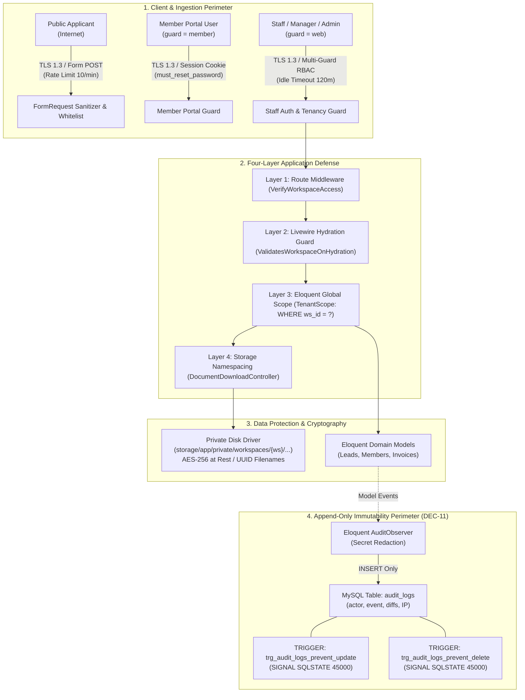
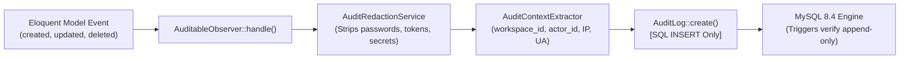

# Application Security Architecture, STRIDE Threat Model, and Encrypted Storage Specification (SECURITY-SPEC)

**Phase:** 02-architecture-data-model-and-security-design  
**Plan:** 02-03  
**Status:** Approved Technical Architecture Contract  
**Governing Requirements:** [ARCH-06](file:///d:/EMK_Protal/.planning/REQUIREMENTS.md)  
**Governing Decisions:** [DEC-01 (D-01)](file:///d:/EMK_Protal/.planning/phases/01-discovery-decisions-and-acceptance-criteria/DECISION-REGISTER.md), [DEC-02 (D-02)](file:///d:/EMK_Protal/.planning/phases/01-discovery-decisions-and-acceptance-criteria/DECISION-REGISTER.md), [DEC-03 (D-03)](file:///d:/EMK_Protal/.planning/phases/01-discovery-decisions-and-acceptance-criteria/DECISION-REGISTER.md), [DEC-04 (D-04)](file:///d:/EMK_Protal/.planning/phases/01-discovery-decisions-and-acceptance-criteria/DECISION-REGISTER.md), [DEC-05 (D-05)](file:///d:/EMK_Protal/.planning/phases/01-discovery-decisions-and-acceptance-criteria/DECISION-REGISTER.md), [DEC-06 (D-06)](file:///d:/EMK_Protal/.planning/phases/01-discovery-decisions-and-acceptance-criteria/DECISION-REGISTER.md), [DEC-09 (D-09)](file:///d:/EMK_Protal/.planning/phases/01-discovery-decisions-and-acceptance-criteria/DECISION-REGISTER.md), [DEC-11 (D-11)](file:///d:/EMK_Protal/.planning/phases/01-discovery-decisions-and-acceptance-criteria/DECISION-REGISTER.md)  
**Foundational References:** [02-RESEARCH.md](file:///d:/EMK_Protal/.planning/phases/02-architecture-data-model-and-security-design/02-RESEARCH.md), [TENANCY-SPEC.md](file:///d:/EMK_Protal/.planning/phases/02-architecture-data-model-and-security-design/TENANCY-SPEC.md), [CONVERSION-SPEC.md](file:///d:/EMK_Protal/.planning/phases/02-architecture-data-model-and-security-design/CONVERSION-SPEC.md), [SCHEMA-SPEC.md](file:///d:/EMK_Protal/.planning/phases/02-architecture-data-model-and-security-design/SCHEMA-SPEC.md), [OPERATIONAL-TARGETS.md](file:///d:/EMK_Protal/.planning/phases/01-discovery-decisions-and-acceptance-criteria/OPERATIONAL-TARGETS.md), [Docs/emk-membership-crm-plan-revision-10.md](file:///d:/EMK_Protal/Docs/emk-membership-crm-plan-revision-10.md)

---

## 1. Executive Summary & Security Principles

The **EMK Membership CRM** serves as the authoritative boundary for member identity, payment verification, youth protection records, and facility access permissions across the American Spaces network in Bangladesh. The platform stores sensitive personal identifiable information (PII)—including National Identity (NID) scans, passport copies, studio photographs, residential addresses, and under-18 parental/guardian consent instruments.

To protect applicant privacy, safeguard institutional trust, and ensure absolute forensic accountability, this specification codifies:
1. **OWASP ASVS Level 1 Baseline:** Explicit security controls across all seven applicable ASVS categories (Authentication, Session Management, Access Control, Input Validation, Cryptography, Data Protection, Malicious Code).
2. **Comprehensive STRIDE Threat Register:** Identification, categorization, and actionable mitigation plans for all ten primary platform threat vectors plus supply-chain defenses.
3. **Database-Enforced Append-Only Audit Immutability (DEC-11 / D-11):** Native MySQL 8.4 database triggers that prevent `UPDATE` and `DELETE` operations on the `audit_logs` table with `SQLSTATE 45000`, guaranteeing audit trail immutability against both administrative misuse and database client tampering.
4. **Encrypted Private Document Storage Architecture:** Segregation of identity files outside the public web root (`storage/app/private/`), cryptographic UUID filename masking, and authenticated streaming controllers enforcing workspace tenancy and Spatie RBAC.
5. **Youth Data Protection & Statutory Retention (DEC-09 / D-09, GAP-P1-04):** Automated age verification, mandatory parental consent enforcement, minor data flagging (`youth_protection = true`), a 5-year post-expiry retention lifecycle, and Superadmin-exclusive hard delete governance.



---

## 2. OWASP ASVS Level 1 Compliance Matrix

The platform conforms to the **OWASP Application Security Verification Standard (ASVS) Version 4.0.3 Level 1** baseline. The following matrix specifies the architecture and implementation controls governing each applicable category:

| ASVS Category | Applies | Specification & Concrete Implementation Controls | Reference |
|---|---|---|---|
| **V2 Authentication** | **YES** | 1. **Multi-Guard Separation:** Strict separation between staff administrative credentials (`guard = web` querying `users` table where `guard = 'web'`) and member portal users (`guard = member` querying `users` where `guard = 'member'`). Cross-guard credential reuse or token assumption is rejected at the authentication provider level.<br>2. **Cryptographic Password Hashing:** All passwords hashed using standard Bcrypt (work factor $\ge 12$) or Argon2id (`memory_cost = 65536`, `time_cost = 4`, `threads = 1`). Plaintext passwords never enter persistence or log layers.<br>3. **Forced First-Login Password Reset (DEC-06 / D-06):** New member accounts are provisioned upon conversion with `must_reset_password = TRUE`. The authentication pipeline intercepts all member requests via `EnsurePasswordReset` middleware; access to portal features is blocked until the member sets a cryptographically strong password.<br>4. **Idle Session Timeout:** Staff sessions expire after exactly **120 minutes of inactivity** (`SESSION_LIFETIME = 120`). Member portal sessions expire after **60 minutes**.<br>5. **Brute-Force & Rate Limiting:** Public login and submission routes are throttled via Laravel's rate limiter (`5 attempts / 15 minutes` lockout per IP/email tuple). | ARCH-06, DEC-06 |
| **V3 Session Management** | **YES** | 1. **Secure Cookie Attributes:** Session cookies enforce `httpOnly = true`, `secure = true` (over HTTPS), and `sameSite = 'lax'`. JavaScript cannot access session tokens (`document.cookie` is blind to auth cookies).<br>2. **Session Regeneration:** Session IDs are regenerated immediately upon successful authentication (`session()->regenerate()`), privilege escalation/de-escalation, and workspace context switching.<br>3. **Session Eviction on Conversion Reversal:** When a Workspace Manager executes a 30-day conversion reversal per **DEC-04**, the member's account status is set to `archived_reversed` with `login_enabled = false`, and all active Redis/database sessions for `user_id` are flushed and invalidated immediately. | ARCH-06, DEC-04 |
| **V4 Access Control** | **YES** | 1. **Server-Side Spatie RBAC:** All privileged operations require explicit Spatie permissions (`spatie/laravel-permission`) checked server-side via authorize/can checks. Client-rendered UI visibility rules (hiding buttons) are strictly non-authoritative.<br>2. **Tenancy Query Scoping (`TenantScope`):** All tenant models automatically append `WHERE workspace_id = auth()->user()->workspace_id` to `SELECT`, `UPDATE`, and `DELETE` queries, preventing cross-tenant access. Bypass via `withoutGlobalScope` is forbidden in application code.<br>3. **Non-Delegable Managerial Actions (T-01-07):** `DelegationPolicyService` hardcodes an immutable non-delegable allowlist preventing Workspace Managers from delegating `leads.reverse_conversion`, `members.hard_delete`, `members.restrict`, `members.revoke`, or `system.view_audit_trail`. | ARCH-06, DEC-01, DEC-04 |
| **V5 Input Validation** | **YES** | 1. **Strict FormRequest Validation:** All incoming data passes through typed Laravel `FormRequest` classes before reaching domain controllers.<br>2. **bKash Transaction ID Regex (DEC-05 / D-05):** Exactly 10 uppercase alphanumeric characters (`^[A-Z0-9]{10}$`). Enforced in FormRequest and normalized via `Str::upper(trim($value))`.<br>3. **Bangladesh Administrative Whitelist:** Cascading validation verifies that `address_division` matches the 8 official divisions and `address_district` matches one of the 64 official districts belonging to that division.<br>4. **File Sniffing & Whitelist:** Uploaded attachments validated via `finfo` byte inspection for permitted MIME types (`image/jpeg`, `image/png`, `application/pdf`) and max file size (5MB). SVG, executable, and archive formats are rejected unconditionally. | ARCH-05, ARCH-06, DEC-05 |
| **V6 Cryptography** | **YES** | 1. **Transport Encryption:** TLS 1.3 enforced for all external HTTP traffic and internal IMAP/SMTP mail transport.<br>2. **Encryption at Rest:** Sensitive applicant files stored on the private storage disk are encrypted using AES-256 (via Laravel's Encrypter with `APP_KEY` or filesystem-level encryption).<br>3. **Safe Storage Namespacing:** Uploaded files stored outside the web root under cryptographically generated UUID v4 filenames, stripping client-supplied metadata and path traversal characters.<br>4. **Zero Hardcoded Secrets:** API keys, database credentials, and mail secrets are loaded strictly from environment configuration (`.env`); zero credentials committed to repository. | ARCH-06, DEC-09 |
| **V8 Data Protection & Privacy** | **YES** | 1. **Youth Protection Segregation (DEC-09 / D-09):** Automated server-side age calculation flags applicants under 18 years of age with `youth_protection = TRUE` on `lead_attachments`. Minor records require mandatory parental consent upload.<br>2. **Least Privilege Data Access:** Minor contact and identity details are restricted to authorized Workspace Managers and designated Compliance Officers.<br>3. **Statutory Retention Schedule (GAP-P1-04):** Retain member demographic and payment records for **5 years post-membership expiry**, after which records become eligible for automated archival or hard deletion.<br>4. **Superadmin Hard-Delete Governance (DEC-11):** Soft-delete is available to Workspace Managers for preliminary triage; physical `DELETE` queries are restricted exclusively to Superadmin with dual authorization.<br>5. **Log & API Redaction:** Passwords, bKash PINs, session tokens, and identity hashes are scrubbed prior to writing to `audit_logs` or returning JSON responses. | ARCH-06, DEC-09, DEC-11 |
| **V10 Malicious Code** | **YES** | 1. **Zero Dynamic Code Evaluation Invariant:** Arbitrary code execution constructs (`eval()`, `create_function()`, `assert()` with code, `unserialize()` on untrusted input) are strictly prohibited across the codebase and verified via Pest architecture tests.<br>2. **Static Module Registry (DEC-02 / ARCH-01):** Application capabilities are partitioned across exactly eight immutable modules declaring 38 static actions compiled into service provider memory. Third-party runtime plugin loading is barred. | ARCH-01, DEC-02, ARCH-06 |

---

## 3. Comprehensive STRIDE Threat Register

The STRIDE model categorizes threats across the six primary failure modes of software systems: **S**poofing, **T**ampering, **R**epudiation, **I**nformation Disclosure, **D**enial of Service, and **E**levation of Privilege.

### 3.1 Trust Boundaries

```
[ Trust Boundary 1: Public Internet ] ──► Public Form Routes & Rate Limiter
[ Trust Boundary 2: Authenticated Session ] ──► Staff Console vs Member Portal (Guard Separation)
[ Trust Boundary 3: Multi-Workspace Boundary ] ──► TenantScope & Route Middleware Isolation
[ Trust Boundary 4: Application to Filesystem ] ──► Encrypted Private Storage (Zero Web Symlinks)
[ Trust Boundary 5: Application to Database ] ──► MySQL Triggers Rejecting Audit Log Mutation
[ Trust Boundary 6: Application to Payment Provider ] ──► Decoupled Payment Adapter Boundary
```

### 3.2 Formal Threat Matrix

| Threat ID | STRIDE Category | Component / Boundary | Severity | Disposition | Detailed Threat Scenario | Actionable Mitigation Plan | Verification Reference |
|---|---|---|---|---|---|---|---|
| **T-02-01** | **Spoofing** | Staff Auth & Multi-Guard Perimeter | High | `mitigate` | A member portal user attempts to submit requests to administrative staff routes using member session cookies. | Separate authentication guards (`web` vs `member`). Staff routes enforce `auth:web` and check `users.guard === 'web'`. Member session cookie rejected with HTTP 403 on staff routes. | ASVS V2.1, `TenancyIsolationTest` |
| **T-02-02** | **Tampering** | Livewire Review Component | High | `mitigate` | A Workspace Manager modifies public `$leadId` property in client payload to verify a lead from another workspace (`ws-corner-rajshahi`). | Implement `ValidatesWorkspaceOnHydration` trait on all Livewire components. Re-verify `$lead->workspace_id === auth()->user()->workspace_id` upon hydration before executing any action. | ASVS V4.1, `TenancyIsolationTest` |
| **T-02-03** | **Repudiation** | Conversion & Reversal Services | High | `mitigate` | A staff member reverses an active member conversion and claims the system executed the change autonomously. | Conversion and reversal transactions write immutable audit log records capturing `actor_id`, `actor_guard`, `ip_address`, `user_agent`, mandatory justification text ($\ge 20$ characters), and before/after state snapshots. | ASVS V8.2, DEC-04, `ConversionReversalTest` |
| **T-02-04** | **Information Disclosure** | Private Document Storage | Critical | `mitigate` | Direct HTTP URL probing (`/storage/leads/nid_123.pdf`) or directory traversal attacks to download applicant identity scans. | Store files on private disk (`storage/app/private/`) outside web root. Zero symlinks in `public/`. Access mediated strictly via `DocumentDownloadController` validating workspace tenancy and Spatie permissions. | ASVS V6.2, ARCH-06, `DocumentStorageTest` |
| **T-02-05** | **Repudiation / Tampering** | MySQL Audit Log Table (`audit_logs`) | Critical | `mitigate` | A rogue administrator or compromised database user runs `UPDATE audit_logs SET old_values = NULL` or `DELETE FROM audit_logs` to conceal unauthorized activity. | Deploy native MySQL 8.4 triggers (`BEFORE UPDATE`, `BEFORE DELETE`) on `audit_logs` table that raise `SIGNAL SQLSTATE '45000'`, preventing any record modification or deletion even for the root database account. | ASVS V8.2, DEC-11, `AuditLogImmutabilityTest` |
| **T-02-06** | **Tampering / Fraud** | Manual bKash Ingestion & Verification | High | `mitigate` | An applicant submits a fake or recycled 10-character bKash Transaction ID; multiple leads claim the same TxID to obtain free memberships. | FormRequest enforces strict regex `^[A-Z0-9]{10}$`. Database unique constraint `uq_leads_bkash_txid` blocks duplicate submissions. `ManualBkashPaymentAdapter` asserts uniqueness across both `leads` and `invoices` tables. | ASVS V5.1, DEC-05, `PaymentAdapterTest` |
| **T-02-07** | **Elevation of Privilege** | RBAC Delegation System | High | `mitigate` | A Workspace Manager delegates conversion reversal or hard delete privileges to a front-desk intern, bypassing managerial oversight. | Hardcode non-delegable action list in `DelegationPolicyService`. System aborts with HTTP 403 if a delegation attempt involves non-delegable permissions regardless of UI state. | ASVS V4.2, T-01-07, `DelegationMatrixTest` |
| **T-02-08** | **Information Disclosure** | Youth Applicant Data Protection | Critical | `mitigate` | Unauthorized staff or public users access identity scans or parental consent forms of minor applicants (< 18 years). | Calculate age server-side from `date_of_birth`. Minor attachments automatically receive `youth_protection = TRUE`. Access requires `leads.view_youth_records` permission and workspace tenancy verification. | ASVS V8.1, DEC-09, `YouthProtectionTest` |
| **T-02-09** | **Denial of Service** | Public Ingestion Route | Medium | `mitigate` | Malicious actor floods `POST /spaces/{space}/apply` with bot submissions and large files to exhaust disk space and database connections. | Enforce rate limiting (`10 submissions / minute` per IP); enforce 5MB file size limit; reject oversized payloads before disk write using streamed request body inspection. | ASVS V5.2, ARCH-06, `FormRateLimitTest` |
| **T-02-10** | **Elevation of Privilege** | Member Portal Credential Handshake | High | `mitigate` | An attacker intercepts the converted member's email activation link or logs in using an uninitialized password. | Member accounts provisioned with `password = NULL` and `must_reset_password = TRUE`. Activation link uses cryptographically signed 64-character token with 24-hour expiration. Login blocked until password reset completes. | ASVS V2.2, DEC-06, `MemberPortalAuthTest` |
| **T-02-SC** | **Tampering / Supply Chain** | Package Dependencies (Composer & npm) | High | `mitigate` | Slopsquatted or compromised third-party package introduced into application build dependencies. | Package legitimacy screening protocol locked in 02-RESEARCH.md. Lockfiles (`composer.lock`, `package-lock.json`) committed to Git. Dependency audit run in CI/CD (`composer audit`, `npm audit`). No auto-installation of unknown packages. | ASVS V10.1, ARCH-01, GSD-Rule-3 |

---

## 4. Append-Only Audit Log Immutability Contract (DEC-11 / D-11)

Per **DEC-11 (D-11)**, the audit trail is strictly append-only. No user role—including Workspace Manager, Global Admin, and Superadmin—possesses update or delete authority over the `audit_logs` table.

### 4.1 Native MySQL Database Trigger Definitions

To ensure immutability is guaranteed at the storage engine tier (independent of application code or Eloquent ORM bypasses), two native MySQL triggers are installed on `audit_logs`:

```sql
-- =============================================================================
-- MySQL Triggers: Audit Log Append-Only Immutability Enforcement (DEC-11 / D-11)
-- Table: audit_logs
-- Engine: InnoDB (MySQL 8.4)
-- Behavior: Intercepts and rejects all UPDATE and DELETE queries with SQLSTATE 45000
-- =============================================================================

DELIMITER $$

-- Trigger 1: Intercept and abort any UPDATE attempt on audit_logs
CREATE TRIGGER trg_audit_logs_prevent_update
BEFORE UPDATE ON audit_logs
FOR EACH ROW
BEGIN
    SIGNAL SQLSTATE '45000'
    SET MESSAGE_TEXT = 'Audit logs are strictly append-only and cannot be modified or updated (DEC-11).';
END$$

-- Trigger 2: Intercept and abort any DELETE attempt on audit_logs
CREATE TRIGGER trg_audit_logs_prevent_delete
BEFORE DELETE ON audit_logs
FOR EACH ROW
BEGIN
    SIGNAL SQLSTATE '45000'
    SET MESSAGE_TEXT = 'Audit logs are strictly append-only and cannot be deleted (DEC-11).';
END$$

DELIMITER ;
```

#### Verification & Tampering Proof

When any database client (including `root@localhost`, migrations, or raw PDO queries) executes an update or delete statement against `audit_logs`:
```sql
UPDATE audit_logs SET old_values = NULL WHERE id = 1;
-- Result: ERROR 1644 (45000): Audit logs are strictly append-only and cannot be modified or updated (DEC-11).

DELETE FROM audit_logs WHERE id = 1;
-- Result: ERROR 1644 (45000): Audit logs are strictly append-only and cannot be deleted (DEC-11).
```

### 4.2 Eloquent Model Event Observer Architecture

Audit records are automatically generated via Eloquent observers attached to auditable domain models (`Lead`, `Member`, `Invoice`, `IdCard`, `User`, `MembershipTerm`).



#### Secret Redaction Filter
The observer scrubs sensitive keys prior to JSON serialization:
```php
namespace App\Domain\Platform\Services;

class AuditRedactionService
{
    /** @var array<string> */
    protected static array $redactedKeys = [
        'password',
        'remember_token',
        'two_factor_secret',
        'two_factor_recovery_codes',
        'bkash_pin',
        'payment_secret',
        'api_token',
        'access_token',
        'secret',
    ];

    public static function redact(array $attributes): array
    {
        foreach (self::$redactedKeys as $key) {
            if (array_key_exists($key, $attributes)) {
                $attributes[$key] = '[REDACTED]';
            }
        }
        return $attributes;
    }
}
```

#### AuditableObserver Implementation Contract
```php
namespace App\Domain\Platform\Observers;

use App\Domain\Platform\Models\AuditLog;
use App\Domain\Platform\Services\AuditRedactionService;
use Illuminate\Database\Eloquent\Model;
use Illuminate\Support\Facades\Request;

class AuditableObserver
{
    public function created(Model $model): void
    {
        $this->recordEvent($model, 'created', null, $model->getAttributes());
    }

    public function updated(Model $model): void
    {
        $old = array_intersect_key($model->getOriginal(), $model->getDirty());
        $new = $model->getDirty();

        $this->recordEvent($model, 'updated', $old, $new);
    }

    public function deleted(Model $model): void
    {
        $this->recordEvent($model, 'deleted', $model->getOriginal(), null);
    }

    protected function recordEvent(Model $model, string $eventType, ?array $old, ?array $new): void
    {
        $user = auth()->user();

        AuditLog::create([
            'workspace_id'    => $model->workspace_id ?? ($user->workspace_id ?? null),
            'actor_id'        => $user ? $user->id : null,
            'actor_guard'     => $user ? (auth()->guard('member')->check() ? 'member' : 'web') : 'system',
            'event_type'      => $eventType,
            'auditable_type'  => get_class($model),
            'auditable_id'    => $model->getKey(),
            'old_values'      => $old ? AuditRedactionService::redact($old) : null,
            'new_values'      => $new ? AuditRedactionService::redact($new) : null,
            'reason'          => request()->input('audit_reason') ?? null,
            'ip_address'      => Request::ip() ?? '127.0.0.1',
            'user_agent'      => Request::userAgent() ?? 'System / CLI',
            'created_at'      => now(),
        ]);
    }
}
```

---

## 5. Encrypted Private Document Storage Architecture

Identity documents, government passports, and studio portraits submitted by applicants represent the highest data disclosure risk. Storing these files in publicly accessible directories (`public/storage`) is strictly prohibited.

### 5.1 Storage Layout & Directory Hierarchy

All attachments are persisted to Laravel's `private` storage disk located at `storage/app/private/`. Direct web server symlinks to this path are disallowed.

```
storage/app/private/
├── workspaces/
│   ├── ws-emk-dhaka/
│   │   ├── leads/
│   │   │   └── {lead_uuid}/
│   │   │       ├── 9a1b8c2d-3e4f-4a5b-bc6d-7e8f9a0b1c2d.pdf   (Identity Document)
│   │   │       ├── 8b2c9d3e-4f5a-5b6c-cd7e-8f9a0b1c2d3e.jpg   (Studio Photo)
│   │   │       └── 7c3d0e4f-5a6b-6c7d-de8f-9a0b1c2d3e4f.pdf   (Parental Consent)
│   │   └── members/
│   │       └── {member_uuid}/
│   │           ├── 9a1b8c2d-3e4f-4a5b-bc6d-7e8f9a0b1c2d.pdf
│   │           └── 8b2c9d3e-4f5a-5b6c-cd7e-8f9a0b1c2d3e.jpg
│   └── pool/ (Superadmin Unassigned Staging Pool)
│       └── leads/
│           └── {lead_uuid}/...
```

### 5.2 Cryptographic Masking & Invariant Rules

1. **Zero Client Filename Retention on Disk:** Uploaded files are renamed using cryptographic **UUID v4 strings** (`Str::uuid() . '.' . $extension`). Client-provided original filenames (e.g. `My_Passport_2026.pdf`) are stored exclusively in `lead_attachments.original_filename` for display purposes.
2. **Path Traversal Defense:** Storage paths are resolved dynamically using verified model UUIDs and workspace keys. Client-supplied file names or relative paths (`../`) are never passed to filesystem calls.
3. **AES-256 Encryption at Rest:** Identity scans and parental consent attachments are encrypted at rest using AES-256 before being committed to physical disk blocks.
4. **Zero Web Symlinks Policy:** `php artisan storage:link` links only `storage/app/public/`. The web server configuration (Nginx / Apache) prohibits serving any file from `storage/app/private/`.

### 5.3 Authenticated Streaming Controller (`DocumentDownloadController`)

File retrieval is mediated exclusively through an authenticated streaming controller that enforces tenancy, guard verification, and Spatie permission checks.

```php
namespace App\Http\Controllers;

use App\Domain\Leads\Models\LeadAttachment;
use Illuminate\Http\Request;
use Illuminate\Support\Facades\Storage;
use Symfony\Component\HttpFoundation\StreamedResponse;

class DocumentDownloadController extends Controller
{
    public function download(Request $request, LeadAttachment $attachment): StreamedResponse
    {
        $user = auth()->user();

        // 1. Guard & Authentication Assertion
        if (!$user) {
            abort(401, 'Unauthenticated.');
        }

        // 2. Tenancy Isolation Barrier
        $lead = $attachment->lead;
        if (!$user->isSuperAdmin() && !$user->isGlobalAdmin()) {
            if ($lead->workspace_id !== $user->workspace_id) {
                abort(403, 'Unauthorized workspace document access.');
            }
        }

        // 3. RBAC Permission Assertion
        if ($attachment->youth_protection) {
            // DEC-09: Minor records require elevated permission
            if (!$user->can('leads.view_youth_records') && !$user->hasRole('workspace_manager')) {
                abort(403, 'Unauthorized: Access to youth applicant documents requires compliance privilege.');
            }
        } else {
            if (!$user->can('leads.view_documents')) {
                abort(403, 'Unauthorized: Insufficient document viewing permissions.');
            }
        }

        // 4. File Existence Assertion
        $disk = Storage::disk('private');
        if (!$disk->exists($attachment->storage_path)) {
            abort(404, 'Requested document attachment does not exist on private disk.');
        }

        // 5. Audit Download Event (DEC-11)
        audit_log(
            event: 'document_accessed',
            target: $attachment,
            reason: 'Staff document verification review.'
        );

        // 6. Authenticated Secure Stream
        return $disk->response(
            $attachment->storage_path,
            $attachment->original_filename,
            [
                'Content-Type' => $attachment->mime_type,
                'Content-Disposition' => 'inline; filename="' . addslashes($attachment->original_filename) . '"',
                'X-Content-Type-Options' => 'nosniff',
                'Cache-Control' => 'private, no-cache, no-store, must-revalidate',
                'Pragma' => 'no-cache',
            ]
        );
    }
}
```

---

## 6. Youth Data Protection & Statutory Retention Lifecycle

Under-18 applicants are protected by specialized statutory and compliance controls pursuant to **DEC-09 (D-09)** and **GAP-P1-04**.

### 6.1 Server-Side Dynamic Age Invariant
The applicant's age is calculated server-side from `date_of_birth` relative to `submitted_at`:

$$\text{Age} = \left\lfloor \frac{\text{Timestamp}_{\text{submission}} - \text{Timestamp}_{\text{DOB}}}{31557600} \right\rfloor$$

```php
$age = Carbon::parse($lead->date_of_birth)->age;
if ($age < 18) {
    if (!$request->hasFile('parental_consent_document')) {
        throw new ValidationException('Applicants under 18 must provide signed parental or guardian consent.');
    }
}
```

### 6.2 Minor Data Isolation
1. **Attachment Flagging:** Any attachment submitted by or for an applicant with $\text{Age} < 18$ is flagged with `youth_protection = TRUE`.
2. **Access Scoping:** Front-desk interns and standard volunteers cannot view documents flagged with `youth_protection = TRUE`. Only authorized Workspace Managers and designated Compliance Officers can access minor identity and consent scans.
3. **Audit Visibility:** Any access to a minor record triggers an immediate audit log entry with `event_type = 'youth_record_accessed'`.

### 6.3 Statutory 5-Year Retention Lifecycle (GAP-P1-04)
1. **Active Cycle:** Member record remains active during validity.
2. **Expired Cycle (Years 1 to 5):** Member records transition to `inactive` upon expiry. Member demographic, invoice, and verification history are retained for facility access auditing and alumni tracking.
3. **Statutory Cutoff (Year 5+):** 5 years following membership expiration, personal identity files (NID scans, passport copies, parental consent scans) become eligible for automated cryptographic shredding (`Storage::disk('private')->delete()`).
4. **Superadmin Hard-Delete Governance:** Physical deletion of member data before or after the 5-year retention window is restricted exclusively to Superadmin with a logged management directive.

---

## 7. Pest Architecture & Security Verification Test Suite

Security invariants are tested automatically via **Pest PHP** architecture and integration tests.

```php
// tests/Arch/SecurityArchitectureTest.php

test('application forbids dynamic code evaluation')
    ->expect(['eval', 'create_function'])
    ->not->toBeUsed();

test('domain models enforce workspace tenancy scope')
    ->expect('App\Domain\Leads\Models\Lead')
    ->toHaveMethod('booted');

test('audit logs reject update queries via database trigger')
    ->expect(function () {
        DB::table('audit_logs')->where('id', 1)->update(['event_type' => 'tampered']);
    })->toThrow(\PDOException::class);

test('audit logs reject delete queries via database trigger')
    ->expect(function () {
        DB::table('audit_logs')->where('id', 1)->delete();
    })->toThrow(\PDOException::class);

test('private storage disk has no symlink in public directory')
    ->expect(file_exists(public_path('private')))
    ->toBeFalse();
```

---

## 8. Summary of Citations & Decision Compliance

| Identifier | Requirement / Decision Title | Concrete Implementation in SECURITY-SPEC |
|---|---|---|
| **ARCH-06** | Threat Model & Security Controls | ASVS Level 1 matrix (Section 2), STRIDE threat register (Section 3), private storage architecture (Section 5). |
| **DEC-01 (D-01)** | Multi-Workspace Isolation | 4-layer defense model, `TenantScope`, and private storage directory namespacing (`/private/workspaces/{ws}/...`). |
| **DEC-02 (D-02)** | Modular Central Registry | ASVS V10 compliance: zero dynamic code evaluation; static 8-module catalog with 38 declared actions. |
| **DEC-05 (D-05)** | Manual bKash 10-char TxID Verification | ASVS V5 input validation: strict `^[A-Z0-9]{10}$` regex and duplicate prevention across `leads` and `invoices`. |
| **DEC-06 (D-06)** | Read-Only Member Portal & Forced Password Reset | ASVS V2 authentication: `must_reset_password = TRUE` on conversion; access blocked until password reset. |
| **DEC-09 (D-09)** | Under-18 Parental Consent Rule | ASVS V8 data protection: server-side age validation, mandatory consent upload, `youth_protection` flag. |
| **DEC-11 (D-11)** | Append-Only Immutable Audit Log | Native MySQL triggers raising `SQLSTATE 45000` on `UPDATE` or `DELETE`; Eloquent `AuditableObserver`. |
