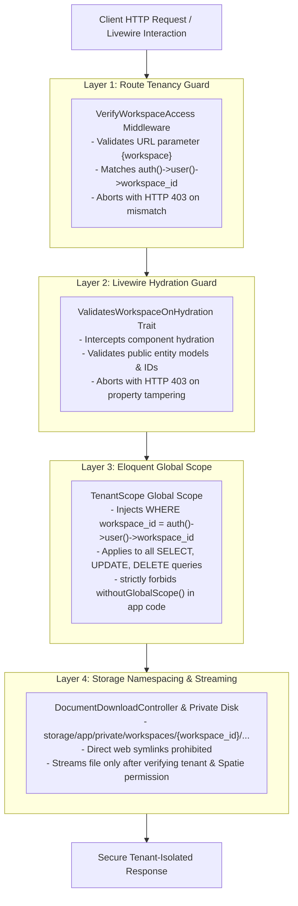

# Multi-Workspace Tenancy Defense Architecture Specification (TENANCY-SPEC)

**Phase:** 02-architecture-data-model-and-security-design  
**Plan:** 02-02  
**Status:** Approved Technical Architecture Contract  
**Governing Requirements:** [ARCH-03](file:///d:/EMK_Protal/.planning/REQUIREMENTS.md), [ARCH-06](file:///d:/EMK_Protal/.planning/REQUIREMENTS.md)  
**Governing Decisions:** [DEC-01 (D-01)](file:///d:/EMK_Protal/.planning/phases/01-discovery-decisions-and-acceptance-criteria/DECISION-REGISTER.md), [DEC-06 (D-06)](file:///d:/EMK_Protal/.planning/phases/01-discovery-decisions-and-acceptance-criteria/DECISION-REGISTER.md), [DEC-11 (D-11)](file:///d:/EMK_Protal/.planning/phases/01-discovery-decisions-and-acceptance-criteria/DECISION-REGISTER.md)  
**Foundational References:** [WORKSPACE-MAPPING.md](file:///d:/EMK_Protal/.planning/phases/01-discovery-decisions-and-acceptance-criteria/WORKSPACE-MAPPING.md), [02-RESEARCH.md](file:///d:/EMK_Protal/.planning/phases/02-architecture-data-model-and-security-design/02-RESEARCH.md), [SCHEMA-SPEC.md](file:///d:/EMK_Protal/.planning/phases/02-architecture-data-model-and-security-design/SCHEMA-SPEC.md)

---

## 1. Architectural Intent & Threat Model

In accordance with **DEC-01 (D-01)**, the EMK Membership CRM operates as a native multi-workspace application embedded within the Laravel 12 Hub monolith. The platform launches in pilot production exclusively serving **EMK Center Dhaka** (`ws-emk-dhaka`).

Multi-tenancy inside a single shared database engine introduces substantial risk of data leaks, horizontal privilege escalation, and cross-office record exposure if isolation relies on ad-hoc controller queries or client-side filters. This specification establishes an uncompromising **Four-Layer Server-Side Defense-in-Depth Model**.



### STRIDE Tenancy Threat Matrix

| Threat ID | Category | Attack Vector | Target Entity | Defensive Barrier | Mitigation Mechanism |
|---|---|---|---|---|---|
| **T-02-01** | Information Disclosure | URL parameter tampering (`/crm/ws-corner-sylhet/leads`) | Tenant CRM Routes | **Layer 1** (Route Middleware) | `VerifyWorkspaceAccess` rejects any non-Superadmin route mismatch with immediate `HTTP 403 Forbidden`. |
| **T-02-02** | Elevation of Privilege | Livewire network payload manipulation modifying public `$leadId` | Livewire Components | **Layer 2** (Hydration Guard) | `ValidatesWorkspaceOnHydration` inspects models and scalar IDs upon component hydration before any action triggers. |
| **T-02-03** | Tampering & Data Leakage | Developer omission of `where('workspace_id', ...)` in queries | Eloquent ORM Queries | **Layer 3** (Eloquent Scope) | `TenantScope` automatically injects workspace filtering into all queries; `withoutGlobalScope()` is banned in app code. |
| **T-02-04** | Information Disclosure | Direct web URL probing or path traversal to retrieve applicant NIDs | Storage Filesystem | **Layer 4** (Storage Namespacing) | Private disk storage namespacing (`/private/workspaces/{ws}/...`) with zero public web symlinks; guarded by `DocumentDownloadController`. |

---

## 2. Layer 1: Route Middleware (`VerifyWorkspaceAccess`)

### 2.1 Specification & Routing Architecture
All CRM, administrative, and workspace-scoped routes are bound to a route prefix containing the `{workspace}` slug parameter:
- `/crm/{workspace}/leads`
- `/crm/{workspace}/leads/{uuid}`
- `/crm/{workspace}/members`
- `/crm/{workspace}/invoices`
- `/crm/{workspace}/reports`

The `VerifyWorkspaceAccess` middleware executes immediately after Laravel's authentication guard (`auth:web`) and before controller or Livewire action execution.

### 2.2 Middleware Invariant Rules
1. **Authenticated Context:** User must be authenticated under the `web` guard.
2. **Superadmin & Global Admin Bypass:** Users possessing the `superadmin` or `global_admin` role have cross-workspace governance authority per **DEC-01** and bypass workspace route matching.
3. **Workspace Matching Assertion:** For all other users (Workspace Managers, Information Desk Officers, Reviewers), `auth()->user()->workspace_id` MUST be non-null and match the route parameter `{workspace}` exactly.
4. **Fail-Closed Execution:** Any mismatch, missing binding, or deactivated workspace terminates immediately with `abort(403, 'Unauthorized workspace access.')`.
5. **Route Parameter Sanitization:** The middleware extracts the workspace identifier, ensures it matches alphanumeric slug syntax (`^[a-z0-9-]+$`), and binds the active `Workspace` model to the request context.

### 2.3 Production Middleware Implementation Contract

```php
declare(strict_types=1);

namespace App\Http\Middleware;

use Closure;
use Illuminate\Http\Request;
use Symfony\Component\HttpFoundation\Response;

final class VerifyWorkspaceAccess
{
    /**
     * Handle an incoming request across workspace-scoped boundaries.
     *
     * @param  \Closure(\Illuminate\Http\Request): (\Symfony\Component\HttpFoundation\Response)  $next
     */
    public function handle(Request $request, Closure $next): Response
    {
        $user = $request->user();

        if ($user === null) {
            abort(Response::HTTP_UNAUTHORIZED, 'Unauthenticated.');
        }

        // Superadmin and Global Admin hold cross-workspace access
        if ($user->hasRole(['superadmin', 'global_admin'])) {
            return $next($request);
        }

        $routeWorkspace = $request->route('workspace');

        // Normalise string parameter if Route-Model binding resolved a Workspace instance
        if ($routeWorkspace instanceof \App\Domain\Workspaces\Models\Workspace) {
            $routeWorkspaceId = $routeWorkspace->id;
        } else {
            $routeWorkspaceId = (string) $routeWorkspace;
        }

        if (empty($user->workspace_id) || $routeWorkspaceId !== $user->workspace_id) {
            // Fail closed: Log security attempt and abort immediately
            \Illuminate\Support\Facades\Log::warning('Cross-workspace route access attempt blocked', [
                'user_id' => $user->id,
                'user_workspace' => $user->workspace_id,
                'attempted_workspace' => $routeWorkspaceId,
                'ip' => $request->ip(),
                'url' => $request->fullUrl(),
            ]);

            abort(Response::HTTP_FORBIDDEN, 'Unauthorized workspace access.');
        }

        return $next($request);
    }
}
```

---

## 3. Layer 2: Livewire Hydration Guard (`ValidatesWorkspaceOnHydration`)

### 3.1 The Livewire Component Hydration Threat
Livewire maintains state by serializing public component properties into encrypted JSON payloads transmitted between client and server. However, an attacker authenticated in `ws-emk-dhaka` can alter component payloads in network traffic (e.g., changing `$leadId = 42` to `$leadId = 88` where ID 88 belongs to an unprovisioned or different workspace).

If authorization is checked only inside initial `mount()` methods, subsequent action executions (e.g., `approve()`, `verifyPayment()`) would execute against the tampered model ID.

### 3.2 Guard Contract & Interception Cycle
To neutralize this attack vector, all Livewire components interacting with tenant domain entities must use the `ValidatesWorkspaceOnHydration` trait.

The trait hooks into Livewire's component lifecycle:
1. **`hydrate()` Hook:** Fires immediately upon component instantiation during network requests before any custom action method or updated hook runs.
2. **Entity Inspection:** Recursively examines public properties, identifying Eloquent model instances (`Lead`, `Member`, `Invoice`, `IdCard`) and scalar identifier properties (`$leadId`, `$memberId`).
3. **Workspace Invariant Assertion:** If the authenticated user is not Superadmin/Global Admin, the trait asserts that the model's `workspace_id` matches `auth()->user()->workspace_id`.
4. **Immediate Abortion:** On any violation, the trait calls `abort(403, 'Unauthorized workspace entity.')`, aborting the request before executing any component method.

### 3.3 Production Trait Implementation Contract

```php
declare(strict_types=1);

namespace App\Domain\Tenancy\Traits;

use App\Domain\Tenancy\Contracts\TenantEntityInterface;
use Illuminate\Database\Eloquent\Model;
use Symfony\Component\HttpFoundation\Response;

trait ValidatesWorkspaceOnHydration
{
    /**
     * Intercept Livewire component hydration on every incoming request.
     */
    public function hydrateValidatesWorkspaceOnHydration(): void
    {
        $user = auth()->user();

        // Unauthenticated or Superadmin/Global Admin users bypass tenant hydration assertion
        if ($user === null || $user->hasRole(['superadmin', 'global_admin'])) {
            return;
        }

        $activeWorkspaceId = $user->workspace_id;

        // Inspect all public properties declared on the component
        $reflection = new \ReflectionClass($this);
        $properties = $reflection->getProperties(\ReflectionProperty::IS_PUBLIC);

        foreach ($properties as $property) {
            $value = $property->getValue($this);

            if ($value instanceof TenantEntityInterface || $value instanceof Model) {
                $this->assertModelWorkspaceOwnership($value, $activeWorkspaceId);
            }
        }
    }

    /**
     * Assert model belongs strictly to the user's active workspace.
     */
    protected function assertModelWorkspaceOwnership(Model $model, string $activeWorkspaceId): void
    {
        if (!isset($model->workspace_id)) {
            return;
        }

        if ($model->workspace_id !== $activeWorkspaceId) {
            \Illuminate\Support\Facades\Log::alert('Livewire hydration tenant tampering detected', [
                'component' => static::class,
                'model' => get_class($model),
                'model_id' => $model->getKey(),
                'model_workspace' => $model->workspace_id,
                'user_workspace' => $activeWorkspaceId,
                'user_id' => auth()->id(),
            ]);

            abort(Response::HTTP_FORBIDDEN, 'Unauthorized workspace entity.');
        }
    }
}
```

---

## 4. Layer 3: Eloquent Global Scope (`TenantScope`)

### 4.1 Specification & Invariant Logic
The third defensive barrier operates directly at the relational query engine level. Even if a controller or service neglects to filter by `workspace_id`, the Eloquent ORM must guarantee that no cross-workspace data is ever queried, updated, or deleted.

The `TenantScope` is automatically registered across all tenant-owned models via the `BelongsToTenant` trait:
- `Lead` (`leads`)
- `Member` (`members`)
- `Invoice` (`invoices`)
- `IdCard` (`id_cards`)
- `MembershipTerm` (`membership_terms`)
- `LeadVerification` (`lead_verifications`)
- `LeadAttachment` (`lead_attachments`)
- `MemberChangeRequest` (`member_change_requests`)
- `AuditLog` (`audit_logs`)

### 4.2 Query Transformation
For every query executed by a non-Superadmin user, `TenantScope` appends:
```sql
WHERE `table_name`.`workspace_id` = 'ws-emk-dhaka'
```

When new records are instantiated via models using `BelongsToTenant`, the trait's `creating` model event automatically populates `workspace_id = auth()->user()->workspace_id` if not explicitly set.

### 4.3 Prohibition of `withoutGlobalScope`
**Hard Architectural Invariant:**
Calling `withoutGlobalScope(TenantScope::class)` or `withoutGlobalScopes()` is **strictly prohibited** in all:
- Controllers
- Livewire Components
- Form Requests
- Domain Services
- Export Services & Jobs
- Reporting Queries

**Single Permitted Exception:** Root Superadmin Artisan console commands (e.g. cross-workspace backup or database maintenance scripts executed via CLI).

This rule is enforced by an automated Pest Architecture test:
```php
test('application code never bypasses TenantScope')
    ->expect(['App\Http', 'App\Domain', 'App\Livewire'])
    ->not->toUse('withoutGlobalScope')
    ->not->toUse('withoutGlobalScopes');
```

### 4.4 Production Scope and Trait Implementation Contract

```php
declare(strict_types=1);

namespace App\Domain\Tenancy\Scopes;

use Illuminate\Database\Eloquent\Builder;
use Illuminate\Database\Eloquent\Model;
use Illuminate\Database\Eloquent\Scope;

final class TenantScope implements Scope
{
    /**
     * Apply the scope to a given Eloquent query builder.
     */
    public function apply(Builder $builder, Model $model): void
    {
        if (!auth()->check()) {
            return;
        }

        $user = auth()->user();

        // Superadmin and Global Admin retain cross-workspace query visibility
        if ($user->guard === 'web' && $user->hasRole(['superadmin', 'global_admin'])) {
            return;
        }

        // Enforce strict workspace isolation
        if (!empty($user->workspace_id)) {
            $builder->where($model->qualifyColumn('workspace_id'), '=', $user->workspace_id);
        } else {
            // Unbound staff user: fail-closed by forcing empty result
            $builder->whereRaw('1 = 0');
        }
    }
}
```

```php
declare(strict_types=1);

namespace App\Domain\Tenancy\Traits;

use App\Domain\Tenancy\Scopes\TenantScope;
use Illuminate\Database\Eloquent\Model;

trait BelongsToTenant
{
    /**
     * Boot the BelongsToTenant trait for the model.
     */
    public static function bootBelongsToTenant(): void
    {
        static::addGlobalScope(new TenantScope());

        static::creating(function (Model $model): void {
            if (empty($model->workspace_id) && auth()->check()) {
                $user = auth()->user();
                if (!empty($user->workspace_id)) {
                    $model->workspace_id = $user->workspace_id;
                }
            }
        });
    }

    /**
     * Relationship to the Workspace anchor model.
     */
    public function workspace(): \Illuminate\Database\Eloquent\Relations\BelongsTo
    {
        return $this->belongsTo(\App\Domain\Workspaces\Models\Workspace::class, 'workspace_id', 'id');
    }
}
```

---

## 5. Layer 4: Storage Namespacing & Streaming Controller

### 5.1 Storage Architecture & Isolation
Uploaded applicant documents (NID cards, passport scans, birth certificates, minor parental consent forms) and studio portrait photos constitute sensitive Personally Identifiable Information (PII) and youth records under **DEC-09**.

1. **Private Storage Disk:** All files are persisted to Laravel's private storage disk located at `storage/app/private/`.
2. **Strict Namespacing:** File paths are compartmentalized by tenant workspace ID:
   ```
   storage/app/private/workspaces/{workspace_id}/leads/{lead_uuid}/{file_hash}.{ext}
   storage/app/private/workspaces/{workspace_id}/members/{member_uuid}/{file_hash}.{ext}
   ```
3. **Zero Web Symlinks:** The `public/` web root MUST NOT contain any symlink to `storage/app/private/`. Running `php artisan storage:link` links only `storage/app/public/` for non-sensitive public assets.
4. **Obfuscated Disk Filenames:** Physical filenames on disk are SHA-256 hashes generated from file contents and cryptographic salts. Original filenames are preserved strictly inside `lead_attachments.original_filename` metadata.

### 5.2 Document Streaming Controller (`DocumentDownloadController`)
Direct HTTP requests to static file assets are impossible. File delivery requires an authorized streaming controller asserting four strict gates:
1. **Authentication Gate:** User authenticated under `web` (staff) or `member` (portal) guard.
2. **Workspace Gate:** The target attachment's `workspace_id` must match `auth()->user()->workspace_id` (unless Superadmin).
3. **Permission Gate:** Staff must possess `leads.view` or `members.view` permission; Members can download only their own profile attachments.
4. **Secure Headers:** Delivered with `X-Content-Type-Options: nosniff` and scoped `Content-Disposition`.

### 5.3 Streaming Controller Implementation Contract

```php
declare(strict_types=1);

namespace App\Http\Controllers\Tenancy;

use App\Domain\Leads\Models\LeadAttachment;
use App\Http\Controllers\Controller;
use Illuminate\Http\Request;
use Illuminate\Support\Facades\Storage;
use Symfony\Component\HttpFoundation\Response;
use Symfony\Component\HttpFoundation\StreamedResponse;

final class DocumentDownloadController extends Controller
{
    /**
     * Securely stream private tenant documents.
     */
    public function __invoke(Request $request, string $workspace, string $attachmentUuid): StreamedResponse
    {
        $user = $request->user();

        // 1. Resolve attachment without tenancy bypass
        $attachment = LeadAttachment::where('uuid', $attachmentUuid)->firstOrFail();
        $lead = $attachment->lead;

        // 2. Validate workspace ownership
        if (!$user->hasRole(['superadmin', 'global_admin'])) {
            if ($lead->workspace_id !== $user->workspace_id || $workspace !== $user->workspace_id) {
                abort(Response::HTTP_FORBIDDEN, 'Unauthorized file access.');
            }
        }

        // 3. Spatie permission authorization
        if ($user->guard === 'web') {
            if (!$user->can('leads.view') && !$user->can('members.view')) {
                abort(Response::HTTP_FORBIDDEN, 'Insufficient permissions to view document.');
            }
        } elseif ($user->guard === 'member') {
            // Portal member can only view their own files
            if ($lead->email !== $user->email) {
                abort(Response::HTTP_FORBIDDEN, 'Access denied.');
            }
        }

        // 4. Assert physical existence on private disk
        $disk = Storage::disk('private');
        if (!$disk->exists($attachment->storage_path)) {
            abort(Response::HTTP_NOT_FOUND, 'Requested document does not exist.');
        }

        // 5. Stream response with security headers
        return $disk->response(
            $attachment->storage_path,
            $attachment->original_filename,
            [
                'X-Content-Type-Options' => 'nosniff',
                'Cache-Control' => 'private, no-cache, no-store, must-revalidate',
                'Pragma' => 'no-cache',
            ]
        );
    }
}
```

---

## 6. Staging Pool Architecture & Non-EMK Routing

### 6.1 Public Application Dropdown Routing
The public membership form allows applicants to choose between all six American Spaces in Bangladesh per **WORKSPACE-MAPPING.md**:
1. `EMK-DHK`: EMK Center Dhaka
2. `AC-DHK`: American Center Dhaka
3. `CR-BAR`: Barishal American Corner
4. `CR-CTG`: Chattogram American Corner
5. `CR-RAJ`: Rajshahi American Corner
6. `CR-SYL`: Sylhet American Corner

### 6.2 Staging Ingestion Rules
When a submission is received:
- **EMK Center Dhaka Selection:** System sets `workspace_id = 'ws-emk-dhaka'` and `target_space_code = 'EMK-DHK'`. Lead becomes immediately active in the EMK Center staff queue.
- **Other Spaces Selection:** System sets `workspace_id = NULL` and `target_space_code` to the selected Space code (e.g. `'CR-BAR'`).

### 6.3 Staging Isolation & Superadmin Drainage
Because `leads.workspace_id` is `NULL`, queries from `ws-emk-dhaka` staff (which append `WHERE workspace_id = 'ws-emk-dhaka'`) strictly ignore staging records. 

Submissions in the staging pool:
1. Are visible **exclusively** to `superadmin` and `global_admin` in a dedicated Superadmin Staging Queue (`/admin/staging-pool`).
2. Cannot be approved or converted into members until a dedicated workspace is formally provisioned by Superadmin per **GAP-P1-01**.
3. When Superadmin provisions a new workspace (e.g., `ws-corner-barishal`), an atomic migration artisan command drains records matching `target_space_code = 'CR-BAR'`, updating their `workspace_id` from `NULL` to `'ws-corner-barishal'` and moving file storage to `storage/app/private/workspaces/ws-corner-barishal/`.

---

## 7. Pest Architecture Compliance Tests

The tenancy invariants must be verified programmatically during CI/CD execution via Pest Architecture tests:

```php
declare(strict_types=1);

test('all tenant domain models use BelongsToTenant trait')
    ->expect([
        \App\Domain\Leads\Models\Lead::class,
        \App\Domain\Members\Models\Member::class,
        \App\Domain\Invoices\Models\Invoice::class,
        \App\Domain\IdCards\Models\IdCard::class,
        \App\Domain\Forms\Models\MembershipTerm::class,
    ])
    ->toUseTrait(\App\Domain\Tenancy\Traits\BelongsToTenant::class);

test('application layers strictly forbid withoutGlobalScope')
    ->expect(['App\Http', 'App\Domain', 'App\Livewire'])
    ->not->toUse('withoutGlobalScope')
    ->not->toUse('withoutGlobalScopes');

test('all CRM controllers are protected by VerifyWorkspaceAccess')
    ->expect('App\Http\Controllers\Crm')
    ->toUse(\App\Http\Middleware\VerifyWorkspaceAccess::class);
```

---

## 8. Summary of Architectural Guarantees

1. **Four Independent Barriers:** Compromising or bypassing a single layer (e.g. client parameter manipulation) is neutralized by the remaining three server-side layers.
2. **Pilot Isolation:** EMK Center Dhaka (`ws-emk-dhaka`) is completely firewalled from future American Spaces and staging records.
3. **No Dynamic Bypass:** `withoutGlobalScope` is banned in application code by automated architectural tests.
4. **Protected File Storage:** Private document disk namespacing completely isolates identity assets from public web exposure.
