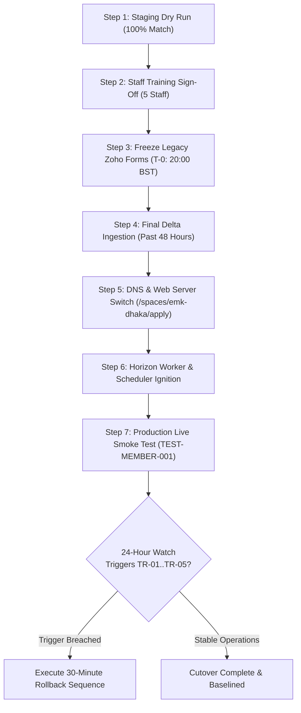
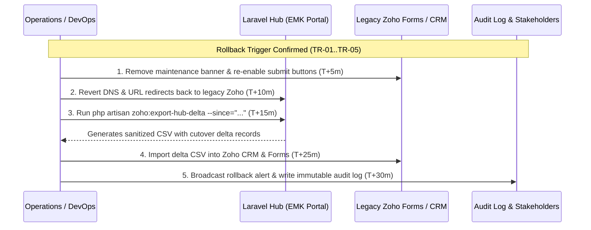

# Comprehensive Production Cutover Runbook & Emergency Rollback Protocol

**Phase:** 11-zoho-migration-and-reconciliation  
**Plan:** 11-04  
**Target Space:** EMK Center Dhaka (`ws-emk-dhaka`)  
**Status:** Approved Operational Procedure  
**Governing Documents:** [OPERATIONAL-TARGETS.md](../../01-discovery-decisions-and-acceptance-criteria/OPERATIONAL-TARGETS.md), [DECISION-REGISTER.md](../../01-discovery-decisions-and-acceptance-criteria/DECISION-REGISTER.md)  
**Requirements Reference:** MIGR-05, DEC-01 (D-01), DEC-06 (D-06), DEC-11 (D-11), GAP-P1-05, GAP-P1-06  

---

## 1. Executive Summary & Zero-Data-Loss Invariant

This runbook establishes the strict, gated execution sequence for transitioning public membership applications, applicant verification workflows, and active member directory records from legacy Zoho Forms and Zoho CRM to the Laravel Hub EMK Membership CRM.

### Core Cutover Invariants
1. **Zero Data Loss Guarantee:** Every application submitted in either platform is preserved, reconciled, and audited.
2. **Transaction Isolation:** Pre-cutover simulations use the transactional dry-run engine (`zoho:dry-run`) guaranteeing zero database writes prior to formal approval.
3. **Inactive Portal Staging:** Legacy member accounts are imported with `guard = 'member'`, `is_active = false`, `must_reset_password = true`, and `password = null` per DEC-06. No unauthenticated logins or session leaks are permitted.
4. **Deterministic Rollback SLA:** If any quantifiable rollback trigger (TR-01 through TR-05) is breached, reversal to legacy Zoho Forms is completed within **30 minutes** using the delta extraction engine (`zoho:export-hub-delta`).

---

## 2. Seven-Step Production Cutover Protocol



### Step 1: Pre-Cutover Staging Dry Run
- **Timing:** Cutover Day minus 24 hours (T-24h)
- **Responsible:** Tech Lead / Lead Architect
- **Execution:**
  1. Execute transactional dry run on full legacy dataset:
     ```bash
     php artisan zoho:dry-run storage/migration/zoho_contacts_export.csv --workspace=ws-emk-dhaka --type=contacts_members
     php artisan zoho:dry-run storage/migration/zoho_leads_export.csv --workspace=ws-emk-dhaka --type=leads
     ```
  2. Verify that 100% of rows simulate without unhandled exceptions.
  3. Run full reconciliation across staged data:
     ```bash
     php artisan zoho:reconcile --workspace=ws-emk-dhaka --format=console
     ```
- **Exit Gate:** 100% match rate across counts, unique emails, and dates; 0 discrepancies; 0 permanent database writes created during simulation.

### Step 2: Staff Training Sign-Off
- **Timing:** Cutover Day (T-4h)
- **Responsible:** Center Manager / Operations Lead
- **Execution:**
  1. Verify all 5 designated EMK Center Dhaka staff users (Front Desk, Verification Officer, Finance Officer, Center Manager, Global Admin) have completed training on:
     - Lead Tri-State Verification (Payment TxID, Identity Document, Studio Photo).
     - ID Card Printing & Delivery Tracking.
     - Inactive Member Portal Claim Assistance.
     - Profile Change Request Approvals.
- **Exit Gate:** Signed training sign-off sheet logged in management registry.

### Step 3: Form Freeze at Cutoff (T-0: 20:00 BST)
- **Timing:** T-0 (20:00 BST)
- **Responsible:** DevOps / Webmaster
- **Execution:**
  1. Access Zoho Forms administration console.
  2. Disable the "Submit" action button on public membership forms.
  3. Publish the scheduled maintenance announcement banner:
     > *"EMK Center Dhaka membership applications are currently transitioning to our new membership portal. Applications will resume at 22:00 BST. Thank you for your patience."*
- **Exit Gate:** Legacy Zoho form returns maintenance banner and blocks any new submissions.

### Step 4: Final Delta Ingestion
- **Timing:** T+15m (20:15 BST)
- **Responsible:** Data Migration Engineer
- **Execution:**
  1. Export incremental delta from Zoho CRM and Zoho Forms for submissions received in the prior 48 hours.
  2. Ingest final delta into core CRM tables:
     ```bash
     php artisan zoho:import storage/migration/delta_contacts.csv --workspace=ws-emk-dhaka --type=contacts_members
     php artisan zoho:import storage/migration/delta_leads.csv --workspace=ws-emk-dhaka --type=leads
     php artisan zoho:import-attachments storage/migration/delta_attachments_manifest.csv storage/migration/attachments/
     ```
  3. Provision inactive portal user accounts for newly imported members:
     ```bash
     php artisan zoho:provision-portal-accounts --workspace=ws-emk-dhaka
     ```
  4. Run final reconciliation audit:
     ```bash
     php artisan zoho:reconcile --workspace=ws-emk-dhaka --format=console
     ```
- **Exit Gate:** Delta ingestion completed with `zoho_id` preserved on all records; all portal accounts staged inactive (`is_active = false`).

### Step 5: DNS & Web Server Switch
- **Timing:** T+45m (20:45 BST)
- **Responsible:** DevOps / SysAdmin
- **Execution:**
  1. Update Nginx / Apache reverse proxy routing to expose public application form:
     - Canonical URL: `https://portal.emk.org.bd/spaces/emk-dhaka/apply`
     - Legacy redirect: Map `https://emkcenter.org/membership` -> `https://portal.emk.org.bd/spaces/emk-dhaka/apply`
  2. Verify SSL/TLS certificates and security headers (HSTS, CSP, X-Frame-Options).
- **Exit Gate:** Public domain serves EMK Portal application form with 200 OK.

### Step 6: Queue & Worker Ignition
- **Timing:** T+60m (21:00 BST)
- **Responsible:** DevOps / SysAdmin
- **Execution:**
  1. Start Laravel Horizon queue supervisors:
     ```bash
     php artisan horizon:terminate
     php artisan horizon
     ```
  2. Verify queue status across priority tiers (`high_priority`, `emails`, `documents`, `default`).
  3. Confirm cron scheduler daemon is actively executing `php artisan schedule:run` every minute.
- **Exit Gate:** Horizon dashboard displays `Active` status with 0 failed jobs and healthy worker balance.

### Step 7: Live Production Smoke Test
- **Timing:** T+75m (21:15 BST)
- **Responsible:** QA Lead / Center Manager
- **Execution:**
  1. Submit a simulated live application using dedicated test identifier:
     - Name: `Smoke Test Member`
     - Email: `smoke.test.member.001@emk.org.bd`
     - bKash TxID: `TXSMOKE001`
     - Tag: `TEST-MEMBER-001`
  2. Login as Verification Officer and verify tri-state approvals (Payment, Document, Photo).
  3. Approve conversion to Member and verify invoice generation.
  4. Confirm automated email notification received in test inbox.
  5. Purge test smoke record from database and audit log confirmation.
- **Exit Gate:** Successful end-to-end traversal of application lifecycle; system declared fully live at 22:00 BST.

---

## 3. Quantifiable Rollback Triggers (TR-01 through TR-05)

An immediate rollback to legacy Zoho Forms is triggered if any of the following objective thresholds are breached within the first 24 hours of cutover:

| Trigger ID | Description | Threshold | Detection Mechanism | Severity | Action |
|---|---|---|---|---|---|
| **TR-01** | Public Submission Failure Rate | **> 2%** of submission attempts | Sentry / CloudWatch application error metrics | Critical | Immediate Halt & Rollback |
| **TR-02** | Historical Data Discrepancy | **> 0.1%** difference from Zoho source | `php artisan zoho:reconcile` audit report | Critical | Immediate Halt & Rollback |
| **TR-03** | Cross-Workspace Data Leakage | **Any occurrence** (DEC-01 breach) | Tenancy scope assertion / Security audit trigger | Critical | Immediate Halt & Rollback |
| **TR-04** | Notification Delivery Failure | **> 5%** of queued notification emails | Horizon failed jobs / Mailgun webhook alerts | High | Technical Review / Rollback |
| **TR-05** | Document Storage Corruption | **Any occurrence** (AES-256 decryption/hash fail) | Document access error log / Health check | Critical | Immediate Halt & Rollback |

---

## 4. 30-Minute Emergency Rollback Sequence

If a rollback trigger is breached, the Superadmin, Lead Architect, and DevOps Lead will execute the following 5-step reversal sequence within 30 minutes:



### Detailed Rollback Steps:
1. **Re-activate Legacy Forms (T+5m):**
   - Access Zoho Forms administration console.
   - Remove scheduled maintenance banner.
   - Re-enable submission action buttons.
2. **Revert DNS & Web Routing (T+10m):**
   - Point `https://portal.emk.org.bd/spaces/emk-dhaka/apply` back to the legacy Zoho Form URL.
   - Flush Cloudflare / CDN cache.
3. **Export Hub Delta Applications (T+15m):**
   - Extract all applications submitted to the Laravel Hub during the live window:
     ```bash
     php artisan zoho:export-hub-delta --since="2026-11-05 20:00:00" --workspace=ws-emk-dhaka --output=storage/rollback/hub_delta_export.csv
     ```
   - Verify CSV formula injection sanitization (`'` prepended to `=`, `+`, `-`, `@`).
   - File permissions are automatically locked to `0600`.
4. **Import Delta Applications to Zoho CRM (T+25m):**
   - Upload `storage/rollback/hub_delta_export.csv` into Zoho CRM Leads module.
   - Verify bKash Transaction IDs, timestamps, and applicant contacts are preserved.
5. **Issue Incident Handoff & Audit Recording (T+30m):**
   - Emit global incident notification to Center Director and US Embassy Public Diplomacy Section.
   - Audit event `hub_delta_exported` automatically recorded in immutable `audit_logs` table (DEC-11).
   - Schedule technical post-mortem within 24 hours.

---

## 5. Roles & Sign-Off Authorization

The cutover cannot proceed without unanimous, verified sign-offs from all four operational authorities:

| Role | Authority Scope | Designated Individual | Cutover Approval | Rollback Authority |
|---|---|---|---|---|
| **Center Manager** | Operational Readiness & Staff Training | Center Manager, EMK Center Dhaka | [ ] Approved | [ ] Authorized |
| **Lead Architect** | Data Integrity & Reconciled Invariants | Lead System Architect | [ ] Approved | [ ] Authorized |
| **DevOps / SysAdmin** | Infrastructure, DNS, & Horizon Queues | DevOps Engineer | [ ] Approved | [ ] Authorized |
| **Superadmin** | Final Executive Go/No-Go & Reversal Order | Superadmin / IT Director | [ ] Approved | [ ] Authorized |
