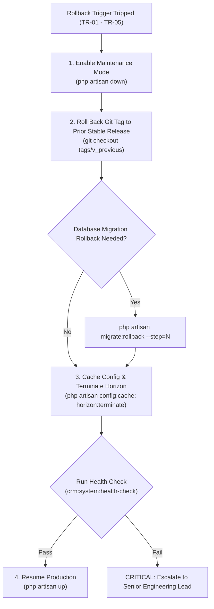

# EMK Center Membership CRM - Production Deployment Runbook

**Document Version:** 1.0.0  
**Phase:** 12-verification-security-review-release-and-later-payment-gatew  
**Plan:** 12-04  
**Requirements Reference:** RELS-04, DEC-01 (D-01), DEC-11 (D-11), OPERATIONAL-TARGETS.md  
**Classification:** DevOps / System Administration Confidential  

---

## 1. System Prerequisites & Architecture Specifications

### 1.1 Minimum Hardware & Infrastructure Envelope
To satisfy the baseline capacity envelope defined in `OPERATIONAL-TARGETS.md` (500 active members, up to 2,500 peak records, 5 concurrent staff sessions, 50 simultaneous submissions/hr):

| Component | Minimum Specification | Recommended Production Spec |
|-----------|-----------------------|-----------------------------|
| **Compute / VPS** | 2 vCPU, 4 GB RAM, 40 GB NVMe SSD | 4 vCPU, 8 GB RAM, 80 GB NVMe SSD |
| **Operating System** | Ubuntu 22.04 LTS / 24.04 LTS x86_64 | Ubuntu 24.04 LTS x86_64 |
| **PHP Runtime** | PHP 8.2 or 8.3 (CLI + FPM) | PHP 8.3-FPM with Zend OPcache enabled |
| **Relational Database** | MySQL 8.0.32+ or Percona Server 8.0 | MySQL 8.0 Enterprise with binary logging |
| **In-Memory Cache & Queue** | Redis 7.0+ (Standalone or Managed) | Redis 7.2 with persistent snapshotting (AOF/RDB) |
| **Web Server / Reverse Proxy** | Nginx 1.24+ with HTTP/2 and TLS 1.3 | Nginx with Cloudflare / AWS ALB SSL termination |
| **Storage Subsystem** | Dedicated private block volume (POSIX) | Encrypted ext4 block volume (`chmod 700`) |

### 1.2 PHP Extension Checklist
Verify that all mandatory PHP modules are compiled and active prior to deployment:
```bash
php -m | grep -E 'bcmath|ctype|curl|dom|fileinfo|json|mbstring|openssl|pdo_mysql|redis|xml|zip'
```

Required Extensions:
- `bcmath` - Financial BDT precision calculation
- `ctype` - Text character validation
- `curl` - bKash PGW API & webhook integration
- `dom` - XML & DOM parsing
- `fileinfo` - MIME-type inspection for private document uploads
- `json` - JSON API payloads and structured audit logs
- `mbstring` - Multilingual Unicode support (English & Bengali names)
- `openssl` - AES-256 document and backup encryption
- `pdo_mysql` - High-performance MySQL database connectivity
- `redis` - phpredis C-extension for low-latency Horizon queues
- `xml` - XML document export and serialization
- `zip` - Encrypted backup archive packaging

### 1.3 MySQL 8.0 Optimization Baseline
Configure `/etc/mysql/conf.d/emk-crm.cnf`:
```ini
[mysqld]
default_storage_engine = InnoDB
innodb_file_per_table = 1
innodb_buffer_pool_size = 2G
innodb_log_file_size = 512M
innodb_flush_log_at_trx_commit = 1
innodb_flush_method = O_DIRECT
character-set-server = utf8mb4
collation-server = utf8mb4_unicode_ci
transaction-isolation = READ-COMMITTED

# Binary Logging for RPO <= 1h Point-in-Time Recovery
server-id = 1
log_bin = /var/log/mysql/mysql-bin.log
binlog_format = ROW
binlog_row_image = FULL
expire_logs_days = 7
max_binlog_size = 100M
```

---

## 2. Production Environment Configuration (.env Security Checklist)

### 2.1 File Permissions & Hardening
The production `.env` file contains sensitive encryption keys, database passwords, and merchant API secrets:
```bash
# Set strict ownership and permissions
sudo chown www-data:www-data /var/www/emk-crm/.env
sudo chmod 600 /var/www/emk-crm/.env
```

### 2.2 Security Configuration Checklist
Ensure every variable conforms to the production security baseline:

```dotenv
###############################################################################
# APPLICATION ENVIRONMENT & CORE SECURITY
###############################################################################
APP_NAME="EMK Center Membership CRM"
APP_ENV=production
APP_DEBUG=false
APP_URL=https://portal.emkcenter.com
APP_TIMEZONE="Asia/Dhaka"

# 32-byte base64 AES-256 encryption key (generated via php artisan key:generate)
APP_KEY=base64:YOUR_GENERATED_32_BYTE_BASE64_KEY_HERE

###############################################################################
# SESSION, COOKIES & SECURITY HEADERS
###############################################################################
SESSION_DRIVER=redis
SESSION_LIFETIME=120
SESSION_ENCRYPT=true
SESSION_PATH=/
SESSION_DOMAIN=.emkcenter.com
SESSION_SECURE_COOKIE=true
SESSION_HTTP_ONLY=true
SESSION_SAME_SITE=lax

###############################################################################
# DATABASE CONNECTION (MySQL 8)
###############################################################################
DB_CONNECTION=mysql
DB_HOST=127.0.0.1
DB_PORT=3306
DB_DATABASE=emk_crm_production
DB_USERNAME=emk_crm_usr
DB_PASSWORD="COMPLEX_RANDOMLY_GENERATED_DB_SECRET"
DB_STRICT_MODE=true

###############################################################################
# REDIS CACHE & HORIZON QUEUES
###############################################################################
REDIS_CLIENT=phpredis
REDIS_HOST=127.0.0.1
REDIS_PASSWORD="COMPLEX_REDIS_AUTH_SECRET"
REDIS_PORT=6379
REDIS_PREFIX="emk_crm_prod:"

QUEUE_CONNECTION=redis
CACHE_STORE=redis

###############################################################################
# HORIZON CONFIGURATION
###############################################################################
HORIZON_PREFIX="emk_horizon_prod:"
HORIZON_PATH="horizon"

###############################################################################
# FILESYSTEM & PRIVATE ENCRYPTED DOCUMENT STORAGE
###############################################################################
FILESYSTEM_DISK=private
BACKUP_ENCRYPTION_KEY="COMPLEX_DEDICATED_AES_256_BACKUP_KEY"

###############################################################################
# BKASH PAYMENT GATEWAY (PRODUCTION LIVE WALLET)
###############################################################################
BKASH_ENV=live
BKASH_BASE_URL="https://tokenized.pay.bka.sh/v1.2.0-beta"
BKASH_APP_KEY="PROD_BKASH_APP_KEY"
BKASH_APP_SECRET="PROD_BKASH_APP_SECRET"
BKASH_USERNAME="PROD_BKASH_USERNAME"
BKASH_PASSWORD="PROD_BKASH_PASSWORD"
BKASH_MERCHANT_WALLET="017XXXXXXXX"

###############################################################################
# MAIL & NOTIFICATION CONFIGURATION
###############################################################################
MAIL_MAILER=smtp
MAIL_HOST=smtp.office365.com
MAIL_PORT=587
MAIL_USERNAME=membership@emkcenter.com
MAIL_PASSWORD="SECURE_SMTP_APP_PASSWORD"
MAIL_ENCRYPTION=tls
MAIL_FROM_ADDRESS=membership@emkcenter.com
MAIL_FROM_NAME="EMK Center Membership Desk"
```

---

## 3. Database Migration & Initial Workspace Seeding

### 3.1 Initial Database Setup
Create the dedicated database and least-privilege database user:
```sql
CREATE DATABASE emk_crm_production CHARACTER SET utf8mb4 COLLATE utf8mb4_unicode_ci;
CREATE USER 'emk_crm_usr'@'127.0.0.1' IDENTIFIED WITH caching_sha2_password BY 'COMPLEX_RANDOMLY_GENERATED_DB_SECRET';
GRANT SELECT, INSERT, UPDATE, DELETE, CREATE, DROP, INDEX, ALTER, LOCK TABLES, CREATE TEMPORARY TABLES, REFERENCES ON emk_crm_production.* TO 'emk_crm_usr'@'127.0.0.1';
FLUSH PRIVILEGES;
```

### 3.2 Running Migrations & Seeding
Execute schema migrations and canonical role/workspace seeders with `--force`:
```bash
cd /var/www/emk-crm

# 1. Execute schema migrations in production mode
php artisan migrate --force

# 2. Seed canonical RBAC roles and declared module registry actions
php artisan db:seed --class=RolesAndPermissionsSeeder --force

# 3. Seed default workspace and membership terms (ws-emk-dhaka)
php artisan db:seed --class=DefaultMembershipFormSeeder --force
```

### 3.3 Provisioning Authorized Named Superadmin
Avoid manual database SQL injection. Use the auditable CLI command per DEC-11:
```bash
php artisan crm:provision:admin \
  --email="sysadmin@emkcenter.com" \
  --name="EMK Lead Systems Engineer" \
  --role="superadmin" \
  --password="RandomStrongPassword2026!#"
```
Verify the audit log entry in `audit_logs` where `event_type = 'admin_provisioned'`.

---

## 4. Daemon & Worker Management (Laravel Horizon Systemd Service)

### 4.1 Systemd Service Unit (`/etc/systemd/system/horizon.service`)
Create the systemd supervisor configuration to guarantee 99.5% uptime and automatic restart:
```ini
[Unit]
Description=Laravel Horizon Queue Daemon for EMK CRM
After=network.target redis-server.service mysql.service
Requires=redis-server.service mysql.service

[Service]
Type=simple
User=www-data
Group=www-data
WorkingDirectory=/var/www/emk-crm
ExecStart=/usr/bin/php /var/www/emk-crm/artisan horizon
ExecReload=/usr/bin/php /var/www/emk-crm/artisan horizon:terminate
Restart=always
RestartSec=5s
StandardOutput=append:/var/log/horizon/horizon.log
StandardError=append:/var/log/horizon/horizon-error.log
LimitNOFILE=65535

[Install]
WantedBy=multi-user.target
```

### 4.2 Activating & Enabling Horizon
```bash
# Create log directory with proper permissions
sudo mkdir -p /var/log/horizon
sudo chown -R www-data:www-data /var/log/horizon

# Reload systemd, enable service on boot, and start
sudo systemctl daemon-reload
sudo systemctl enable horizon.service
sudo systemctl start horizon.service

# Verify active status
sudo systemctl status horizon.service
```

### 4.3 Horizon Queue Prioritization
Configured queues in `config/horizon.php`:
1. `high_priority` - Real-time bKash payment verification, webhook ingestion, staff password resets.
2. `emails` - Welcome emails, verification notifications, missing item notices.
3. `documents` - EXIF stripping, ID scan encryption, thumbnail generation.
4. `default` - Maintenance jobs, analytics recalculation, cleanup.

---

## 5. Cron Scheduler Setup

### 5.1 System Crontab Configuration
Configure the web user's crontab to execute Laravel's scheduled task runner every minute:
```bash
# Edit crontab for www-data
sudo crontab -u www-data -e
```
Add the standard schedule worker line:
```cron
* * * * * cd /var/www/emk-crm && php /usr/bin/php artisan schedule:run >> /dev/null 2>&1
```

### 5.2 Scheduled Tasks Executed
- `crm-scheduler-heartbeat` (Every minute) - Heartbeat for diagnostic health checks.
- `horizon:snapshot` (Every 5 minutes) - Metric snapshots for Horizon dashboard.
- `crm:mailbox-sync` (Every 5 minutes) - IMAP sync for official email desk.
- `crm:process-membership-milestones` (Daily at 01:00 BST) - Expiry transitions & renewal alerts.
- `crm:backup:create` (Daily at 02:00 BST) - Automated AES-256 encrypted platform backup.
- `queue:prune-failed --hours=48` (Daily) - Prunes dead jobs older than 48 hours.

---

## 6. Disaster Recovery & Backup Procedures (RPO <= 1h, RTO <= 4h)

### 6.1 Backup Cadence & Storage Targets
Per `OPERATIONAL-TARGETS.md`:

| Backup Tier | Asset | Mechanism | Cadence | Encryption | Storage Target |
|-------------|-------|-----------|---------|------------|----------------|
| **Tier 1 (RPO <= 1h)** | MySQL Binlogs | Continuous streaming via `mysqlbinlog` | Real-time / Hourly | AES-256 SSE | S3 Offsite Cold Vault |
| **Tier 2 (Daily Snapshot)** | Database + Documents | `crm:backup:create` | Daily at 02:00 BST | AES-256-CBC | Offsite S3 Bucket |
| **Tier 3 (Config & Secrets)** | GPG Git-Crypt | Infrastructure repo templates | Per deployment | GPG 4096-bit | Encrypted Git Archive |

### 6.2 Manual On-Demand Backup Execution
```bash
# Run on-demand encrypted backup including database and documents
php artisan crm:backup:create

# Verify integrity and checksum of the newly created archive
php artisan crm:backup:verify --latest
```

### 6.3 Disaster Recovery Restoration Drill (Monthly)
On the first Sunday of each month, verify the recovery time objective (RTO <= 4 hours):
1. Provision a clean Ubuntu test instance.
2. Download the latest encrypted backup archive from S3:
   ```bash
   aws s3 cp s3://emk-crm-backups/production/backup-latest.tar.gz.enc /tmp/
   ```
3. Run the automated restoration and verification suite:
   ```bash
   php artisan crm:system:health-check --json
   ```
4. Confirm row counts for `users`, `leads`, `members`, and `audit_logs` match the primary instance.

---

## 7. Zero-Downtime Deployment & Emergency Rollback Protocol

### 7.1 Standard Zero-Downtime Deployment Flow
```bash
#!/usr/bin/env bash
set -euo pipefail

APP_DIR="/var/www/emk-crm"
cd "$APP_DIR"

echo "Step 1: Enabling maintenance mode with automatic client retry header..."
php artisan down --retry=60 --secret="EMK-DEPLOY-BYPASS-TOKEN-2026"

echo "Step 2: Fetching latest signed release tags..."
git fetch origin --tags
git checkout tags/v1.0.0

echo "Step 3: Installing optimized PHP dependencies..."
composer install --no-dev --optimize-autoloader --no-interaction

echo "Step 4: Executing pending database migrations..."
php artisan migrate --force

echo "Step 5: Optimizing caches (config, routes, views)..."
php artisan config:cache
php artisan route:cache
php artisan view:cache

echo "Step 6: Gracefully restarting Horizon queue workers..."
php artisan horizon:terminate

echo "Step 7: Executing comprehensive production health check..."
php artisan crm:system:health-check

echo "Step 8: Disabling maintenance mode..."
php artisan up

echo "Deployment complete and certified healthy!"
```

### 7.2 Post-Deployment Health Verification
Run the diagnostic tool immediately following deployment:
```bash
php artisan crm:system:health-check
```
*Expected exit code: `0` (`[HEALTHY]` on all critical subsystems).*

### 7.3 Emergency Rollback Decision Tree & Execution
If any quantifiable rollback trigger from `OPERATIONAL-TARGETS.md` is tripped within 24 hours (submission error rate > 2%, mail delivery failures > 5%, or data leakage):



Rollback Execution Commands:
```bash
# 1. Put portal in maintenance mode
php artisan down

# 2. Check out prior stable tag
git checkout tags/v0.9.9

# 3. Roll back migrations if necessary
php artisan migrate:rollback --step=1

# 4. Rebuild configuration cache
php artisan config:cache
php artisan route:cache
php artisan view:cache

# 5. Restart Horizon workers
php artisan horizon:terminate

# 6. Verify health
php artisan crm:system:health-check

# 7. Bring portal back online
php artisan up
```

---

## 8. Summary of Artisan Diagnostic & Provisioning Commands

| Command | Options | Purpose | Expected Exit Code |
|---------|---------|---------|--------------------|
| `php artisan crm:system:health-check` | `--json` | Comprehensive health check of DB, Redis, Horizon, Storage, Scheduler, App Key | `0` = Healthy/Warning, `1` = Critical |
| `php artisan crm:provision:admin` | `--email=`, `--name=`, `--role=`, `--password=` | Secure named admin provisioning and password rotation with immutable DEC-11 audit logging | `0` = Success, `1` = Validation Failure |
| `php artisan crm:backup:create` | `--no-docs`, `--no-encrypt` | Creates encrypted AES-256 snapshot archive of database and private documents | `0` = Success, `1` = Backup Failure |
| `php artisan crm:backup:verify` | `--latest`, `--file=` | Validates checksum, decryption, and integrity of backup snapshot | `0` = Valid, `1` = Corrupted |
