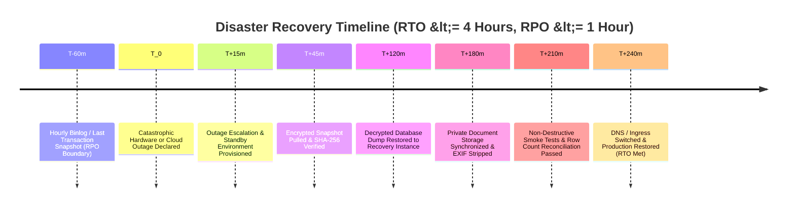

# Platform Backup & Disaster Recovery Operational Runbook

**Phase:** 10 — Dashboard, Reports, Data Tools, and Platform Settings  
**Requirements:** `DASH-05`, `GAP-P1-06`, `GAP-P1-04`  
**Threat Mitigations:** `T-10-10` (AES-256 At-Rest Encryption), `T-10-11` (Concurrency Locking), `T-10-12` (SHA-256 Integrity Verification)  
**Decisions Enforced:** `DEC-01` (Multi-Workspace Isolation), `DEC-11` (Append-Only Audit Logging)

---

## 1. Executive Summary & Operational SLOs

To safeguard applicant identity scans, member personal data, invoices, and compliance logs against infrastructure failures, data corruption, or ransomware attacks, the EMK Membership CRM operates a codified, automated backup and disaster recovery subsystem.

### 1.1 Measurable Service Level Objectives (SLOs)

In accordance with **GAP-P1-06** and Section 9 of the primary system specification:

| Objective Dimension | Operational Target | Description | Enforcement Mechanism |
|---|---|---|---|
| **Recovery Point Objective (RPO)** | **&le; 1 hour** | Maximum allowable data loss window in the event of catastrophic infrastructure failure. | Continuous MySQL binary transaction logging (`binlog`) with hourly replication + daily snapshots at 02:00 BST. |
| **Recovery Time Objective (RTO)** | **&le; 4 hours** | Maximum elapsed duration from outage declaration to operational production cutover. | Codified restore procedures, automated validation scripts, and monthly recovery drills. |
| **Rolling Retention Window** | **30 days** | Daily encrypted snapshots retained on active storage before automated pruning. | `config('backup.retention_days', 30)` automated daily pruning. |
| **Integrity Standard** | **100% SHA-256 match** | All archives accompanied by cryptographic hash manifests. | `hash_file('sha256')` companion manifest (`.sha256`) per `T-10-12`. |
| **Encryption Standard** | **AES-256-CBC** | All database dumps and storage files encrypted at rest. | `OpenSSL` / Laravel `Encrypter` symmetric cipher per `T-10-10`. |



---

## 2. Backup Architecture & Storage Layout

### 2.1 File Structure & Naming Conventions

All backups are stored in `storage/app/backups/` outside the web document root:

```text
storage/app/backups/
├── backup-2026-11-05-020000.zip.enc           # Encrypted platform archive
├── backup-2026-11-05-020000.zip.enc.sha256    # Cryptographic SHA-256 manifest
├── backup-2026-11-04-020000.zip.enc
└── backup-2026-11-04-020000.zip.enc.sha256
```

### 2.2 Archive Contents (Decrypted Payload)

When decrypted with `BACKUP_ENCRYPTION_KEY`, each archive expands into:
- `database.sql`: Complete DDL and row data for all CRM tables (`workspaces`, `spaces`, `users`, `membership_terms`, `member_id_sequences`, `leads`, `lead_attachments`, `lead_verifications`, `members`, `invoices`, `id_cards`, `member_change_requests`, `audit_logs`, `platform_settings`, `email_messages`, `email_threads`, `email_templates`, `workflow_rules`, `forms`, `form_submissions`).
- `manifest.json`: System version, generator metadata, database driver, timestamp, and packaging parameters.
- `documents/`: Mirror of private applicant identity scans, parental consent uploads (`DEC-09`), and studio photos.

### 2.3 Concurrency Protection (`T-10-11`)

To prevent memory exhaustion and database lock contention caused by overlapping backup executions, `BackupService` acquires an atomic cache lock:

```php
Cache::lock('platform_backup_lock', 600);
```

If another backup is currently executing, subsequent trigger requests are rejected immediately with HTTP 423 / RuntimeException `"A backup operation is currently in progress."`

---

## 3. Command-Line (CLI) Administration

### 3.1 On-Demand Backup Generation

Run full encrypted backup including database and documents:

```bash
php artisan crm:backup:create
```

Run backup excluding private storage documents (database only):

```bash
php artisan crm:backup:create --no-docs
```

Run unencrypted backup (strictly for local development / testing only):

```bash
php artisan crm:backup:create --no-encrypt
```

### 3.2 Backup Integrity & Tamper Verification (`T-10-12`)

Every archive should be verified before any restore operation:

```bash
php artisan crm:backup:verify backup-2026-11-05-020000.zip.enc
```

The verification command systematically checks:
1. File existence and non-zero byte size.
2. Companion `.sha256` hash comparison against `hash_file('sha256')`.
3. AES-256-CBC decryption test using `BACKUP_ENCRYPTION_KEY`.
4. ZIP table of contents inspection confirming `database.sql` exists and has valid headers.
5. Emits an immutable `backup_restore_verified` event into `audit_logs`.

---

## 4. Disaster Recovery & Restoration Procedure

### Phase 1: Preparation & Standby Environment Setup

1. **Declare Disaster Incident:** Notify the Disaster Recovery Coordinator and convene the response team.
2. **Provision Clean Infrastructure:** Launch a clean Ubuntu LTS / Docker container instance with PHP 8.2+, MySQL 8.0, and Redis.
3. **Configure Environment Keys:** Ensure `.env` includes the production `APP_KEY` and `BACKUP_ENCRYPTION_KEY`:
   ```dotenv
   APP_KEY=base64:...
   BACKUP_ENCRYPTION_KEY=base64:...
   DB_CONNECTION=mysql
   DB_HOST=127.0.0.1
   DB_DATABASE=emk_membership_crm
   DB_USERNAME=emk_crm_user
   DB_PASSWORD=***STRONG_DATABASE_PASSWORD***
   ```

### Phase 2: Archive Retrieval & Verification

1. **Pull Latest Archive from Offsite S3 Storage:**
   ```bash
   aws s3 cp s3://emk-platform-backups/backup-latest.zip.enc storage/app/backups/
   aws s3 cp s3://emk-platform-backups/backup-latest.zip.enc.sha256 storage/app/backups/
   ```
2. **Execute Cryptographic Verification:**
   ```bash
   php artisan crm:backup:verify backup-latest.zip.enc
   ```
   *Stop immediately if verification returns FAIL. Investigate potential transmission corruption or tampering.*

### Phase 3: Non-Destructive Sandbox Drill (Monthly Test)

Before touching live databases, test restoration in an isolated sandbox database:

```bash
# 1. Create temporary sandbox database
mysql -u root -p -e "CREATE DATABASE IF NOT EXISTS emk_recovery_sandbox CHARACTER SET utf8mb4 COLLATE utf8mb4_unicode_ci;"

# 2. Decrypt archive into staging directory
mkdir -p /tmp/emk_recovery_drill
php -r "
  require 'vendor/autoload.php';
  \$app = require 'bootstrap/app.php';
  \$app->make('Illuminate\Contracts\Console\Kernel')->bootstrap();
  \$service = app(\App\Domain\Platform\Services\BackupService::class);
  \$zipPath = \$service->decryptArchive('backup-latest.zip.enc', '/tmp/emk_recovery_drill/archive.zip');
  \$zip = new ZipArchive();
  if (\$zip->open(\$zipPath) === true) {
      \$zip->extractTo('/tmp/emk_recovery_drill/');
      \$zip->close();
      echo 'Decryption and extraction SUCCESS\n';
  } else {
      echo 'Extraction FAILED\n';
      exit(1);
  }
"

# 3. Import SQL dump into sandbox database
mysql -u root -p emk_recovery_sandbox < /tmp/emk_recovery_drill/database.sql

# 4. Verify integrity and record counts
mysql -u root -p emk_recovery_sandbox -e "
  SELECT 'Users' AS entity, COUNT(*) AS total FROM users
  UNION ALL
  SELECT 'Leads', COUNT(*) FROM leads
  UNION ALL
  SELECT 'Members', COUNT(*) FROM members
  UNION ALL
  SELECT 'Invoices', COUNT(*) FROM invoices
  UNION ALL
  SELECT 'Audit Logs', COUNT(*) FROM audit_logs;
"

# 5. Clean up temporary extraction
rm -rf /tmp/emk_recovery_drill
```

### Phase 4: Production Restoration & Cutover

Once sandbox validation succeeds:

```bash
# 1. Place application into maintenance mode
php artisan down --message="System maintenance and database restoration in progress. Expected return: < 1 hour."

# 2. Import database dump into production database
mysql -u emk_crm_user -p emk_membership_crm < /tmp/emk_recovery_drill/database.sql

# 3. Restore private storage documents
cp -r /tmp/emk_recovery_drill/documents/* storage/app/private/

# 4. Run database migrations to ensure schema currency
php artisan migrate --force

# 5. Clear application caches and re-warm
php artisan optimize:clear
php artisan optimize

# 6. Verify queue workers and scheduler
php artisan horizon:terminate
php artisan queue:restart

# 7. Resume production service
php artisan up
```

---

## 5. Cutover Rollback Protocol

If a production upgrade, migration, or new deployment fails during live operation:

1. **Rollback Criteria:**
   - Any public form submission failure rate exceeding 2%.
   - Ingestion reconciliation discrepancies greater than 0.1%.
   - Cross-workspace data leakage (violation of `DEC-01`).
   - Failed decryption or file corruption in private document storage.

2. **Rollback Steps:**
   - Immediately divert public DNS back to the standby maintenance endpoint.
   - Restore the pre-deployment database snapshot following Section 4.
   - Run `php artisan optimize:clear`.
   - Log an incident record into `audit_logs` citing trigger conditions and recovery timestamp.

---

## 6. Emergency Contacts & Escalation Matrix

| Role | Name / Title | Primary Channel | Escalation Window |
|---|---|---|---|
| **Disaster Recovery Lead** | DevOps Lead | Slack `#incident-crm` / Mobile | Immediate (< 15 mins) |
| **Workspace Manager** | Center Manager (EMK Dhaka) | Mobile / WhatsApp | < 30 mins |
| **Lead Architect** | System Architect | Slack / Emergency Phone | < 30 mins |
| **Compliance Officer** | Security & Compliance Lead | Email / Phone | < 1 hour |
| **Superadmin** | Global Platform Administrator | Phone | Immediate |
